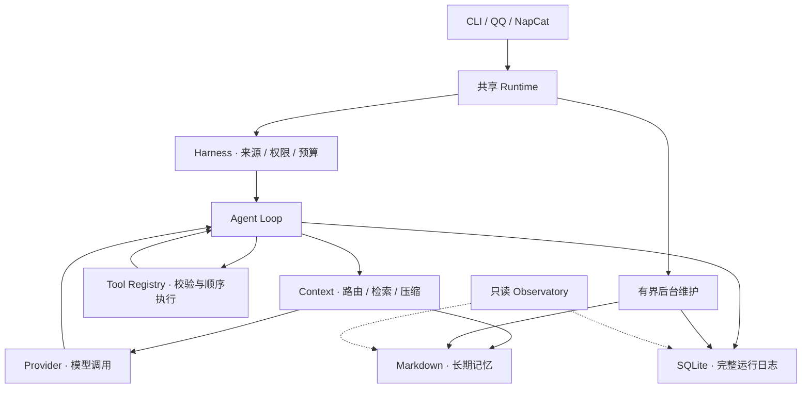

# HeyBuddy

**本地运行、长期记忆、执行过程可追溯的个人 AI Agent。**

[](https://github.com/KindofCrazy/heybuddy/actions/workflows/ci.yml)
[](https://www.python.org/downloads/)
[](https://docs.astral.sh/uv/)

[快速开始](#快速开始) · [架构与机制](docs/architecture.md) · [完整文档](docs/README.md) · [评测](#评测与验证) · [参与贡献](CONTRIBUTING.md)

HeyBuddy 用 Python 和 asyncio 自行实现 Agent Harness，把模型调用、工具执行、会话路由、记忆和后台维护放在同一套明确的生命周期与预算约束下。SQLite 保存完整运行日志，普通 Markdown 保存长期记忆，便于理解、检查和直接编辑。

项目适合希望理解 Agent 内部机制、实验长期记忆，或搭建本地个人助手的开发者。核心循环不依赖 LangChain、LangGraph 等 Agent 框架；模型通过 Provider Protocol 接入，当前适配器使用官方 OpenAI Python SDK。

> **项目状态：持续开发中。** 当前包版本为 `0.7.2`，已实现 P5 Harness，SQLite schema 为 `24`。版本号、实现阶段和数据库版本分别维护；已有评测的适用范围见对应报告。

## 核心能力

| 能力 | 当前实现 |
| --- | --- |
| 可控执行 | 手写异步循环、生命周期 Hooks、来源隔离、共享执行预算和明确停止状态 |
| 长期记忆 | Markdown Core / Deferred Memory、历史证据检索、后台 Learning 与手动审批 Reflection |
| 会话与上下文 | Thread 逻辑会话、有限历史读取、多层上下文压缩、完整原始 Journal |
| 工具与扩展 | 注册与授权校验、只读 Skills、MCP Client、受控工作文件和白名单命令 |
| 任务与工作流 | Todo / Task / Goal、深度一只读子执行、后台作业、注册式 Workflow 与显式恢复 |
| 交互与观测 | 本地 CLI、官方 QQ 白名单私聊、NapCat 单主号私聊、loopback 只读 Observatory |
| 关注与提醒 | 关心式跟进保持 Shadow；明确一次性提醒可向已绑定 NapCat 主号投递 |

## 架构概览



从[机制与逻辑流程](docs/mechanisms.md)理解整体决策，再按[一条消息的实际执行路径](docs/architecture.md)对照代码。模块文档包含职责、关键符号、异常边界和验证入口。

## 快速开始

需要 [Git](https://git-scm.com/)、[uv](https://docs.astral.sh/uv/) 和支持 SQLite FTS5 trigram 的 Python 3.13。以下命令使用 PowerShell：

```powershell
git clone https://github.com/KindofCrazy/heybuddy.git
cd heybuddy
uv python install 3.13
uv sync --locked
if (-not (Test-Path .env)) { Copy-Item .env.example .env }
```

编辑本地 `.env`，填写 `OPENAI_API_KEY`、`OPENAI_MODEL` 和 `AGENT_CONTEXT_WINDOW`。窗口大小必须按所用模型的实际规格设置；输出和摘要预算需要与窗口匹配，详见[配置说明](docs/modules/config.md)。`.env.example` 包含可选能力的开发配置，当前选择 Luna；库级角色默认值仍为 `none`。

```powershell
# 查看帮助：不读取密钥、不打开数据库、不调用模型
uv run personal-agent --help

# 开始交互：需要有效配置，模型请求会产生相应费用
uv run personal-agent
```

| 常用输入 | 行为 |
| --- | --- |
| 普通文本 | 运行 Agent，保存原始消息与执行结果 |
| `/new`、`/sessions`、`/resume <id>` | 新建、查看和选择 Thread；关闭路由时操作 Conversation |
| `/memory read <请求>`、`/memory edit <请求>` | 仅为当前 Run 授予对应记忆权限 |
| `/status`、`/context status` | 查看运行状态与上下文预算 |
| `exit` / `quit` / EOF | 正常退出 |

完整环境变量、数据目录、会话操作与恢复说明见[安装与日常使用](docs/getting-started.md)。其他入口见 [Observatory](docs/observatory.md)、[NapCat](docs/napcat-setup.md)、[官方 QQ](docs/qq-setup.md)和[明确提醒](docs/reminder-delivery.md)。

## 设计边界

- **权限来自可信宿主。** 工具必须注册、校验并授权；不开放任意 Shell、模型生成代码执行或配置管理。自然语言和历史消息不能授予权限。
- **记忆与证据分离。** Markdown 是长期 Memory 唯一权威源，SQLite 保存原始历史。主模型写入按 Run 授权，后台 Learning 使用独立 Host 策略，手动 Reflection 仍需审批。
- **摘要不替代日志。** 压缩只改变模型可见的工作上下文，保留原始 Journal、工具调用和结果。重启不自动重跑工具，Workflow 仅经可信显式 Resume 并核对副作用后恢复。
- **主动能力分级开放。** 关心式 Proactive 保持 Shadow，不真实发送；明确提醒使用独立 Scheduler。官方 QQ 仅被动回复。
- **数据在本地以明文保存。** `.env`、数据库和 Memory 不应入 Git；自定义记忆目录建议放在仓库外。当前没有数据加密或日常自动备份。更多见[安全说明](SECURITY.md)。

## 文档导航

| 想了解什么 | 阅读入口 |
| --- | --- |
| 安装、配置和日常使用 | [入门指南](docs/getting-started.md)、[配置](docs/modules/config.md)、[CLI](docs/modules/sessions-cli.md) |
| 一条请求如何执行 | [机制流程](docs/mechanisms.md)、[架构](docs/architecture.md)、[Agent](docs/modules/agent.md)、[Harness](docs/modules/harness.md) |
| 会话、检索和上下文 | [Thread 路由](docs/modules/thread-routing.md)、[Context](docs/modules/context.md)、[Compaction](docs/modules/compaction.md)、[检索](docs/modules/retrieval.md) |
| 工具和任务扩展 | [Tools](docs/modules/tools.md)、[Hooks](docs/modules/hooks.md)、[Skills](docs/modules/skills.md)、[MCP](docs/modules/skills-mcp.md)、[Planning](docs/modules/planning.md) |
| 长期记忆和维护 | [Memory](docs/modules/memory.md)、[Learning](docs/modules/learning.md)、[Reflection](docs/modules/reflection.md)、[Proactive](docs/modules/proactive.md) |
| 存储、执行和恢复 | [Storage](docs/modules/storage.md)、[Execution](docs/modules/execution.md)、[Workflow](docs/modules/workflows.md) |
| 全部模块与历史资料 | [完整模块索引](docs/README.md)、[历史归档](docs/archive/README.md) |

## 评测与验证

[HeyBuddy Benchmark](docs/modules/heybuddy-benchmark.md)覆盖 Routing、Memory Learning、Proactive Decision，各有 50 个独立快照。当前 v0.4 含四个公开来源的 31 个改编样本，另有 30 个相关挑战变体。数据尚未独立人工审核，决策快照成绩不代表整体助手能力。

真实重复对照、Bad Case 归因和成本见[迭代报告](evals/heybuddy_bench/ITERATION_REPORT.md)；数据、协议和运行入口见[评测目录](evals/heybuddy_bench/README.md)。[Long-Horizon 系列](docs/modules/long-horizon-evaluation.md)、[v1](docs/modules/long-horizon-benchmark-v1.md)、[v2](docs/modules/long-horizon-benchmark-v2.md)和[真实模型 Pilot](docs/modules/long-horizon-pilot-v2.md)分别保留实验范围与局限，离线契约测试不作为真实模型效果结论。

本地开发检查：

```powershell
uv run pytest
uv run ruff check .
uv run ruff format --check .
```

测试使用 Fake Provider、MockTransport 和隔离数据，保留网络禁用保护，不调用付费模型。[CI](.github/workflows/ci.yml)在 Ubuntu 和 Windows 上执行离线测试、静态检查、构建和 CLI 帮助检查。

## 参与贡献与许可

提交问题或改动前请阅读[贡献指南](CONTRIBUTING.md)。安全问题按[安全报告流程](SECURITY.md)处理，开发 Agent 另需遵守 [AGENTS.md](AGENTS.md)。

主项目尚未声明开源许可证。第三方角色、图标和评测数据的来源及许可分别见 [Luna 来源说明](src/personal_agent/character/packages/luna/SOURCE.md)、[图标许可证](src/personal_agent/dashboard/static/ICONS-LICENSE.txt)、[角色图片说明](src/personal_agent/dashboard/static/characters/README.md)和[评测来源清单](evals/heybuddy_bench/public_sources/SOURCES.md)；这些许可不代表对整个项目的统一授权。
