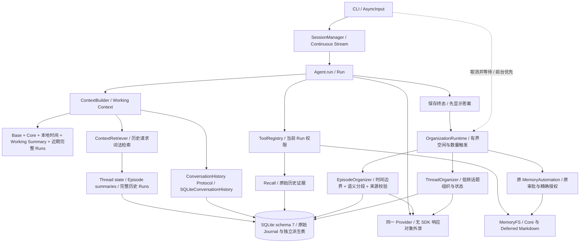
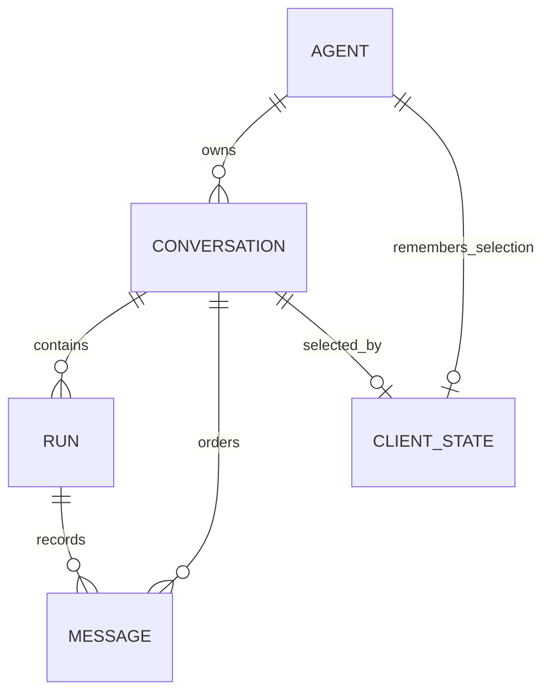
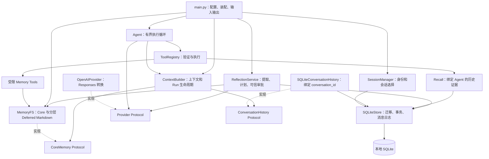
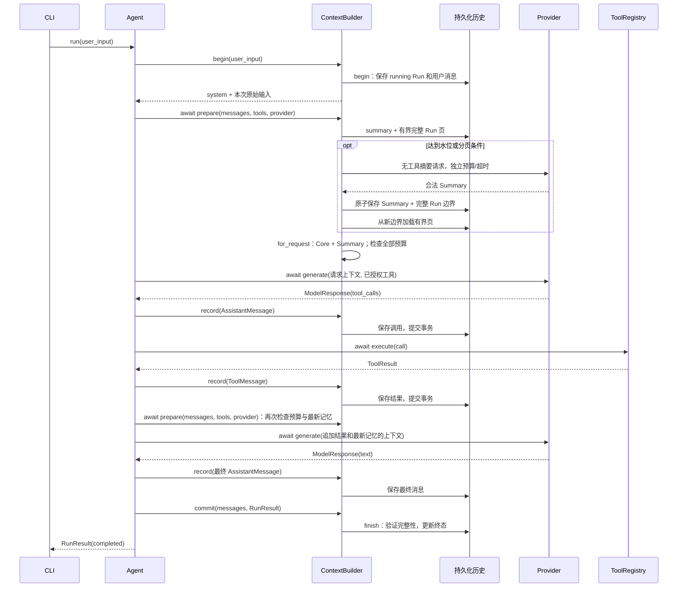
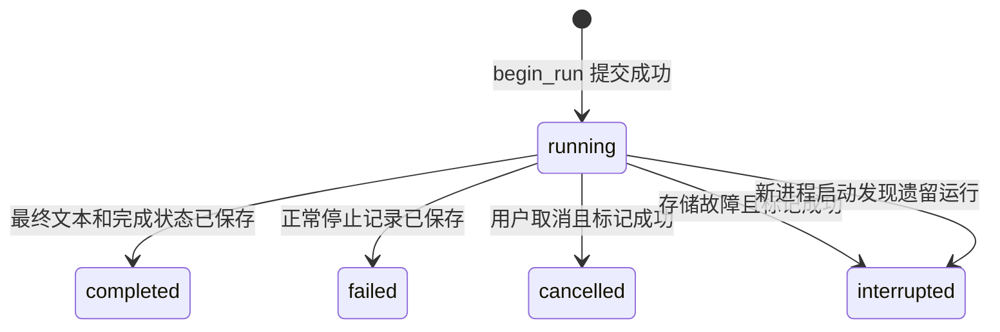
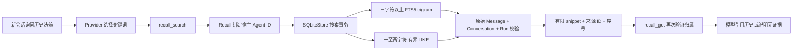
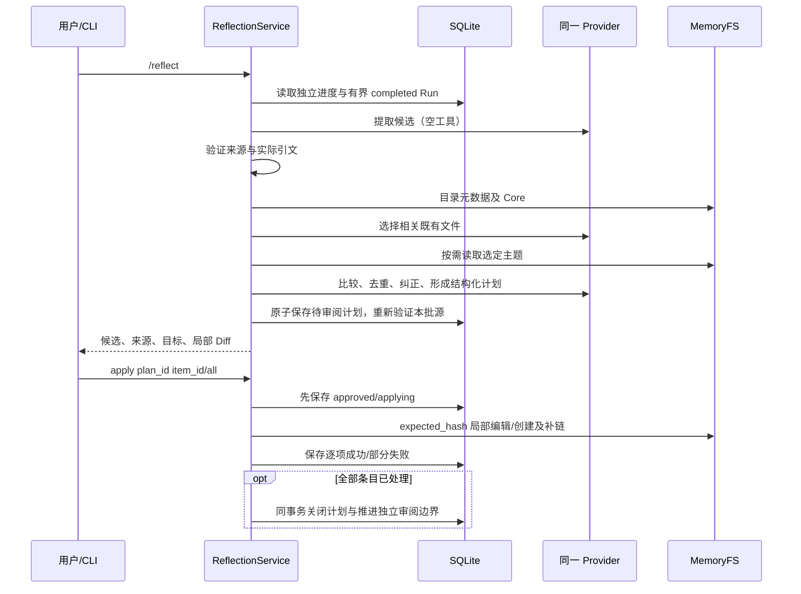

# HeyBuddy P1：整体架构与 Pipeline

本文串起从启动到退出的真实执行路径。当前是一个本地进程、SQLite 和普通 Markdown；P1 增加有界 asyncio 事后整理及可抢占输入，没有消息队列、通用任务平台或工具续跑。先看下面 P1 路径，再读后续保留的 Journal、Provider、Memory、Reflection 细节。迁移、测试、限制与 P2 接口见 [P1 交付](p1-delivery.md)。

## P1 实际执行架构



Run 是执行与审计单位；Episode 是连续 Run 的事后时间/语义组织；Thread 是跨 Episode 的持续话题；Working Context 是单次请求的有限视图。Episode/Thread 没有 MemoryFS 或 Registry 写入接口，不执行历史工具。

真实顺序：

1. main() → run_cli() 取得数据库占用锁，initialize() 顺序原子迁移 1–7，recover_incomplete_runs() 只标记中断。
2. SessionManager 沿用 client_state；没有选择时创建流，其他旧流不合并不删除。初始化 Core Memory，然后 _run_session() 装配 Provider、工具、ContextRetriever、原 Reflection/Automation、独立 Episode/Thread Repository 与 Organizer。
3. chat() 启动持久进度检查；_chat() await AsyncInput.read()。只有读取终端在 daemon 线程，所有 SQLite 留在事件循环。
4. 新输入先 await OrganizationRuntime.foreground()；取消后台模型等待并完成原状态记账，再 Agent.run() → ContextBuilder.begin() 原子创建 Run/用户消息。
5. prepare() 读取有界历史；首轮 _retrieve() 走 fast 或历史检索，_select_history() 做来源/调用 ID 去重和剩余预算选择；for_request() 注入 Core、Summary、本地带 offset 时间与低信任历史。需要时按原完整 Run 前缀 Compaction；当前 Run 和受保护近期 Run 不拆开。
6. Provider / ToolRegistry 继续原手写循环，每条调用先落库、每条结果在下一工具前落库。commit() 原子完成 Journal，先向 CLI 返回并显示答案。
7. schedule() 用独立 asyncio task 执行原 MemoryAutomation 的内部顺序阶段，再等待默认 25 分钟空闲或累计 8 条。Episode 每次最多 8 条源记录、一次模型请求；不完整/失败 Run 明确跳过，不汇总为成功经历。publish() 原子校验源 hash/版本并更新派生表和独立 cursor。
8. 达到默认 3 个新/修订 Episode 才触发一次 ThreadOrganizer；group/no_thread、状态与关联在独立事务 CAS 后提交。此后最多一次无模型 Finalize 检查，不循环吃完整 backlog。正常聊天成功不依赖整理成功。
9. exit/EOF/Ctrl+C → chat() finally 取消整理 → SDK 关闭 → Store 释放占用锁。重启依据 Journal、cursor、dirty 状态继续纯派生整理，不重跑工具或 Memory Apply。

时间存储使用 UTC aware 时间；Temporal Context 使用宿主操作系统当前本地 offset，显式展示 offset/时区和互动间隔，不用 UTC 日期代替本地日期。Summary/组织结果/历史命令不会授予权限。Core/Deferred 仍只有普通 Markdown 一个权威源。

## 1. 先区分实体、执行器和执行次数

| 概念           | 当前实现                               | 生命周期与职责                                                                    |
| -------------- | -------------------------------------- | --------------------------------------------------------------------------------- |
| 持久 Agent     | `storage/models.py::AgentRecord`     | 数据库中的身份、名称；system_prompt 保留为兼容元数据；CLI 默认 ID 为 `heybuddy` |
| Conversation   | `ConversationRecord`                 | 属于一个 Agent；隔离聊天历史，退出进程后仍存在                                    |
| Message        | `StoredMessage` 包装内部 `Message` | 属于一个 Conversation 和一个 Run，保存完整结构及顺序                              |
| Run            | `RunRecord`                          | 一次普通用户输入的处理过程，包含零个或多个已收到的模型响应、工具结果与终态        |
| Runtime 执行器 | `core/agent.py::Agent`               | 进程内 Python 对象，执行手写循环；不是数据库中的 Agent 实体                       |
| round          | `_run()` 的一次循环                  | 一次模型请求；一个 Run 可以消耗多个 round                                         |

因此，“一个 Agent 有多个会话”说的是数据库实体关系；“Agent Loop”说的是 Runtime 的执行职责。 CLI 可以复用同一个 Runtime，切换它绑定的 ContextBuilder，持久 Agent 的身份不会因此改变。 `/new`、`/sessions`、`/resume`、`/status` 是管理命令，不创建聊天 Run。

数据关系如下；client_state 是恢复上次选择的元数据，不承担记忆存储职责：



数据库里的 `client_state.agent_id` 是主键，一个 Agent 最多保存一个当前选择；复合外键还要求选中的 Conversation 属于同一个 Agent。图中的关联不表示复制聊天记录：会话切换只改变选择，消息仍属于原会话。

## 2. 模块分层与依赖方向



CLI 是装配入口，知道使用哪个具体 Provider、存储和工具。Runtime 只调用小接口，不导入 sqlite3 或 SDK 响应类型。ContextBuilder 负责历史何时加载、消息何时记录、Run 何时结束；具体 SQL 则集中在 SQLiteStore。

这让“换一个入口”和“换存储实现”不必改写模型/工具循环。当前只实现 CLI、一个官方 SDK Provider 和 SQLite 适配器，没有为未来系统预建更多服务。

| 边界                | 输入                              | 输出               | 谁理解具体协议                              |
| ------------------- | --------------------------------- | ------------------ | ------------------------------------------- |
| CLI → Runtime      | 用户文本、本轮权限集合            | `RunResult`      | CLI 理解交互命令，Runtime 不理解 slash 命令 |
| Runtime → Provider | 内部消息、`ToolDefinition`      | `ModelResponse`  | OpenAIProvider 理解 Responses API           |
| Runtime → Registry | `ToolCall`                      | `ToolResult`     | Registry 理解参数模型与执行函数             |
| Context → History  | 用户消息、消息追加、结束/中断通知 | Run ID、可重放消息 | SQLiteConversationHistory 绑定会话          |
| History → Store    | 会话 ID、Run ID、完整消息         | 持久记录           | SQLiteStore 理解表、外键和事务              |

## 3. 启动 Pipeline：先恢复状态，再接收输入

入口为 `pyproject.toml` 的 `personal-agent = personal_agent.main:main`，也可执行 `python -m personal_agent.main`。

1. `main.py::main()` 解析命令行。`--help` 在此结束，不读取配置或打开数据库。
2. `config.py::load_settings()` 读取当前目录配置，环境变量优先；Pydantic 校验模型、密钥、超时及 API 地址。失败时报告字段并返回退出码 2。
3. `main()` 配置安全日志，通过 `asyncio.run(run_cli(settings))` 进入异步应用。
4. `SQLiteStore(settings.database_path)` 解析路径、创建必要目录、取得进程占用锁，再打开数据库。同一路径已被其他应用实例占用时失败，避免两个 CLI 同时处理同一份运行状态。
5. `SQLiteStore.initialize()` 显式迁移到 schema 7，顺序执行 Recall、Context、Reflection、Automation、Episode 和 Thread 追加迁移，结构和 user_version 在同一事务内更新，遇到更新版本或陌生数据库时拒绝继续。
6. `recover_incomplete_runs()` 将遗留 running Run 标记为 interrupted。这个步骤只更新状态，不调用 Provider 或任何工具。它在占用锁下进行，因此不会把另一正常运行实例的 Run 当作遗留任务。
7. `SessionManager(store)` 读取或创建持久 Agent，读取 client_state；首次创建空会话，后续校验摘要检查点并恢复上次选择的会话，不全量反序列化旧消息。
8. `run_cli()` 构造 `MemoryFS.for_agent()`，初始化或迁移普通 Markdown，绑定到 SessionManager。新安装默认用户数据目录，已有数据库旁 `.memory` 目录沿用；可配置根目录，详见迁移说明。
9. `_run_session()` 注册受限 Memory Tools 与绑定 Agent 的只读 Recall Tools，再创建 AsyncOpenAI 客户端、OpenAIProvider、内置 ToolRegistry、带显式 ContextBudget、与当前会话绑定的 ContextBuilder，以及 Runtime Agent，然后调用 `chat()`。

这里没有“启动就请求模型”的步骤。用户输入普通文本进入普通请求 Pipeline；显式 /reflect 可单独调用 Provider 生成提案。启动存储失败返回退出码 1，不悄悄退回内存模式；显式使用不带 history_store 的 ContextBuilder 仍可获得进程内模式，原有 Runtime 单元测试使用该方式。

## 4. 请求 Pipeline：输入 → 上下文 → 模型 → 工具 → 结果

### 4.1 一次调用工具的完整时序

下图把 history 适配器和 SQLiteStore 合并为“持久化历史”参与者，便于看清调用顺序；实际方法映射见[ContextBuilder](modules/context.md)和[SQLite 存储](modules/storage.md)。



请求路径中的实际操作按以下阶段执行：

| 阶段     | 实际方法                                                    | 输入/输出与状态变化                                             |
| -------- | ----------------------------------------------------------- | --------------------------------------------------------------- |
| 接收     | `chat()` → `Agent.run()`                               | 普通文本进入 Runtime；空白输入由 CLI 跳过，Runtime 也拒绝空输入 |
| 串行化   | `Agent.run()` 的 `asyncio.Lock`                         | 同一 Runtime 的 Run 顺序执行，避免上下文交错                    |
| 构建     | `ContextBuilder.begin()`                   | system + 新用户消息；历史在 prepare() 有界加载                        |
| 开始记录 | `ConversationHistory.begin()` → `begin_run()`          | 原子保存 running Run 与用户消息，得到 Run ID                    |
| 请求模型 | `Agent._run()` → `ContextBuilder.prepare()` → `Provider.generate()`                 | 准备/摘要后通过预算；正常请求超时内 await，消耗一个 round                          |
| 响应检查 | `_run()` 的 ID/空响应检查                                 | 拒绝重复 ID 或既无文本也无调用的响应                            |
| 记录响应 | `_run()` 内部 `append()` → `ContextBuilder.record()` | 先落库，再加入 pending 和当前上下文                             |
| 执行工具 | `ToolRegistry.execute()`                                  | 名称查找、参数校验、执行与 JSON 规范化，生成同 ID 的结果        |
| 继续     | 再次 `append()`，进入下一轮                               | 先保存结果，再允许下一工具或模型请求                            |
| 完成     | `_run()` 内部 `finish()` → `ContextBuilder.commit()` | 保存正常终态，清理运行中状态，才返回 CLI                        |

### 4.2 哪些分支会继续，哪些会停止

只有“没有工具调用且文本非空”才作为最终答案。文本与工具调用同时出现时，先处理调用，这段文本不会提前作为最终成功展示。多个工具按响应给出的顺序逐个执行；每个结果保存成功后，才处理下一项。未知工具、参数错误、执行异常或工具超时都转为 ToolResult，模型可在下一轮处理错误。工具报错本身不必使整个 Run 成为 failed：模型仍可能解释错误并给出最终回答。

最后一轮不提供工具定义，保留给最终回答。如果模型仍返回调用，Runtime 还会在执行层再次拦截：为所有调用保存 `round_budget_exhausted` 结果，不进入 Registry，返回 max_rounds。因此 max_rounds=1 只允许直接回答；系统不会为总结再多发一个超预算请求。

### 4.3 用一条具体消息链跟踪数据

假设用户输入“计算 2 + 3”，模型先调用加法，再回答“5”，这是一个 Run、两个 round：

| 会话 sequence | 内部消息                   | 关键字段                                                        | 保存时 Run 状态                         |
| ------------- | -------------------------- | --------------------------------------------------------------- | --------------------------------------- |
| 1             | `TextMessage(role=user)` | `text=计算 2 + 3`                                             | running，与 Run 同一事务创建            |
| 2             | `AssistantMessage`       | `tool_calls[0].id=sum-1`，`name=add_numbers`，原始参数 JSON | running，工具尚未执行                   |
| 3             | `ToolMessage`            | `result.call_id=sum-1`，`ok=True`，`data={sum: 5}`        | running，工具已经返回                   |
| 4             | `AssistantMessage`       | 最终文本“5”，可能带 Provider output items                     | running，消息已保存但 Run 尚未 finalize |

随后 `finish_run()` 把状态改为 completed，并保存 RunResult、ended_at、会话 updated_at。 sequence 是会话内顺序；下一条用户消息从 5 开始。Run ID 用来区分每次输入， `ToolCall.id` 与 `ToolResult.call_id` 则用来关联同一次工具调用，两者不能互相替代。

同一条 assistant 消息可以携带多个调用，后面对应多条 tool 消息。一次 Provider 响应里的多个 reasoning、文本、函数项目保存在这条消息的 provider_data 内，不会各自变成数据库顶层消息。

## 5. 四种历史视图：已写入与可重放并非同一回事（请求编译见第 11 节）

| 视图           | 读取位置                                     | 包含内容                                    | 用途                           |
| -------------- | -------------------------------------------- | ------------------------------------------- | ------------------------------ |
| 完整持久化历史 | `SQLiteStore.load_messages()`              | 所有 Run 的消息，包括未完成调用             | 审计、诊断，不直接全量送入模型 |
| 可重放历史     | `ContextBuilder.history` → summary()/page() | 摘要边界之后的有界 completed/failed 完整 Run 页   | 构建下一次输入的上下文         |
| 工作消息链     | `_run()` 的局部 `messages`               | system、可重放历史、新输入、本 Run 后续消息 | for_request 编译前的基础链     |
| 运行中消息     | `ContextBuilder.pending_messages`          | 仅当前 Run 的用户、模型、工具消息副本       | 跟踪尚未结束的 Run             |

pending 消息可以已经逐条持久化；“Run 未完成”不表示持有一个一直不提交的 SQL 事务。例如正在执行工具时，调用已在数据库中，但整个 Run 仍是 running，尚未进入正常可重放历史。这种区分避免“数据库中有一条调用”被误解为“下次启动应继续执行它”。

Base 来自程序代码，不作为原始消息重复保存。V0.6 在四种历史视图之外增加独立的会话摘要检查点；正常请求只发送有界未覆盖历史、低信任 Summary 和当前 Run。完整原始日志仍留在 SQLite/Recall。

## 6. 持久化 Pipeline 与事务边界

`SQLiteStore._transaction()` 以 BEGIN IMMEDIATE 开始短事务，成功 commit，异常 rollback。不在等待模型或工具时保持数据库事务开放。各阶段的提交含义如下：

| 事务               | 写入内容                                                  | 失败后的含义                           |
| ------------------ | --------------------------------------------------------- | -------------------------------------- |
| schema 初始化/迁移 | 表、索引、user_version                                    | 全部回滚，避免半个 schema              |
| 新建并激活会话     | conversations + client_state                              | 全部回滚，不留下多余空会话             |
| 开始 Run           | runs + 首条用户消息                                       | 全部回滚，模型还未被调用               |
| 追加消息           | 校验既有 Run 消息，插入完整 JSON 及下一个 sequence        | 只回滚本次追加，保留此前日志           |
| 完成 Run           | 检查调用完整性，更新终态、result_json、结束时间与会话时间 | 全部回滚，不能报告最终成功             |
| Summary 检查点 | 校验本批来源、原子更新摘要/完整 Run 边界/修订/checksum | 失败批次回滚，之前独立批次保留 |
| 标记中断           | 更新 cancelled / interrupted 与结束时间                   | 写入仍失败时保留 running，待启动时处理 |

数据库约束防止同一会话的 sequence 重复、消息挂到其他会话的 Run，以及同一 Conversation 同时出现两个 running Run。`validate_turn()` 还检查调用 ID、工具名和结果的配对关系；正常结束必须没有悬空调用，最后一条是 assistant 消息。

这些事务保障的是数据库内部一致性。外部工具效果不属于 SQLite 事务， “工具执行成功 → 结果落库”之间的窗口不能被这套设计消除。

## 7. 失败 Pipeline 与 Run 状态



只有 completed / failed 进入下一次正常上下文。failed 表示“Run 已明确结束并完成保存”，不是“可能还要后台重试”。它可以对应 RunResult 中的 provider_error、timeout、invalid_response、 runtime_error（Provider 调用中的非预期异常）、memory_error 或 max_rounds。

| 失败位置                        | Runtime 行为                            | 保存/重放语义                             |
| ------------------------------- | --------------------------------------- | ----------------------------------------- |
| 用户消息或 Run 创建失败         | 返回 storage_error，rounds=0            | 不调用模型；当前创建事务回滚              |
| 模型请求超时或报错              | 保存停止说明，返回明确 RunResult        | 正常 finalize 为 failed，可重放           |
| assistant 调用记录写入失败      | 立即停止，不执行该批工具                | 尝试标记 interrupted，保留之前日志        |
| 工具执行失败                    | 保存对应错误 ToolResult，继续有限循环   | 有后续预算时交给模型处理                  |
| 工具已返回，结果写入失败        | 立即停止后续工具，不自动重试            | 工具效果可能已发生，当前 Run 排除出上下文 |
| 最终消息已保存，finish_run 失败 | 返回 storage_error，不展示最终成功      | 尝试标记 interrupted，已保存消息只作审计  |
| 用户取消当前运行                | 尝试标记 cancelled，传播 CancelledError | 部分消息保留，不自动执行剩余调用          |
| 进程直接退出                    | 已提交日志保留，Run 可能仍为 running    | 下次启动标记 interrupted，整个 Run 不重放 |

若连中断标记也无法写入，代码只记录安全诊断；Run 仍为 running，下次启动再标记。中断记录里的未配对调用可能尚未开始，也可能已经产生外部效果，不能根据缺少结果断言未执行。同步工具超时同样只停止等待，线程可能继续；详细契约见[工具模块](modules/tools.md)。

## 8. 会话切换 Pipeline

这些是开发者历史管理命令，普通持续聊天无需使用。命令在两次前台 Run 之间处理，先取消并等待事后整理停止，避免切换与发布交错。

- `/new`：`SessionManager.new()` → `create_conversation(activate=True)`，原子新建空会话并更新 client_state；成功后 `agent.context = sessions.context()`。
- `/resume <id>`：先查会话归属和可重放历史，再保存当前选择，最后替换 ContextBuilder。验证或保存失败时，旧选择不被修改。
- `/sessions`：只列当前持久 Agent 的会话，按 updated_at 降序、ID 排序；不创建聊天消息。
- `/status`：读取当前会话 Run 状态，提示中断/取消记录未进入模型上下文。

切换时 Provider、SDK 客户端、ToolRegistry 和 Runtime 对象继续复用，替换的是绑定会话的上下文。新会话使用程序 Base System Prompt 和同一个 Agent 的 Core Memory，但其历史为空，不会拷贝上一会话的 `_history`。切回旧 ID 时再从数据库加载，两个 Conversation 的 sequence 和 Run 各自独立。

## 9. 退出与重启 Pipeline

正常 exit / quit / EOF 时，`chat()` 返回，SDK 客户端和数据库依次关闭，数据库占用锁释放。下次启动从 client_state 找回上次选择，再通过 ContextBuilder 的历史接口重建消息。

重启不会把旧工具调用当作新的执行请求。已完成历史中的调用/结果只是 Provider 输入的一部分；只有模型在本次 Run 的新响应中发出调用，而且仍有执行预算时，Runtime 才进入 Registry。被中断的整个 Run 会排除出这条重放路径。

Provider 专用数据必须跟随消息保存：OpenAIProvider 把 output items 转成普通 JSON，放入 `provider_data['openai']`。重载时 Pydantic 恢复这个字段；`OpenAIProvider._input()` 直接重放原始项目及顺序，不再重复追加归一化调用。工具输出则按 call_id 转成 function_call_output。因此 reasoning、函数参数、调用 ID 和结果之间的关系可以跨进程保留。

这使“重启后追问前文”成为恢复 Conversation History 的结果。这与 Core Memory 独立：`/new` 后仍注入同一 Agent 已提交的记忆，但不会检索或复制旧会话历史。

## 10. 按 Pipeline 验证与阅读源码

| 路径                   | 建议先读的源码                                          | 对应测试                                                                    |
| ---------------------- | ------------------------------------------------------- | --------------------------------------------------------------------------- |
| 启动和迁移             | `main.py::run_cli`、`storage/sqlite.py::initialize` | `test_initialization_is_explicit_versioned_and_idempotent`                |
| 一次 Run 与工具循环    | `core/agent.py::run` / `_run`                       | `tests/test_agent.py`                                                     |
| 运行中记录与历史分离   | `core/context.py`、`storage/history.py`             | `test_pending_history_is_distinct_from_replayable_and_full_history`       |
| 会话隔离与多次重启     | `sessions.py`、`load_messages`                      | `test_restart_restores_previous_topic_and_new_conversation_is_empty`      |
| SDK 重放完整数据       | `llm/openai_provider.py::_input`                      | `test_complete_provider_items_replay_through_sdk_after_restart`           |
| 写入失败后的副作用边界 | `append_message`、`Agent._abort_context`            | `test_result_write_failure_stops_batch_and_keeps_prior_history`           |
| 真正进程退出           | `storage/lock.py`、`recover_incomplete_runs`        | `test_actual_process_exit_releases_lock_and_retains_unfinished_run`       |
| CLI 切换               | `main.py::chat`、`SessionManager.resume`            | `test_cli_session_commands_switch_and_restore_without_polluting_messages` |

上表源码路径以 `src/personal_agent/` 为根；存储测试位于 `tests/test_storage.py`，跨模块测试位于 `tests/test_persistent_runtime.py`。它们使用临时数据库、Fake Provider 和 MockTransport，可以在不使用真实 API Key、不支付模型费用的情况下观察整条 Pipeline。

## 11. V0.5：Base / Core / Deferred / Recall

程序 `DEFAULT_SYSTEM_PROMPT` 是可信 Base，SessionManager 不从旧 agents.system_prompt 恢复执行规则。ContextBuilder 只依赖 `CoreMemory.compile()`，每次请求自动注入三块 Core 的 JSON 数据；MEMORY.md 已包含顶层 Deferred 入口，不再额外拼接全部目录正文。

```text
ContextBuilder.begin → Base + 本次输入；prepare → 有界原始历史 + pending
Agent._run 每次 Provider.generate 前 → ContextBuilder.for_request
  system: 程序 Base
  user: JSON {kind: agent_core_memory, trust: data_only, blocks: ...}
  user: JSON {kind: conversation_summary, trust: historical_data_only, ...}
  摘要未覆盖的有界完整历史 + 本 Run 消息
模型按需 → deferred_read(目录 MEMORY.md) → deferred_list(元数据)
         → deferred_read(有关主题) → 正常 ToolMessage → 下一次请求
历史取证 → recall_search / recall_get → 正常 ToolMessage
```

Core 保存稳定人格、用户信息、重要原则和顶层地图。Deferred 保存按主题提炼的长期理解、取舍与开放问题；Recall 保留原始历史证据。三者不自动互相复制。目录 name/description 和概要帮助判断是否深入；未来请求通过 Core 根地图逐级发现，而不是依赖模型猜到已有文件名。

Core 编译上限默认 8192 UTF-8 字节，包含 JSON 开销；Deferred 新增正文不扩大这个预算。编译不写 pending/SQLite；工具结果正常审计保存。编译错误停止该次 Provider 请求，返回 memory_error。同 Run 写入后下一次请求读取最新 Core，新会话和重启同样共享最新文件，但不继承别的 Conversation 聊天。

## 12. 本轮授权和写入路径

```text
/memory edit 请求 → Agent.run(memory.read + memory.update + deferred.update)
  → Provider 读取当前内容/hash → 请求局部编辑或创建
  → 调用先落库 → Registry 复查权限与严格参数
  → MemoryFS.writing：路径/隐私检查 + 短 FileLock
  → edit 核对 expected_hash + old_text 精确唯一匹配
  → 验证文件和 Core 总容量/Frontmatter
  → 同目录临时文件 + flush/fsync → 再核对摘要 → os.replace
  → 返回新 hash → ToolResult 落库 → 下一轮模型请求
```

`/memory read` 只额外授权固定 Core 读取；普通对话默认提供 Deferred 列举、分段读取、索引检查和原有 Recall。所有写入都需要可信入口明确授权，且只持续当前 Run。自然语言、旧命令、记忆内容不能赋权。Core 使用固定 block，Deferred 使用 Agent 根内受限路径，模型没有 agent_id 参数。最终轮拒绝新工具的策略保持不变。

`memory_history`、`memory_restore` 和 `/memory restore` 已移除；没有 Revision、恢复授权或伪装的新历史接口。局部编辑优先，memory_update 仍是需用户明确请求的完整 Core 块替换。旧 expected_version 改为目标文件的 expected_hash。

## 13. 文件、索引和 SQLite 的边界

正常布局是 `<memory_root>/<agent_id>/{persona.md,human.md,MEMORY.md,topics/...}`，用户可直接编辑普通 Markdown。默认新数据在用户目录；已有数据库旁 `.memory` 目录原地继续使用。没有每次更新复制三块的成本，摘要也不保存旧版本。

单文件原子替换确保正常本地进程崩溃时读到旧或新完整内容；受控写入有短锁。编辑器不参与锁，摘要核对到替换之间仍有竞争窗口，不支持跨文件完整快照或断电保证。磁盘 I/O 和 Git 隐私检查仍同步执行，asyncio 超时不能强制中断，写入不留在后台线程。

`index.create()` 先创建主题，再由 `ensure_chain()` 创建缺失目录索引、逐级追加父链接。全部成功才返回 indexed=true；后续失败返回 memory_index_incomplete，明确保留已经发生的效果。`index.inspect()` 检查缺失/悬空/跳级/无效链接，`index.repair()` 补齐缺项并安全刷新内联标记完整的生成条目，保留人工文字。V0.5.1 自动目录概要使用中性范围；元数据/目录概要变更由 index.edit() 在同一短锁内维护直属父入口，正文编辑不写索引。不能安全维护时返回 ok=false 和文件已保存的结构化数据，完整状态见 Memory 模块。根容量不足同样可能造成部分完成，需要检查后整理 Core；不偷偷提高限制或删除内容。

文件发布与 SQLite ToolResult 保存无共同事务。后者失败返回 storage_error 并中断 Run，文件可能已经成功，不撤销或自动重试。ToolMessage 不伪装用户消息；记忆文本始终是低信任数据，不能覆盖系统或工具权限。

## 14. V0.4 一次性迁移

`memory/migration.py::initialize_files()` 检测 CURRENT/versions，校验当前已提交版本的三个块和哈希，先建立唯一完整备份，再原子导出相同字节到根文件。`.migration-v05` 仅记录备份位置及是否完成；中断后从已固定的备份恢复导出，只补缺失且一致的目标，遇到人工编辑拒绝覆盖。成功后正常读写不再访问旧格式，不会删除旧目录或备份。

迁移前的校验/备份失败不更改源；导出中断保留源和备份。新文件已存在时不会静默覆盖，部分新格式也不会自动初始化抹掉原文。完整步骤与人工处理见[迁移说明](memory-migration.md)。只保留这段迁移读取代码，没有永久双存储、版本数据库或新历史系统。

## 15. 设计依据与验证路径

[Letta Code 源码调研](memory-design.md) 区分上游真实实现、V0.4 已有能力和本次取舍。采用分层 MEMORY.md、name/description、渐进读取与主题理解；不复制 Git-backed MemFS、system prompt learning、后台 Reflection/worktree 或远程同步；V0.7 的手动 Reflection 见后文。

`tests/test_memory_store.py` 验证原子文件写、进程退出、编辑器更改、冲突、路径和容量；`test_memory_migration.py` 验证字节保留、完整备份、重复/中断迁移；`test_deferred_memory.py` 验证索引链、分页读取、部分失败/补链、CLI 新会话/重启和 Recall 协作；`test_memory_runtime.py` 保留 Runtime 授权与双存储窗口测试。全部离线，不调用真实模型。

## 16. V0.4 Conversation Recall Pipeline

Core Memory 是每次请求编译的稳定参考数据，Conversation History 是原始审计日志，Recall 是从该日志按需取得的证据；三者没有合并成同一存储或默认上下文。Agent Loop 和 Provider 继续使用原有工具机制。



启动时 `SQLiteStore.initialize()` 在原子 schema 1→2 迁移中创建派生 view、FTS5 表、消息触发器和 Agent 归属索引，再回填旧 user / assistant 非空 text。回填不修改原始消息、Run、ID 或顺序。新消息的触发器与原写入共用事务；Run 在 finish_run 事务提交后才对查询可见。迁移失败保持原 schema 和历史，不将半成品索引作为可用数据源。

`main._run_session()` 以 `Recall(sessions.store, sessions.agent.id)` 装配只读工具，`agent_id` 不进入模型参数。普通输入不用额外授权，模型根据 Base 中的规则先搜索关键词、按需展开。原 Agent Loop 先持久化调用，再执行 Registry、保存关联 call_id 的结果并继续模型请求；终轮仍禁止新工具调用。ContextBuilder 没有自动全库检索，结果只按当前会话正常工具消息保存，不默认带进另一个新会话。

搜索只返回 completed / failed Run 的文本证据，运行中、取消或中断内容都不可检索，读取单条 ID 时再次做同样过滤。不会暴露 Provider 原始项目、reasoning、工具参数或 Tool Result，更不会因展开历史而执行旧调用。低信任的历史文本不能改变 Base、工具注册或 memory.update / deferred.update 授权；未找到记录不等于过去一定没有发生，模型应说明未找到证据和范围限制。

三个字符以上使用转义的字面 FTS 短语，中文不依赖分词；短词回退到最近 2000 条可见文本的有限前缀，返回 scope_limited。参数、snippet、展开窗口、总输出和 SQLite VM 工作均有上限，详细数值见[Recall 模块](modules/recall.md)。这提供字面关键词搜索，不提供语义检索、重排序或 Compaction。

索引候选必须回到 canonical messages 读取正文并再次核验字面条件，不能输出伪造的索引正文。缺失 token 可能造成假阴性，索引故障返回安全错误，可信宿主可显式调用 `SQLiteStore.rebuild_recall_index()` 在事务中重建派生对象；不会自动尝试任务恢复。SQLite 文件本身的损坏不属于派生索引重建可保证修复的范围。

对应 tests/test_recall_storage.py 的迁移、事务、中文查询、隔离、范围和重建测试，以及 tests/test_recall_runtime.py 的 Fake Provider 搜索→展开→回答、跨新会话不注入、历史不提权和旧副作用不重跑测试。

## 17. V0.6 Context Management Pipeline

`core/budget.py` 管理显式模型窗口及输入/输出/安全余量，`core/compaction.py` 只生成无工具摘要，ContextBuilder.prepare() 在每次正常请求前组合两者。CLI 要求 AGENT_CONTEXT_WINDOW；不猜自定义模型窗口。估算包括工具定义、Core、Summary、Provider JSON 和当前 Run，服务端 usage 单独记录。近期保护单位是完整已结束 Run，当前 Run 不压缩。

```text
begin：原子保存 Run + user
  → prepare：summary + sequence 范围内有限完整 Run 页 + 全部 pending
  → for_request：Base + Core + 低信任 Summary + 窗口 + 当前消息
  → 估算本轮请求及输出余量
      无压力 → 正常 Provider.generate(max_output_tokens)
      有可压缩前缀 → 旧 Summary + 有界新前缀 → 无工具 Provider 请求
          → 校验结果 → 原子 checkpoint → 新边界重新组装并检查
      不可缩减 / 失败 / 批数上限 → 明确停止，不静默删消息或重试工具
```

schema 3 追加 context_runs 范围/大小派生索引和每会话一行 context_summaries。迁移一次性回填旧 completed/failed Run，之后终态触发器同事务维护。页查询先核对元数据预算再加载有限 payload，单页最多 2 MiB/64 Run，每 Run 最多 2048 条；正常 prepare 实际更小。resume 只验证身份和 checkpoint，commit 不复制全会话，status 只读 SQL 统计。完整 load_messages 审计 API 与 Recall 保留。

Summary 和 through_sequence/through_run_id/revision/checksum 在同一事务提交。失败不移动失败批次边界，先前批次有效；进程退出后恢复最后检查点，当前遗留 Run 仍按原规则 interrupted。Summary 是会话工作数据，不写 Core/Deferred，不自动提取长期事实，不改变权限。

ContextError 分别映射 context_error/compaction_error；准备中的 HistoryError 必须经外层存储中断处理。较早历史分批压缩但不在 Run 内拆分；不可缩减的单 Run、当前 Run 和预算配置变化可能需要人工调整或新会话。摘要有损、估算非精确，不提供对任意本机 SQL 篡改的全库验证。完整算法、WHY、配置和故障示例见[Compaction 模块](modules/compaction.md)。

测试入口是 `tests/test_compaction.py`：Fake Provider/MockTransport、schema 2→3 回填/回滚、增量前缀、完整工具重放、取消、真实进程退出、原子摘要冲突、查询范围和解码数量；原 Runtime、Memory 和 Recall 测试继续离线回归。

## 18. V0.7 Reflection Pipeline

Reflection 与 Context Compaction 是两个独立入口：前者从原始 completed Run 学习跨会话知识，后者从 completed/failed Run 形成当前会话低信任工作摘要。Compaction 不修改 Memory，Reflection 不维持当前窗口，也不依赖压缩边界。Agent Loop、Recall 和 Markdown 权威源继续沿用。



schema 4 增加 reflection_progress 与 reflection_plans；后一表保存有界、带修订/checksum 的审阅 JSON，每会话最多一个活动计划。生成候选不会推进为“已写入”；未决计划阻止重复提取，空候选直接记录关闭。拒绝和跳过都保存结果。已应用 Markdown 通过下一次正常 Core 编译/Deferred 读取被使用，不向当前聊天伪造新的用户授权消息。

SQLite 与文件没有共同事务。逐项 applying 先落库，文件发布后若记账失败或进程退出，重启不会重复写入；显式 reconcile 核对 after_hash、发现链及具体过期元数据条目后记账。不能核实时保持 partial/uncertain，用户处理剩余计划。一个已成功项不会因为后项失败而被撤销或重新执行。

每个 Reflection 模型阶段均有独立输入/输出预算、超时、无工具 JSON 校验。程序验证 ID/引文存在，不证明候选语义一定正确；人工审阅仍是事实和修改批准边界。详细模型、状态、实际函数路径、命令与限制见[Reflection 模块](modules/reflection.md)。不实现 V0.8 Background Task Runtime。


## V0.7.2 Phase 1 集成

V0.7.2 Phase 1 在 CLI 已展示 completed 答案后顺序执行 MemoryAutomation → Worthiness → 原 Reflection → Host Policy；Agent Loop 不承担自动审批。schema 5 保存独立 batch 决策/计量，阴性筛查原子推进审阅边界，阳性提案沿用原计划。完整实际路径见[Memory Automation](modules/automation.md)。

## V0.7.2 Phase 2：Prompt 与离线汇总

运行时仅调整 ContextBuilder 的 DEFAULT_SYSTEM_PROMPT、Automation 的 WORTHINESS_PROMPT、Builtin/Memory/Recall 工具描述。没有改变 Agent Loop、Schema、权限、工具执行或 Reflection/Compaction Prompt。Core/Recall/Summary/Tool Result 仍是参考数据，只有 Host 控制授权。最终源码与 retained-candidate 快照一致，测试校验一致性。

evaluation 是独立显式入口：固定合成 Case → 隔离 SQLite/MemoryFS → 原 Runtime/Automation → TraceProvider 预算/计量 → 固定 Rubric → 同 Case 配对。默认 pytest 不访问模型；真实采集需 --live。公开结果只保存脱敏数值，正文/数据库不入 Git。开发分组改善并未转化为 Holdout 总通过率提高，详见 [A/B 报告](prompt-ab-results.md) 和 [实际执行路径](modules/evaluation.md)。
