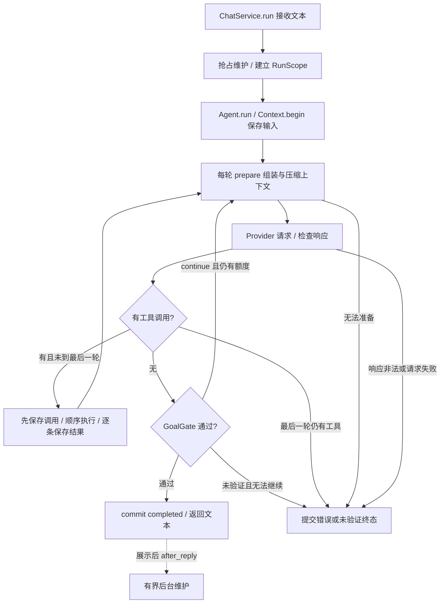

# 一条消息在 Agent 内部怎样完成

本文按普通文本请求的真实执行顺序展开，基线为 P5 Harness、SQLite schema 23。入口适配层只需把可信来源和输入交给 `runtime.py::ChatService`。本文路径相对仓库根目录；源码统一位于 `src/personal_agent/`。未来改进是建议，不代表已实现或获得执行授权。



图示省略了存储失败和取消的特殊清理路径；第 10、11 步单独说明，不能将这些情况视作成功提交。

## 1. 执行前已经有哪些对象

`runtime.open_application()` 打开 SQLiteStore，取得占用锁、顺序迁移、将遗留 running Run 标为 interrupted，再建立 SessionManager 与 Agent 级 MemoryFS。`open_chat()` 创建 Provider，`assemble_chat()` 装配 Agent、Context、Registry、检索、维护服务与可选 HarnessRuntime。Harness 启动时建立配置过的 MCP 连接。重启不会自动执行旧工具。

| 概念 | 保存什么 | 范围 |
| --- | --- | --- |
| 持久 Agent | 身份、共享 Markdown Memory | 跨会话与重启 |
| Conversation | 隔离的消息 Journal、工作摘要 | 多个 Run |
| `core.agent.Agent` | Provider、Registry、Context、循环配置 | 当前会话执行器 |
| Run | 一次输入、所有响应、调用、结果、终态 | begin 到 commit/abort |
| round | `_run()` 的一次循环迭代 | 最多 max_rounds 次 |
| Request | 一次实际 Provider 调用 | 同一 round 可有摘要及超限补救 |
| RunScope | Agent/Conversation/来源、根 ID、权限与共享预算 | 根执行及子工作 |

会话切换通过 `ChatService.select_conversation()` 更换 Context，并重新绑定 Harness。长期 Memory 仍属于同一持久 Agent。参见 [Runtime](modules/runtime.md)、[会话与 CLI](modules/sessions-cli.md)、[存储](modules/storage.md)。

## 2. 收到文本：先取得前台执行权

`ChatService.run(text, permissions, images, source_scope)` 拒绝 observer_only，设置前台活动标记，`note_input()` 增加 Proactive 的 activity_epoch，再 `await foreground()`。后者等待 OrganizationRuntime 取消后台维护并完成清理。

Harness 开启时进入 `HarnessRuntime.run()`，关闭时直接调用 `Agent.run()`。来源由可信入口提供，不从用户文本识别权限。Harness 先处理 `/harness`、`/compact`、`/workflow`、`/goal`；多数管理命令直接返回结果，由 ChatService 包装为 rounds=0 的文本，不创建聊天 Run。活动 Goal 创建后会把条件交给 Agent 执行。Workflow Resume 只允许可信 CLI/Host。下文讨论普通文本。

## 3. 建立来源和共享执行预算

`HarnessRuntime.scope()` 创建 RunScope，`CURRENT_SCOPE` 通过 ContextVar 传递。Planning、后台结果、Workflow 和产物查询据此隔离来源。

根预算默认限制 24 次模型请求、131072 估算预留 tokens、180 秒；工具次数取宿主配置。`BudgetProvider` 每次请求前预留输入估算与输出额度，返回后另外记录真实 usage。失败不会退还预留。主回答、摘要、子执行等共享根预算，换执行器不能重新领取额度。ContextBudget 管单次模型窗口，ExecutionBudget 管任务累计成本。参见 [Harness](modules/harness.md)。

## 4. 开始 Run：原子保存原输入

`Agent.run()` 检查输入非空（图片也可构成输入），取得实例级 asyncio Lock，串行化同会话请求；重置 round/request 计数，设置 ContextVar，并用 BudgetProvider 包装 Provider。

`ContextBuilder.begin()` 调用 History Protocol 的 `begin(user)`。SQLite 实现原子创建 running Run 与初始用户消息。Context 保留完整 pending 副本，返回临时 `[system, user]`，这还不是最终请求。Harness 的 `on_begin` 保存 Run 与 root_id 的关联，随后发出 `RunStarted` Hook。

自动注入的 Memory、时间和摘要不会伪装成真实用户消息写进 Journal。数据库失败直接停止，不退回无持久化模式。

## 5. round 开始：决定可见工具

`Agent._run()` 从 1 遍历到 max_rounds。非最后一轮调用 `ToolRegistry.definitions(permissions=...)`，只暴露满足逐 Run 权限的注册工具。最后一轮传空工具列表，让模型收尾。

执行时仍会复查权限。Skill、历史命令、用户自然语言或模型陈述都不能增加授权。Memory 写入等受限操作必须由可信宿主传入权限。

## 6. prepare：组装本轮模型上下文

每次正常模型请求前调用 `await ContextBuilder.prepare(messages, definitions, provider)`：

1. `_load()` 读 Conversation 摘要检查点和边界之后有界的完整 Run 页。仅 completed/failed Run 正常重放，不全量反序列化会话。
2. `_retrieve()` 在本 Run 首次执行，按原请求检索 Thread、Episode、完整历史 Run 或 Markdown。可选 Preflight 有额外模型成本。检索失败可降级为近期上下文，核心记忆、Journal、预算错误不能绕过。
3. 用近期历史页与完整 pending 重建工作列表。启用 ReplayView 时改变当前 Run 的模型投影，原始 pending 保持完整。
4. `_injections()` 重新编译 Core Memory、角色、会话摘要、时间、外发接续和 Planning/Skills/Execution 贡献器。每项贡献 JSON 最多 32768 字节。
5. `_select_history()` 在剩余额度内选检索结果，按 Run、call_id、Memory 来源去重。原始历史 Run 整体进入或省略，不拆工具配对。
6. `_assemble()` 拼出请求，估算消息、图片、Provider JSON 和工具定义的总成本。有压力或历史还有下一页时压缩，再重建、重新估算。

最终内部消息依次为：

```text
system：程序规则 + 可选角色系统内容 + 可选视觉规则
user JSON：Core → Conversation Summary → 时间 → 外发接续 → Contributors
user：角色编译出的其他参考数据（如有）
可选检索结果及来源标记
近期完整历史 Run
当前 Run 原请求 + assistant/tool 交互的派生投影
```

Core、摘要、工具结果和检索都是参考数据，不因注入而成为系统指令。角色开启时采用角色编译规则，`without_legacy_persona()` 避免旧静态 persona 干扰角色。主题正文不默认全量注入。参见 [Context](modules/context.md)、[检索](modules/retrieval.md)、[Persona](modules/persona.md)。

## 7. 超预算时如何压缩

输入硬上限为 `context_window - reserved_output_tokens - safety_margin`，窗口由宿主明确配置。估算基于序列化 UTF-8 大小和 framing，是保守估计，不是精确 tokenizer。

Harness 下先将大工具结果存为产物，投影中保留引用和预览；有压力时 micro projection 清理已被成功响应消费、且不属于最近三个受保护结果的正文。接着优先摘要可压缩的完整历史 Run 前缀，默认保护最近两个 Run。历史已无可压前缀时，才尝试当前 Run 的安全旧前缀摘要：保留原用户请求、最近两个交互周期，并要求 Provider 声明支持。

进入减压后目标为输入上限的 60%。压缩有步骤上限；无法缩减且仍超硬上限就明确停止。摘要请求不执行工具；所有层次只改派生视图，不删 Journal、不写长期 Memory、不重跑工具。参见 [Compaction](modules/compaction.md)。

## 8. 请求模型：Hook、审计、超时与一次补救

prepare 成功后发出 `BeforeModelCall`。`Agent._generate()` 递增实际请求编号，将输入快照写入 RunTrace，再在请求超时内等待 Provider.generate。BudgetProvider 同时限制根预算。OpenAIProvider 把内部 Message/ToolDefinition 转为 SDK 格式，再将响应还原为 ModelResponse；Core 不依赖 SDK 对象。

仅明确的 `ProviderError(code="context_length_exceeded")` 且本 Run 尚未补救时，设置 reactive、重新 prepare 并再发一次请求。它仍属同一 round，但有新请求编号，不重跑工具。其他错误、超时或第二次超限直接停止。

成功后 `mark_consumed()` 标记此前工具结果已被消费，发出 `AfterModelCall`，记录 usage。摘要也调用 Provider，但不走普通 `_generate()`，所以 round、回答请求审计与累计请求数不同。参见 [Provider](modules/provider.md)、[Tracing](modules/tracing.md)、[Hooks](modules/hooks.md)。

## 9. 检查响应，再执行工具

先检查单响应/单 Run 工具数量、当前 Run 内 call_id 不重复，以及不能既无工具又无非空文本。不合格响应整批拒绝，未执行其中任何调用，返回 invalid_response。

合法响应先将完整 AssistantMessage 落库，保留 text、tool_calls、JSON provider_data。同时有文本和工具时，文本是中间响应，不能当最终答案返回。

每条工具顺序执行：

```text
Registry.execute(call)
  注册名 → 权限 → 参数 → 根工具额度 → Host policy → PreToolUse
  → 等待工具 → 规范化 ToolResult
Context.record(ToolMessage(result))   # 下一工具开始前提交
PostToolUse                          # 结果已持久化
```

未知工具、非法参数、执行异常、超时、Hook 拒绝变成关联原 call_id 的 ok=false 数据，通常交给下一轮模型处理。共享工具额度耗尽时，批内各调用仍得到结果，批后以 budget_exhausted 结束。数据库失败则立即停止，不继续后续工具，不声称撤销已发生副作用。参见 [Tool Use](modules/tools.md)。

## 10. 什么时候结束 round 和 Run

普通工具批处理完进入下一 round。无工具的非空文本是候选答案；若配置 GoalGate，还需验收。

| 条件 | 行为 |
| --- | --- |
| 无工具、非空文本，GoalGate 通过或未配置 | completed，返回文本 |
| GoalGate continue，尚有轮数且续跑少于两次 | 保留候选，下一轮重新装配 Goal 反馈 |
| GoalGate waiting/blocked 或续跑额度耗尽 | goal_unverified，保留文本与原因 |
| 最后一轮仍返回工具 | 不执行；逐条保存 round_budget_exhausted，最终 max_rounds |
| 非法响应、Context/Memory/Provider/预算失败或超时 | 对应错误终态 |
| HistoryError | storage_error，尝试中断 Run |
| 外部取消 | abort(cancelled=True)，向外抛 CancelledError |

最后一轮正常返回文本仍可 completed。工具错误通常只是下一轮输入，不是整个 Run 的强制停止条件。详见 [Agent Loop](modules/agent.md)、[Planning](modules/planning.md)。

## 11. 提交结果，返回调用者

`finish()` 对非 completed 结果追加 Runtime stopped 审计消息，再 `ContextBuilder.commit()` → History.finish：验证调用/结果完整性，原子保存终态与结束元数据，清空 Context pending 和本次页缓存。数据库原消息保留。

`Agent.run()` finally 发出 Stop，恢复 Provider 和 ContextVar。Harness 在 completed 后确认已展示的后台结果通知，保存预算报告，把 root_id 放入 RunResult.execution_id，返回 ChatService。入口根据 status 呈现文本或错误；“模型生成了文本”不保证数据库提交成功。

SQLite 不能与文件或外部副作用共同事务提交。工具成功但结果写库失败时不自动回滚、不重试。重启仅标记 interrupted，这些 Run 留作审计，不进入正常重放。注册式 Workflow 的可信显式 Resume 另有核对流程。

## 12. 返回之后的维护

入口展示/投递回答后调用 `ChatService.after_reply()`，调度 OrganizationRuntime 的可抢占维护任务，可处理 Episode/Thread、Learning、Curator、角色状态与 Proactive Shadow。这些不是主回答 round，也不能用“已回答”推导“已写长期记忆”。新输入通过 foreground 抢占。

明确提醒另走 Scheduler；关心式 Proactive 仍为 Shadow，只生成建议和草稿。Harness 的显式后台作业与自动维护是两种机制。继续阅读 [Memory](modules/memory.md)、[Proactive](modules/proactive.md)、[Execution](modules/execution.md)、[Workflow](modules/workflows.md)。

## 阅读与离线验证

直答占一个 round；“查时间 → 工具结果 → 文本”占两个 round；单个响应带两个工具仍只占一个 round，工具顺序执行。最后一轮拒绝工具不产生真实工具副作用。

```powershell
uv run pytest tests/test_agent.py tests/test_harness.py tests/test_compaction.py tests/test_model_rounds.py
```

`tests/test_persistent_runtime.py` 对照提交、中断与重启；`tests/test_working_context.py` 对照检索。测试使用 Fake Provider 和隔离存储，验证工程契约，不代表真实模型语义质量。

## 未来改进

- 把停止条件和 GoalGate 结果收敛为类型化决策，减少循环内分散分支，保持逐结果提交。
- 分开显示 round、实际请求、摘要请求和子执行成本，解释单条消息为何触发多次模型调用。
- 提供脱敏的上下文解释：各层来源、大小、遗漏原因、压缩选择与停止原因，默认不输出私人正文。
