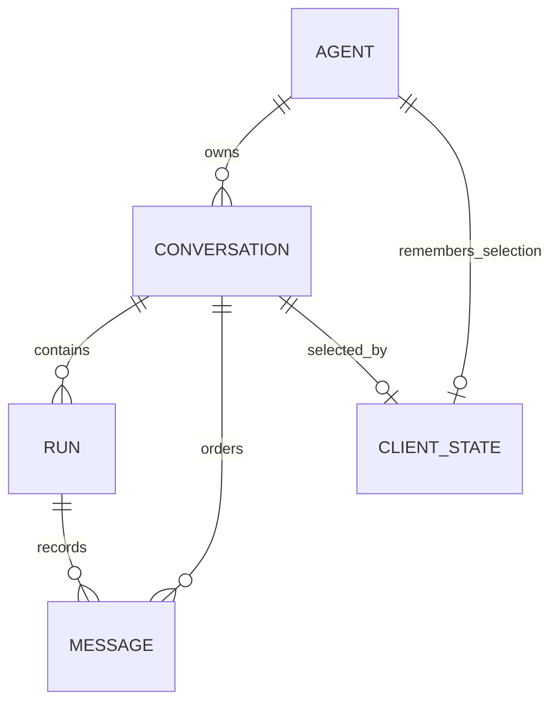
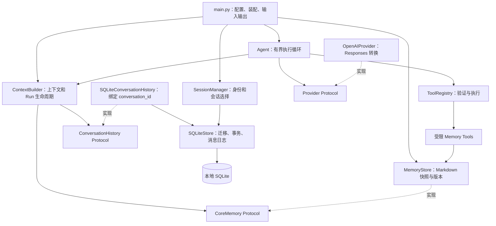
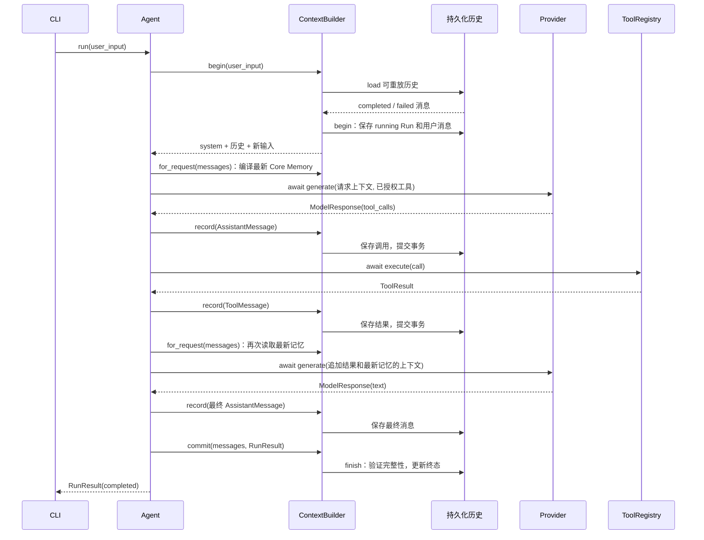
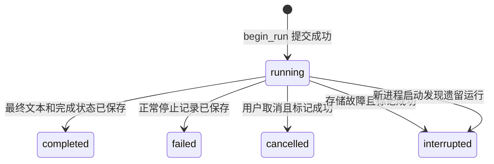
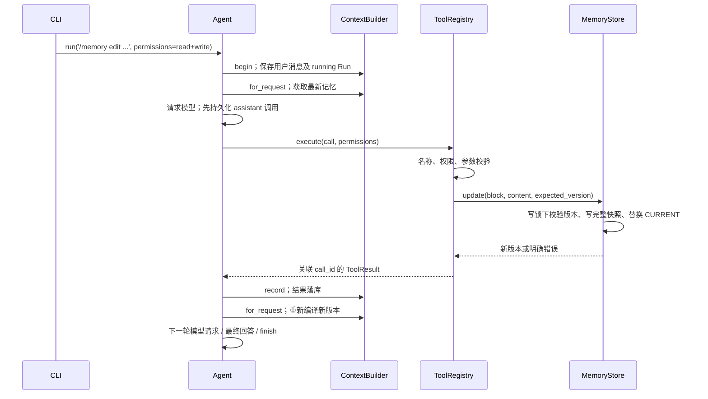

# HeyBuddy V0.3：整体架构与 Pipeline

本文串起从启动到退出的真实执行路径，解释每一层接收什么、改变什么状态、在哪里保存数据。具体方法细节可从[文档索引](README.md)进入。当前系统是一个本地进程、一个 SQLite 数据库和独立的 Markdown 记忆目录，没有消息队列、后台任务消费者或自动续跑器。

## 1. 先区分实体、执行器和执行次数

| 概念           | 当前实现                               | 生命周期与职责                                                             |
| -------------- | -------------------------------------- | -------------------------------------------------------------------------- |
| 持久 Agent     | `storage/models.py::AgentRecord`     | 数据库中的身份、名称；system_prompt 保留为兼容元数据；CLI 默认 ID 为 `heybuddy`          |
| Conversation   | `ConversationRecord`                 | 属于一个 Agent；隔离聊天历史，退出进程后仍存在                             |
| Message        | `StoredMessage` 包装内部 `Message` | 属于一个 Conversation 和一个 Run，保存完整结构及顺序                       |
| Run            | `RunRecord`                          | 一次普通用户输入的处理过程，包含零个或多个已收到的模型响应、工具结果与终态 |
| Runtime 执行器 | `core/agent.py::Agent`               | 进程内 Python 对象，执行手写循环；不是数据库中的 Agent 实体                |
| round          | `_run()` 的一次循环                  | 一次模型请求；一个 Run 可以消耗多个 round                                  |

因此，“一个 Agent 有多个会话”说的是数据库实体关系；“Agent Loop”说的是 Runtime 的执行职责。 CLI 可以复用同一个 Runtime，切换它绑定的 ContextBuilder，持久 Agent 的身份不会因此改变。 `/new`、`/sessions`、`/resume`、`/status` 是管理命令，不创建聊天 Run。

数据关系如下；client_state 是恢复上次选择的元数据，不承担记忆存储职责：



数据库里的 `client_state.agent_id` 是主键，一个 Agent 最多保存一个当前选择；复合外键还要求选中的 Conversation 属于同一个 Agent。图中的关联不表示复制聊天记录：会话切换只改变选择，消息仍属于原会话。

## 2. 模块分层与依赖方向



CLI 是装配入口，知道使用哪个具体 Provider、存储和工具。Runtime 只调用小接口，不导入 sqlite3 或 SDK 响应类型。ContextBuilder 负责历史何时加载、消息何时记录、Run 何时结束；具体 SQL 则集中在 SQLiteStore。

这让“换一个入口”和“换存储实现”不必改写模型/工具循环。当前只实现 CLI、一个官方 SDK Provider 和 SQLite 适配器，没有为未来系统预建更多服务。

| 边界                | 输入                              | 输出               | 谁理解具体协议                              |
| ------------------- | --------------------------------- | ------------------ | ------------------------------------------- |
| CLI → Runtime      | 用户文本、本轮权限集合             | `RunResult`      | CLI 理解交互命令，Runtime 不理解 slash 命令 |
| Runtime → Provider | 内部消息、`ToolDefinition`      | `ModelResponse`  | OpenAIProvider 理解 Responses API           |
| Runtime → Registry | `ToolCall`                      | `ToolResult`     | Registry 理解参数模型与执行函数             |
| Context → History  | 用户消息、消息追加、结束/中断通知 | Run ID、可重放消息 | SQLiteConversationHistory 绑定会话          |
| History → Store    | 会话 ID、Run ID、完整消息         | 持久记录           | SQLiteStore 理解表、外键和事务              |

## 3. 启动 Pipeline：先恢复状态，再接收输入

入口为 `pyproject.toml` 的 `personal-agent = personal_agent.main:main`，也可执行 `python -m personal_agent.main`。

1. `main.py::main()` 解析命令行。`--help` 在此结束，不读取配置或打开数据库。
2. `config.py::load_settings()` 读取当前目录配置，环境变量优先；Pydantic 校验模型、密钥、超时及 API 地址。失败时报告字段并返回退出码 2。
3. `main()` 配置安全日志，通过 `asyncio.run(run_cli(settings))` 进入异步应用。
4. `SQLiteStore(settings.database_path)` 解析路径、创建必要目录、取得进程占用锁，再打开数据库。同一路径已被其他应用实例占用时失败，避免两个 CLI 同时处理同一份运行状态。
5. `SQLiteStore.initialize()` 显式迁移 schema。迁移与版本更新在同一事务内完成，遇到更新版本或陌生数据库时拒绝继续。
6. `recover_incomplete_runs()` 将遗留 running Run 标记为 interrupted。这个步骤只更新状态，不调用 Provider 或任何工具。它在占用锁下进行，因此不会把另一正常运行实例的 Run 当作遗留任务。
7. `SessionManager(store)` 读取或创建持久 Agent，读取 client_state；首次创建空会话，后续验证并恢复上次选择的会话。
8. `run_cli()` 构造 `MemoryStore.for_agent()`，初始化或校验当前快照，绑定到 SessionManager。记忆默认保存在数据库路径加 `.memory` 后的 Agent 子目录；可通过配置指定根目录。
9. `_run_session()` 注册受限 Memory Tools，再创建 AsyncOpenAI 客户端、OpenAIProvider、内置 ToolRegistry、与当前会话绑定的 ContextBuilder，以及 Runtime Agent，然后调用 `chat()`。

这里没有“启动就请求模型”的步骤。直到用户输入普通文本才进入请求 Pipeline。启动存储失败返回退出码 1，不悄悄退回内存模式；显式使用不带 history_store 的 ContextBuilder 仍可获得进程内模式，原有 Runtime 单元测试使用该方式。

## 4. 请求 Pipeline：输入 → 上下文 → 模型 → 工具 → 结果

### 4.1 一次调用工具的完整时序

下图把 history 适配器和 SQLiteStore 合并为“持久化历史”参与者，便于看清调用顺序；实际方法映射见[ContextBuilder](modules/context.md)和[SQLite 存储](modules/storage.md)。



请求路径中的实际操作按以下阶段执行：

| 阶段     | 实际方法                                                    | 输入/输出与状态变化                                             |
| -------- | ----------------------------------------------------------- | --------------------------------------------------------------- |
| 接收     | `chat()` → `Agent.run()`                               | 普通文本进入 Runtime；空白输入由 CLI 跳过，Runtime 也拒绝空输入 |
| 串行化   | `Agent.run()` 的 `asyncio.Lock`                         | 同一 Runtime 的 Run 顺序执行，避免上下文交错                    |
| 构建     | `ContextBuilder.begin()` → `build()`                   | system + 当前会话可重放历史 + 新用户消息                        |
| 开始记录 | `ConversationHistory.begin()` → `begin_run()`          | 原子保存 running Run 与用户消息，得到 Run ID                    |
| 请求模型 | `Agent._run()` → `Provider.generate()`                 | 在单次请求超时内 await，消耗一个 round                          |
| 响应检查 | `_run()` 的 ID/空响应检查                                 | 拒绝重复 ID 或既无文本也无调用的响应                            |
| 记录响应 | `_run()` 内部 `append()` → `ContextBuilder.record()` | 先落库，再加入 pending 和当前上下文                             |
| 执行工具 | `ToolRegistry.execute()`                                  | 名称查找、参数校验、执行与 JSON 规范化，生成同 ID 的结果        |
| 继续     | 再次 `append()`，进入下一轮                               | 先保存结果，再允许下一工具或模型请求                            |
| 完成     | `_run()` 内部 `finish()` → `ContextBuilder.commit()` | 保存正常终态，清理运行中状态，才返回 CLI                        |

### 4.2 哪些分支会继续，哪些会停止

只有“没有工具调用且文本非空”才作为最终答案。文本与工具调用同时出现时，先处理调用，这段文本不会提前作为最终成功展示。多个工具按响应给出的顺序逐个执行；每个结果保存成功后，才处理下一项。未知工具、参数错误、执行异常或工具超时都转为 ToolResult，模型可在下一轮处理错误。工具报错本身不必使整个 Run 成为 failed：模型仍可能解释错误并给出最终回答。

最后一轮不提供工具定义，保留给最终回答。如果模型仍返回调用，Runtime 还会在执行层再次拦截：为所有调用保存 `round_budget_exhausted` 结果，不进入 Registry，返回 max_rounds。因此 max_rounds=1 只允许直接回答；系统不会为总结再多发一个超预算请求。

### 4.3 用一条具体消息链跟踪数据

假设用户输入“计算 2 + 3”，模型先调用加法，再回答“5”，这是一个 Run、两个 round：

| 会话 sequence | 内部消息                   | 关键字段                                                        | 保存时 Run 状态                         |
| ------------- | -------------------------- | --------------------------------------------------------------- | --------------------------------------- |
| 1             | `TextMessage(role=user)` | `text=计算 2 + 3`                                             | running，与 Run 同一事务创建            |
| 2             | `AssistantMessage`       | `tool_calls[0].id=sum-1`，`name=add_numbers`，原始参数 JSON | running，工具尚未执行                   |
| 3             | `ToolMessage`            | `result.call_id=sum-1`，`ok=True`，`data={sum: 5}`        | running，工具已经返回                   |
| 4             | `AssistantMessage`       | 最终文本“5”，可能带 Provider output items                     | running，消息已保存但 Run 尚未 finalize |

随后 `finish_run()` 把状态改为 completed，并保存 RunResult、ended_at、会话 updated_at。 sequence 是会话内顺序；下一条用户消息从 5 开始。Run ID 用来区分每次输入， `ToolCall.id` 与 `ToolResult.call_id` 则用来关联同一次工具调用，两者不能互相替代。

同一条 assistant 消息可以携带多个调用，后面对应多条 tool 消息。一次 Provider 响应里的多个 reasoning、文本、函数项目保存在这条消息的 provider_data 内，不会各自变成数据库顶层消息。

## 5. 四种历史视图：已写入与可重放并非同一回事（请求编译见第 11 节）

| 视图           | 读取位置                                     | 包含内容                                    | 用途                             |
| -------------- | -------------------------------------------- | ------------------------------------------- | -------------------------------- |
| 完整持久化历史 | `SQLiteStore.load_messages()`              | 所有 Run 的消息，包括未完成调用             | 审计、诊断，不直接全量送入模型   |
| 可重放历史     | `ContextBuilder.history` → adapter.load() | 仅 completed / failed Run，且通过结构校验   | 构建下一次输入的上下文           |
| 工作消息链     | `_run()` 的局部 `messages`               | system、可重放历史、新输入、本 Run 后续消息 | for_request 编译前的基础链 |
| 运行中消息     | `ContextBuilder.pending_messages`          | 仅当前 Run 的用户、模型、工具消息副本       | 跟踪尚未结束的 Run               |

pending 消息可以已经逐条持久化；“Run 未完成”不表示持有一个一直不提交的 SQL 事务。例如正在执行工具时，调用已在数据库中，但整个 Run 仍是 running，尚未进入正常可重放历史。这种区分避免“数据库中有一条调用”被误解为“下次启动应继续执行它”。

Base system 提示词来自程序代码，不作为每个 Run 的重复数据库消息保存。当前对 Conversation 的可重放历史全部加载，不进行召回筛选、摘要或 token 压缩。

## 6. 持久化 Pipeline 与事务边界

`SQLiteStore._transaction()` 以 BEGIN IMMEDIATE 开始短事务，成功 commit，异常 rollback。不在等待模型或工具时保持数据库事务开放。各阶段的提交含义如下：

| 事务               | 写入内容                                                  | 失败后的含义                           |
| ------------------ | --------------------------------------------------------- | -------------------------------------- |
| schema 初始化/迁移 | 表、索引、user_version                                    | 全部回滚，避免半个 schema              |
| 新建并激活会话     | conversations + client_state                              | 全部回滚，不留下多余空会话             |
| 开始 Run           | runs + 首条用户消息                                       | 全部回滚，模型还未被调用               |
| 追加消息           | 校验既有 Run 消息，插入完整 JSON 及下一个 sequence        | 只回滚本次追加，保留此前日志           |
| 完成 Run           | 检查调用完整性，更新终态、result_json、结束时间与会话时间 | 全部回滚，不能报告最终成功             |
| 标记中断           | 更新 cancelled / interrupted 与结束时间                   | 写入仍失败时保留 running，待启动时处理 |

数据库约束防止同一会话的 sequence 重复、消息挂到其他会话的 Run，以及同一 Conversation 同时出现两个 running Run。`validate_turn()` 还检查调用 ID、工具名和结果的配对关系；正常结束必须没有悬空调用，最后一条是 assistant 消息。

这些事务保障的是数据库内部一致性。外部工具效果不属于 SQLite 事务， “工具执行成功 → 结果落库”之间的窗口不能被这套设计消除。

## 7. 失败 Pipeline 与 Run 状态



只有 completed / failed 进入下一次正常上下文。failed 表示“Run 已明确结束并完成保存”，不是“可能还要后台重试”。它可以对应 RunResult 中的 provider_error、timeout、invalid_response、 runtime_error（Provider 调用中的非预期异常）、memory_error 或 max_rounds。

| 失败位置                        | Runtime 行为                            | 保存/重放语义                             |
| ------------------------------- | --------------------------------------- | ----------------------------------------- |
| 用户消息或 Run 创建失败         | 返回 storage_error，rounds=0            | 不调用模型；当前创建事务回滚              |
| 模型请求超时或报错              | 保存停止说明，返回明确 RunResult        | 正常 finalize 为 failed，可重放           |
| assistant 调用记录写入失败      | 立即停止，不执行该批工具                | 尝试标记 interrupted，保留之前日志        |
| 工具执行失败                    | 保存对应错误 ToolResult，继续有限循环   | 有后续预算时交给模型处理                  |
| 工具已返回，结果写入失败        | 立即停止后续工具，不自动重试            | 工具效果可能已发生，当前 Run 排除出上下文 |
| 最终消息已保存，finish_run 失败 | 返回 storage_error，不展示最终成功      | 尝试标记 interrupted，已保存消息只作审计  |
| 用户取消当前运行                | 尝试标记 cancelled，传播 CancelledError | 部分消息保留，不自动执行剩余调用          |
| 进程直接退出                    | 已提交日志保留，Run 可能仍为 running    | 下次启动标记 interrupted，整个 Run 不重放 |

若连中断标记也无法写入，代码只记录安全诊断；Run 仍为 running，下次启动再标记。中断记录里的未配对调用可能尚未开始，也可能已经产生外部效果，不能根据缺少结果断言未执行。同步工具超时同样只停止等待，线程可能继续；详细契约见[工具模块](modules/tools.md)。

## 8. 会话切换 Pipeline

管理命令只在两次 Run 之间处理，当前没有后台 Run 与切换命令并发执行的路径。

- `/new`：`SessionManager.new()` → `create_conversation(activate=True)`，原子新建空会话并更新 client_state；成功后 `agent.context = sessions.context()`。
- `/resume <id>`：先查会话归属和可重放历史，再保存当前选择，最后替换 ContextBuilder。验证或保存失败时，旧选择不被修改。
- `/sessions`：只列当前持久 Agent 的会话，按 updated_at 降序、ID 排序；不创建聊天消息。
- `/status`：读取当前会话 Run 状态，提示中断/取消记录未进入模型上下文。

切换时 Provider、SDK 客户端、ToolRegistry 和 Runtime 对象继续复用，替换的是绑定会话的上下文。新会话使用程序 Base System Prompt 和同一个 Agent 的 Core Memory，但其历史为空，不会拷贝上一会话的 `_history`。切回旧 ID 时再从数据库加载，两个 Conversation 的 sequence 和 Run 各自独立。

## 9. 退出与重启 Pipeline

正常 exit / quit / EOF 时，`chat()` 返回，SDK 客户端和数据库依次关闭，数据库占用锁释放。下次启动从 client_state 找回上次选择，再通过 ContextBuilder 的历史接口重建消息。

重启不会把旧工具调用当作新的执行请求。已完成历史中的调用/结果只是 Provider 输入的一部分；只有模型在本次 Run 的新响应中发出调用，而且仍有执行预算时，Runtime 才进入 Registry。被中断的整个 Run 会排除出这条重放路径。

Provider 专用数据必须跟随消息保存：OpenAIProvider 把 output items 转成普通 JSON，放入 `provider_data['openai']`。重载时 Pydantic 恢复这个字段；`OpenAIProvider._input()` 直接重放原始项目及顺序，不再重复追加归一化调用。工具输出则按 call_id 转成 function_call_output。因此 reasoning、函数参数、调用 ID 和结果之间的关系可以跨进程保留。

这使“重启后追问前文”成为恢复 Conversation History 的结果。这与 Core Memory 独立：`/new` 后仍注入同一 Agent 已提交的记忆，但不会检索或复制旧会话历史。

## 10. 按 Pipeline 验证与阅读源码

| 路径                   | 建议先读的源码                                          | 对应测试                                                                    |
| ---------------------- | ------------------------------------------------------- | --------------------------------------------------------------------------- |
| 启动和迁移             | `main.py::run_cli`、`storage/sqlite.py::initialize` | `test_initialization_is_explicit_versioned_and_idempotent`                |
| 一次 Run 与工具循环    | `core/agent.py::run` / `_run`                       | `tests/test_agent.py`                                                     |
| 运行中记录与历史分离   | `core/context.py`、`storage/history.py`             | `test_pending_history_is_distinct_from_replayable_and_full_history`       |
| 会话隔离与多次重启     | `sessions.py`、`load_messages`                      | `test_restart_restores_previous_topic_and_new_conversation_is_empty`      |
| SDK 重放完整数据       | `llm/openai_provider.py::_input`                      | `test_complete_provider_items_replay_through_sdk_after_restart`           |
| 写入失败后的副作用边界 | `append_message`、`Agent._abort_context`            | `test_result_write_failure_stops_batch_and_keeps_prior_history`           |
| 真正进程退出           | `storage/lock.py`、`recover_incomplete_runs`        | `test_actual_process_exit_releases_lock_and_retains_unfinished_run`       |
| CLI 切换               | `main.py::chat`、`SessionManager.resume`            | `test_cli_session_commands_switch_and_restore_without_polluting_messages` |

上表源码路径以 `src/personal_agent/` 为根；存储测试位于 `tests/test_storage.py`，跨模块测试位于 `tests/test_persistent_runtime.py`。它们使用临时数据库、Fake Provider 和 MockTransport，可以在不使用真实 API Key、不支付模型费用的情况下观察整条 Pipeline。


## 11. V0.3 的 Base / Core Memory / History 分层

`core/context.py::DEFAULT_SYSTEM_PROMPT` 是程序管理的 Base System Prompt，说明工具权限、记忆为数据、禁止从记忆获得规则覆盖权等边界。`SessionManager.context()` 明确使用这个代码常量。 V0.2 agents 表的 system_prompt 字段保留兼容，不再被 CLI 当作执行规则加载，schema 仍为 1。可信宿主可以通过 ContextBuilder 构造参数提供系统提示词，模型和 Memory Tools 没有这个接口。

Core Memory 属于 Agent，初始固定为 persona.md、human.md、MEMORY.md，独立于 Conversation。 ContextBuilder 只依赖 `core/memory.py::CoreMemory.compile()` Protocol，不导入具体文件存储。在之前四种历史视图之外，V0.3 增加了**每次模型请求的编译视图**：

```text
ContextBuilder.begin() → 工作消息链：Base + 可重放历史 + 本轮用户消息
Agent 追加 assistant / tool → 工作消息链持续增长
每次 Provider.generate 前：ContextBuilder.for_request(工作消息链)
  system: 程序 Base System Prompt
  user:   JSON {kind: agent_core_memory, trust: data_only, version: ..., blocks: ...}
          当前 Conversation 可重放历史
  user:   本轮输入
          本轮新增 assistant / tool 消息
```

记忆通过标准 JSON 编码，不能拼接出新的消息角色。Base 明确拒绝记忆中的权限、规则覆盖或执行代码要求。这保证数据没有 system 角色及程序权限，不能证明模型永远不受恶意文本影响。自动注入的记忆不加入 pending 或 SQLite，避免每轮持久化旧快照；memory_read 工具结果和用户消息仍是正常审计历史，可能保留旧记忆内容。当前版本没有历史 token 预算或压缩。

每次请求都重新编译，所以同一 Run 修改记忆后，下一轮立即获得新版本；不会一直使用 Run 开始时的缓存。总大小按编译后的 JSON UTF-8 字节计，默认 8192，包含三块、版本及转义开销。拒绝超限而不静默截断；请求前读取损坏/超限返回 memory_error，不发出该次模型请求。

## 12. 显式授权与记忆修改 Pipeline



普通输入不授予 Memory Tools 权限，但每次请求仍自动包含有界 Core Memory 数据。 `/memory read <请求>` 本轮开启 memory_read / memory_history； `/memory edit <请求>` 再开启 memory_update / memory_restore。完整命令作为正常用户消息保存，供审计；它不是会话管理命令。权限由 CLI 解析本次输入后通过 `Agent.run(..., permissions=...)` 传入，默认空集合，结束即失效。自然语言“记住”、历史命令和记忆内容均不能授权后续 Run。嵌入入口的可信宿主也必须显式传权限。

Registry 同时过滤模型工具定义并在执行前复查权限；模型凭空请求受限工具返回 permission_denied。工具参数只允许固定块名和版本，不能传路径或改权限。更新替换一个块，恢复复制完整旧快照，都要求当前 expected_version；冲突返回 memory_conflict，不自动合并或重试。终轮策略优先于授权：即使有写权限，最后一轮的新工具调用也不会执行。

## 13. 文件版本提交与数据库事务的交界

实际布局如下；root 默认是数据库路径加 `.memory`，再以 Agent ID 隔离：

```text
<root>/heybuddy/
  CURRENT                       # 唯一已提交版本指针
  .write.lock                   # OS 写锁，进程退出释放
  versions/<32位版本>/
    persona.md
    human.md
    MEMORY.md
    revision.json               # parent、action、时间、内容 SHA-256
```

`MemoryStore._publish()` 在新目录写完整三块和元数据，逐文件 flush/fsync；写临时 CURRENT 并 fsync，最后通过 os.replace 发布指针，这是提交点和最后一个可能失败的发布步骤。读者只读取一次 CURRENT，随后读取同一不可变版本，因此不会看到混合的新旧文件。写者持短期写锁，在锁内核对 expected_version。恢复版本同样生成新提交，保留 parent 与 restored_from，不会移动指针抹去更新历史。只有 CURRENT 的祖先可被恢复，孤立目录和其他 Agent 的版本被拒绝。

提交前失败保留旧快照；新目录可能残留为不可达孤立版本，不作为历史展示或自动恢复。提交后进程退出，下次读取新版本。该方案保证进程崩溃边界的一致视图，不承诺断电级持久性：未做目录 fsync，不保证网络文件系统语义，也没有自动版本清理/备份。不可直接修改版本目录里的 Markdown，否则完整性校验失败；通过 MemoryStore API 或授权工具修改。

SQLite 与记忆文件**没有共同事务**：记忆已经发布而 ToolResult 落库失败时，新记忆保留，Run 标记 interrupted，不自动撤销或重试。审计必须区分“记忆已提交”和“Run 已完成”。 Memory Tools 用无 await 点的短本地协程包装同步提交，不将写操作交给超时后可能继续运行的线程。因此磁盘操作会阻塞事件循环，超时不能打断这些同步步骤；未来若处理大型数据需另行设计隔离。

固定文件名、版本格式、哈希及链接检查防止模型参数越界；本地文件系统仍是可信操作员边界，不抵御同一 OS 用户恶意篡改元数据或竞争替换祖先路径。记忆与历史均为明文，不得存放凭证。

## 14. 设计参考与 V0.3 验证

本次核对用户提供的本地 Letta Code checkout，参考 [Core Memory 维护约定](https://github.com/letta-ai/letta-code/blob/main/src/skills/builtin/maintaining-core-memory/SKILL.md) 与 [system-prompt compilation](https://github.com/letta-ai/letta-code/blob/main/src/backend/local/system-prompt-compilation.ts)。采用固定 Markdown 核心文件与 Conversation 分离的思路，但将记忆限制为低优先级数据，不照搬自主系统提示词学习、递归目录索引或 Deferred Memory 检索。

`tests/test_memory_store.py` 验证原子发布、并发冲突、版本恢复、字节限制、篡改和真实进程退出； `tests/test_memory_runtime.py` 验证跨会话/重启共享、每轮刷新、权限过期、不可覆盖 Base、失败回滚、双存储提交窗口与终轮拒绝。全部使用临时目录和 Fake Provider，禁止真实网络。后续再设计版本保留策略、token 预算、自动提取和更强文件隔离；本轮不预建相应模块。
