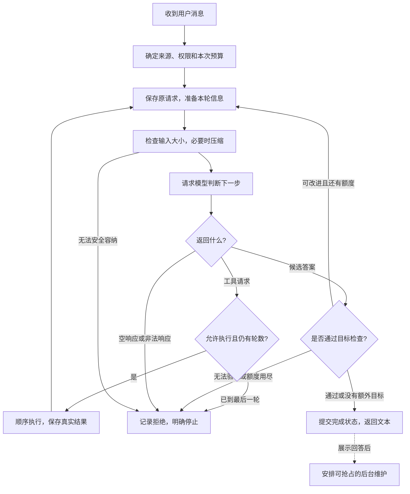

# Agent 怎样工作：机制与逻辑流程

这份文档用于向别人解释机制，不要求先读源码。阅读顺序是：先理解一次消息处理，再理解工具、上下文和记忆为什么这样协作。需要定位实现时，再读[代码执行主线](architecture.md)；每个[模块专题](README.md)也分别提供“机制流程”和代码路径。

本文描述已交付的 P5 行为。工作区中尚未完成的新增机制不作为本文能力承诺。

## 1. 一条消息不是一次模型调用

收到用户消息后，程序建立一次执行，把原始请求保存下来。这次执行可以只问模型一次，也可以经历多轮“模型决定下一步 → 工具取得新信息 → 模型继续判断”。程序负责组织信息、执行动作和决定是否还能继续；模型负责根据当时提供的信息提出回答或工具请求。

一次执行可以用下面的流程解释：

图中省略了超时、取消和存储故障：这些也会停止执行。无法保存记录时停止后续动作；取消不保证撤销此前已经发生的副作用。

## 2. 先确定这次工作属于谁、可以做什么

程序从可信入口取得身份、会话和消息来源，避免不同来源读取彼此的任务、后台结果或工作产物。权限也由可信入口提供，不由模型根据用户措辞自行决定。

同时给本次工作一份累计额度：最多问模型多少次、可以使用多少工具、允许花费多少时间和估算成本。辅助分析、摘要和评审也消耗同一份额度，不能通过拆分工作获得无限资源。

这些检查回答两个不同问题：“这个动作是否允许做？”和“这次任务是否还有资源做？”允许但额度不足，仍然要停。

## 3. 每轮都准备一份有限的工作资料

模型不会自动看见数据库、文件或全部历史。程序必须为这一次判断准备资料：

| 信息 | 为什么需要 | 如何使用 |
| --- | --- | --- |
| 程序规则与角色设定 | 确定边界和表达方式 | 保持稳定，不能被参考资料改写 |
| 用户资料与相处记忆 | 理解长期偏好与真实互动 | 每轮读取最新内容 |
| 会话摘要与近期交互 | 连续理解当前讨论 | 摘要补充远期背景，近期保留完整交互 |
| 相关旧讨论与主题资料 | 回答当前请求缺少的背景 | 按需检索、去重，再按剩余额度选择 |
| 原始请求与本次执行过程 | 保持目标并利用新取得的信息 | 保留请求、工具调用和对应结果 |
| 时间、计划与后台结果 | 理解当前进度和待办 | 只加入本来源可见且有界的信息 |

把资料放进输入，不等于允许它发号施令。过去的对话、工具输出和技能指南即使包含“忽略限制”，也不能改变程序真正执行的权限检查。

## 4. 资料放不下时，减少重复和正文，不删除原始记录

模型窗口限制的是本次能读多少信息，累计预算限制的是整个任务能花多少资源。输入组装完后要连同工具说明一起估算大小，并给模型输出预留空间。

减压按保守顺序处理：先把大工具正文保存成可查产物，在输入里留下预览与引用；压力增大时减少已经看过的旧结果正文；再把较早的完整历史交互整理成摘要。只有这些仍不够时，才考虑摘要当前执行中已经结束的旧交互，保留原始请求、近期过程和必要的模型协议数据。

摘要是有损的工作资料，完整日志始终保留。不能拆掉一次工具调用所需的对应结果，也不能为腾空间重新执行工具。仍放不下就明确停止；模型明确报告输入超限时，只允许一次重新整理后的补救请求。

## 5. 模型提出动作，程序决定是否真的执行

模型返回工具请求时，只是在说“我需要这个操作”。程序先检查工具是否存在、当前是否授权、参数是否合法、额度是否充足，再检查宿主策略和执行前拦截条件。

允许的调用按顺序执行。每条结果先保存，再开始下一条。成功、拒绝、参数错误和超时都返回与原请求对应的结果，下一轮模型根据这些实际信息继续判断。

例如，读取资料失败时，模型可以解释缺少依据，或选择另一条合法路径；不能仅因为自己写出“读取成功”就让程序产生成功回执。工具超时也不能理解为“什么都没发生”，因此不会盲目重试可能重复产生副作用的动作。

## 6. Hooks 和 Skills 分别参与什么

Hooks 是宿主在关键节点安装的观察与检查机制。例如工具真正执行前，可以有额外的拒绝检查；执行之后，可以观察已记录的结果。检查本身有时间限制，只能进一步收紧允许的动作，不能授予新权限。

Skills 是按需阅读的操作指南。模型先看到名称和用途，需要时才读取具体做法；指南帮助模型安排步骤，实际动作仍由工具完成。读到一份指南，不等于执行了指南里的脚本，也不等于获得指南所描述的全部能力。

外部工具服务提供另一种动作来源：宿主先配置连接与白名单，程序再把允许的能力接入同一套工具检查。它不会因为来自外部服务就绕过本地预算和授权。

## 7. 什么时候继续，什么时候停止

一轮是一次“准备信息 → 模型判断 → 处理响应”的循环。工具结果通常要等下一轮模型阅读，所以执行工具之后并不代表本次请求已经完成。摘要或输入超限补救还可能增加模型请求，因此轮数和实际请求次数不同。

| 当前情况 | 下一步 |
| --- | --- |
| 模型提出合法工具请求，尚有轮数 | 执行并保存结果，进入下一轮 |
| 模型同时给出文本和工具请求 | 文本作为中间响应，继续处理工具 |
| 模型只返回非空文本，且没有额外目标或目标检查通过 | 提交并返回最终文本 |
| 目标尚未通过，但检查允许继续且还有额度 | 带着反馈有限续跑，最多两次，不重置原轮数 |
| 目标无法验证，或无法继续 | 返回未验证状态，不能宣称完成 |
| 最后一轮仍提出工具请求 | 拒绝新动作，记录原因并停止 |
| 达到累计预算、响应非法、请求超时等 | 明确停止，保留已完成记录 |

最后一轮仍能正常返回文本；最后一轮的空工具清单是让模型收尾，同时程序也会防御模型继续要求调用工具的情况。

## 8. “模型回答了”与“任务完成了”是两回事

对于普通问答，非空文本可以成为最终答案。对于显式目标，还要检查用户要求的完成依据。待办清单说明准备做什么，任务状态说明哪一步做过，真实工具回执说明发生过什么，目标检查才判断这些结果是否满足验收条件。

例如文件存在，只能证明有一个允许读取的文件，不能证明报告论证正确。没有相应语义评审或人工审阅时，程序不能把这样的检查包装成语义质量保证。

准备返回时，还要把最终状态和结束信息提交到日志。存储失败时，即使模型已经生成文本，也不能把它当作一次正常提交完成的执行。

## 9. 返回之后，记忆和主动关注怎样继续

回答展示后，程序可以安排一条有界的后台维护通道。新用户消息到来时，前台优先，维护会被取消并等待清理。已经提交的维护结果保留，没完成的批次不假装推进。

后台工作各有用途：整理聊天片段与持续话题，帮助以后发现相关历史；学习有证据的长期认识，写入受限 Markdown；低频整理主题，改善可发现性。这些动作与主回答分开计量，也不表示每次聊天都会立刻写入长期记忆。手动反思仍需要审批。

主动关注则先从真实计划形成待关注事项，再选择将来何时评估。到时仍要检查安静时段、新消息、证据新鲜度和预算，可能选择沉默、延后或生成草稿。用户若已经主动谈过进展，就撤掉这轮原定关心，但不把事项误标为完成。目前关心式内容仅生成建议与草稿，不真实主动发送。

明确提醒是另一条机制：只有用户明确要求才创建，时间和内容不足先追问；到期按允许渠道进行一次受控投递，不把普通计划自动转成提醒。

## 10. 用一个例子串起来

用户说：“读一下已有资料，帮我整理一份报告。”

1. 程序保存请求，绑定来源，准备规则、相关背景与允许工具。
2. 模型发现还缺资料，提出读取请求。程序校验后读取并保存真实结果。
3. 下一轮把这些结果交给模型。正文过长时用预览和引用控制输入大小，需要时再分页取回。
4. 模型据此组织内容；若要保存文件，仍须通过受控写工具并得到真实回执。
5. 模型提出最终答案。若用户设定了目标检查，则先验收；条件不足时有限继续，无法验证时如实说明。
6. 提交结束状态，再把文本返回用户。之后的后台整理可以帮助未来记住这次讨论，但不能倒过来替代本次报告的证据。

向别人概括时可以这样说：“模型负责提出下一步，程序负责准备有限资料、检查权限和预算、执行并记录动作。新结果回到模型形成下一轮，直到答案可接受或必须停止。”
