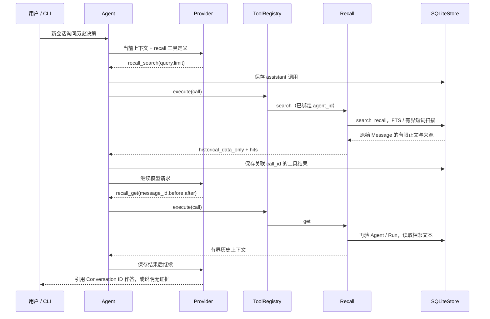

# Conversation Recall

## 职责与架构组成

Recall 是从历史中取证的只读能力，与 Core Memory 的稳定事实和编辑版本分开。SQLite messages 始终是 Conversation History 的唯一权威来源，FTS 只用于候选定位，不保存另一份可单独编辑的事实。

| 文件 | 职责 |
| --- | --- |
| `recall/models.py` | 查询、窗口参数及带来源信息的证据模型；严格限制输入 |
| `recall/service.py` | Recall 实例绑定宿主 agent_id，校验输入并限制文本和 JSON 输出 |
| `recall/tools.py` | 注册 recall_search / recall_get，领域错误转换为标准 ToolResult |
| `storage/recall.py` | 派生索引 schema、重建、参数化查询、短词扫描及 SQLite 工作预算 |
| `storage/sqlite.py` | 版本 2 迁移及搜索、展开、重建事务入口 |
| `main.py::_run_session` | 创建 Recall(sessions.store, sessions.agent.id)，注册普通对话可用的工具 |
| `core/context.py` | Base 中加入取证、来源引用、无证据时说明和低信任规则；不自动搜索 |

Agent Loop、Provider、MemoryStore 不需要识别 Recall 类型，继续通过普通工具调用循环处理结果。Recall 没有新的数据库连接、独立事实文件、后台更新任务或自动任务恢复能力。

## 为什么使用 trigram，以及中文的取舍

默认 unicode61 按字符类别划分 token，不提供中文分词；连续中文字符可能作为一个长词处理，不适合直接检索其中任意短语。FTS5 trigram 对连续三个 Unicode 字符建 token，更适合中文、英文和中英混合的字面子串。它不做语义理解、词干处理、同义词或拼音匹配。实现将整个 query 编码为一个 FTS 双引号短语，并把内部引号转义，OR、NEAR、星号等不会变成查询语法。

[SQLite 官方 trigram 文档](https://www.sqlite.org/fts5.html#the_trigram_tokenizer)说明少于三个字符的 MATCH 不会得到命中，因此这里区分两条路径：

- query 长度至少 3：FTS5 trigram 提供候选，再从 canonical messages 验证字面子串并读取 snippet；查询当前 Agent 的全部 completed / failed 文本，按创建时间和 Message ID 降序返回，排序稳定。
- query 长度 1～2：MATERIALIZED CTE 先选该 Agent 最近 2000 条符合条件的文本消息，再对每条前 65536 字符做 LIKE。百分号、下划线和反斜线按字面转义。scope_limited 为 true，即使没有命中也不能声称完整历史都不存在该信息。

英文采用 SQLite 字面匹配的 ASCII 大小写不敏感语义，中文按原文子串匹配，不承诺通用 Unicode 归一化。模型应搜索简短关键词，如 Memory，而不是把整句“我们为什么先实现 Memory”作为一个短语。可在有限的 Agent 轮数内换关键词继续查证。

本地 Python 3.13 的 SQLite 3.47.1 已验证支持 FTS5 trigram。运行环境必须提供这项编译能力；不支持时迁移失败并回滚，不能悄悄改成一个无上限全库 LIKE 扫描。迁移期间及大规模回填为同步工作。

## schema 1 → 2 与索引一致性

原迁移 1 保留不变，`MIGRATIONS[2]` 新增以下对象，并在同一初始化事务中回填历史：

- `recall_text`：以 messages.rowid 为索引内部键的 VIEW，只投影 role 为 user / assistant 的非空 text。
- `recall_fts`：FTS5 external-content 表，content 指向上述 VIEW；正文始终来自 messages。
- 三个消息触发器：INSERT 新文本、DELETE 旧 token、UPDATE 时删除旧 token 再加入新 token，与原消息修改共用事务。
- `recall_conversations_agent`：Agent 归属查找索引。

Provider JSON、encrypted reasoning、工具参数、原始 Tool Call 以及 Tool Result 都不参与索引或展开。assistant 同时包含文本与调用时只索引其 text。工具返回不会被当作新的可执行历史调用。

索引允许记录 running / cancelled / interrupted 的文本 token，但查询总是重新 JOIN canonical Conversation 与 Run，验证宿主 Agent ID，且只允许 completed / failed。这样 Run 在 finish_run() 事务提交前不可见，取消或启动恢复中断后也不可检索；无需另一套易失效的“完成状态缓存”。

新消息与索引失败一起回滚；finalize 失败不会把 running 内容暴露给 Recall。非法 JSON 在触发器解析阶段即拒绝，合法 JSON 但内部 Message 结构损坏仍由原有加载校验报告。模型输入、查询、ID 和 limit 都使用参数绑定；SQL 拼接只包含程序定义的表达式和对象名。

## 代码实际运行路径



`ContextBuilder.build()` / for_request() 不执行全库检索，也不将上次 Recall 结果编译成 Core Memory。工具结果作为当前 Conversation 正常 Run 的历史记录保存；新建另一个 Conversation 后不会自动携带这些结果。只读指不修改已有历史或权限；Runtime 对本次调用和结果的审计追加仍然存在。

## 输入、输出和执行上限

| 项目 | 当前限制 |
| --- | --- |
| query | 去除首尾空白后非空，输入不超过 120 字符 / 512 UTF-8 字节，拒绝内部控制字符 |
| 搜索 limit | 默认 5，范围 1～5，布尔值、字符串不冒充整数 |
| snippet | 最多读取命中附近 320 字符，再裁至 512 字节的 JSON 转义后文本 |
| message_id | 1～128 字符；未知、其他 Agent 或未结束 Run 的 ID 统一 recall_not_found |
| before / after | 默认各 1，范围 0～3；最多 7 条同 Conversation 的可见 user / assistant 文本，按 sequence 排序 |
| 展开文本 | 每条先读取前 8192 字符；每条输出最多 2048 转义后字节，总文本不超过 8192 转义后字节，窗口大时分摊预算 |
| 总数据输出 | 单次工具 data JSON 不超过 12288 UTF-8 字节，含来源元数据；超出则明确报错 |
| SQLite 查询工作 | 每 1000 个 VM 步骤检查，约 0.5 秒或 500 万 VM 步骤后中止并返回安全错误 |

每个证据包含 conversation_id、message_id、run_id、role、created_at、sequence、run_status，及 snippet / text 和 truncated。搜索另有 mode、scope_limited、has_more；展开标记整体 truncated。kind 为 conversation_recall，trust 为 historical_data_only。

SQLite VM 预算不是硬实时取消：同步 I/O、原生 SQL 函数或磁盘等待期间未必执行回调；数据库自身繁忙等待上限仍为 2 秒。协程包装不会使 SQLite 可及时取消，也没有把数据库连接交给不安全的后台线程。

## 安全与错误

Agent ID 由宿主绑定，模型参数中不允许提供 agent_id。search 和 get 都重新验证归属；跨 Agent 的 ID 与未知 ID 返回同一种错误。当前没有 include_incomplete 选项，无法让模型检索 running、cancelled 或 interrupted Run。

历史文本可以包含恶意指令，但它只存在于普通 ToolMessage 数据，不能改写 Base、授权 memory.update / memory.restore 或注册工具。Base 要求历史问题优先搜索、必要时展开、尽量说明会话来源、无证据时不编造；这是模型行为指引，程序仍独立执行权限校验。离线测试验证数据流和程序边界，不证明真实模型每次都选择最佳关键词或准确归纳证据。

SQL/索引异常、预算耗尽或坏的证据元数据返回 recall_unavailable；不会输出 SQL、原始查询、正文或数据库异常体。不自动重建、不自动重试，也不续跑任何历史工具操作。

## 显式重建与损坏处理

关闭 CLI 后，可在可信宿主中对指定数据库调用：

```python
from pathlib import Path
from personal_agent.storage.sqlite import SQLiteStore

with SQLiteStore(Path(".heybuddy/heybuddy.sqlite3")) as store:
    store.initialize()
    store.rebuild_recall_index()
```

这不需要模型或 API Key。rebuild_recall_index() 在一个事务中重建派生 view / FTS / triggers / lookup index，并从 messages 回填，不修改原始 Message ID、顺序、Run 或正文；失败恢复原派生对象。缺失 token 可重建，缺失 FTS 表也可重新创建。真正损坏的 SQLite 文件仍可能需要数据库备份恢复，不声称索引重建可以修复底层文件损坏。

失效索引可能使新消息触发器失败，系统会停止该次写入，修复前不绕过事务一致性。索引损坏可能产生假阴性；返回结果会再用 canonical text 核验，不接受伪造的索引正文。[SQLite VACUUM 文档](https://www.sqlite.org/lang_vacuum.html)说明手工 VACUUM 可能改变没有 INTEGER PRIMARY KEY 的表的 rowid，因此外部进行这种维护后应显式重建 Recall；公开 Message ID 不受这条内部键限制影响。

## 阅读与验证

`uv run pytest tests/test_recall_storage.py tests/test_recall_runtime.py` 覆盖旧库迁移与回填、事务回滚、新消息可见性、中文/英文/混合查询、跨会话与跨 Agent、长度与窗口限制、重启、索引损坏与重建、非法参数和注入输入。Fake Provider 模拟搜索 → 展开 → 回答，另外验证低信任历史不能授予记忆权限、结果不自动跨新会话注入、历史副作用不会重新执行。CLI 工具装配检查见 tests/test_config_cli.py。

当前没有语义检索、重排序、结果分页、长消息内分页、自动索引健康扫描、后台回填、Recall 历史摘要或 Compaction。
