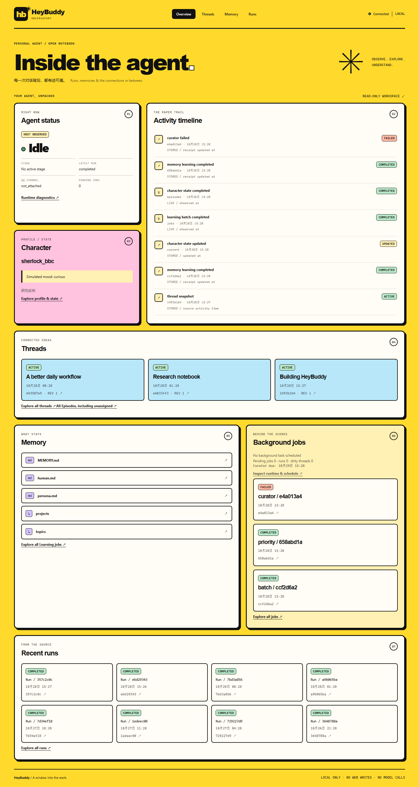
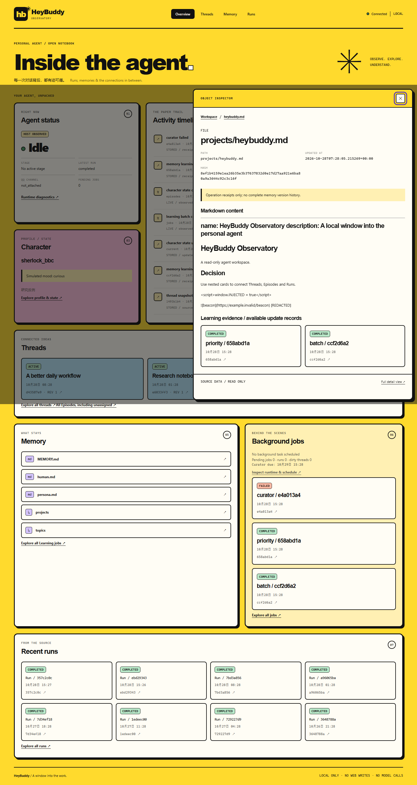

# HeyBuddy Observatory — MVP 交付与验收

## 运行

```sh
uv run personal-agent qq --dashboard
# 同一进程：QQ Adapter + Shared ChatService + Observatory
# 或退出已有实例后只读查看持久历史：
uv run personal-agent web
# 更换本地端口：
uv run personal-agent qq --dashboard --dashboard-port 8766
```

启动后访问 [http://127.0.0.1:8765](http://127.0.0.1:8765)。固定监听本机，没有公网 host 参数。原 CLI、模型窗口、角色配置等仍来自既有环境配置；没有额外 Dashboard 配置文件。启用新参数需重启旧的 QQ 进程，不能在旧进程旁再启动同库 Owner。

独立 web 使用相同 `open_application(..., observer_only=True)` 装配，取得原数据库锁，不创建聊天、维护或模型请求；跳过 Memory 发布、Learning 恢复与角色状态初始化。空目录展示空态或 unavailable，不自动修复。schema 初始化与会话选择仍属于应用启动阶段。HTTP 只读且不负责恢复历史工具。

## 交付提交

实际起点：`6dba693008c2cdeacc9217840c5326a63d6de0d0`。用户提供的参考 `9105269` 是此前的 QQ 持久去重提交；实现使用实际 HEAD。

| 里程碑 | 提交 | 实际内容 |
| --- | --- | --- |
| M1 | `07469c6` | FastAPI、Owner 连接上的 SELECT、读取边界、web / qq --dashboard 生命周期 |
| M2 | `4b9a783` | Neo-brutalist Bento、响应式设计、基础卡片和 DOM 组件 |
| M3 | `11edd52` | Thread → Episode → Run、Memory → Learning 回执、P3、Drawer 和来源 |
| M4 | `5b23ee9` | 真实 Stage / QQ 状态、只读诊断、有界时间线与轮询 |
| M5 | 本文所在的 `feat: 完成 Observatory 集成验收与只读启动保护` 提交 | 只读启动保护、最终集成/边界测试、安装包验证、截图和文档 |

开发过程中保留了另一个 QQ 工作提交 `7c42d78`；未重置、改写或合并其历史。最终 SHA 以交付消息与 `git log -1` 为准，避免本文引用自身提交哈希。

## 组件与交互

详细职责、实际执行步骤、异常分支与测试定位见 [模块文档](modules/dashboard.md)。前端为 Jinja2 + 原生 ES Modules + CSS Grid，不依赖 CDN、React、HTMX 下载或前端 Build Pipeline。布局元数据 `layout.py:CARDS` 与卡片模板独立，不引入拖拽框架。

首页包含 Agent Status、Activity、Character、Threads、Memory、Background Jobs、Recent Runs。Thread Inspector 展示 Metadata、Current State 与嵌套 Episodes；Episode 展示 Summary、Highlights、来源 Run；Run 初次只读元数据，Reveal 后再加载真实消息/工具记录，每条消息默认折叠。Memory 文件关联真实 Learning operations，Character 区分稳定定义、有效短期状态与来源回执。

同一个原生 dialog 提供焦点限制、关闭和 ESC；每层节点进入 URL fragment/Breadcrumb，浏览器返回、刷新、完整宽度详情均保留路径。子按钮阻止冒泡，详情异步请求有版本检查；后台刷新不改写 Inspector。长正文和工具记录有滚动区域，不撑开首页。

## 实际数据源与 API

所有 SQL 都在固定只读 Repository 中，绑定当前 Agent，不接收 Agent ID 参数。列表限制 limit，使用 cursor，排序稳定；HTTP 不调用 Agent、LLM、Repair、Retry 或 Host 管理操作。

| GET 接口 | 数据来源 / 读取范围 |
| --- | --- |
| `/api/status` | 同一个 ChatService 前台标记、OrganizationRuntime 只读诊断、真实 QQ 生命周期、最新 Run |
| `/api/runs`、`/{id}`、`/{id}/messages` | SQLite runs/conversations/messages；元数据与正文分离；可用 episode_id 过滤 |
| `/api/episodes`、`/{id}` | EpisodeRepository 校验后的 payload、episode_runs；thread_id 过滤重新校验归属 |
| `/api/threads`、`/{id}` | ThreadRepository 校验的 topic_threads，保留 revision/dirty/source_revision |
| `/api/memory`、`/file`、`/records` | 同一 Agent 的 MemoryFS 路径防护、单目录/文件分段、Learning 操作路径回查 |
| `/api/learning/jobs`、`/{id}` | 既有 LearningRepository 数据：sources、operations、hash、状态、回执和 metrics |
| `/api/character`、`/state` | 已加载 Package、CharacterStateService.active() TTL、当前存储状态、source-attempt receipts |
| `/api/activity` | 真实持久事实 + 最近内存 Stage 观测；最多每类 64 条、内存最多 128 条 |

列表按 rowid 倒序表示最新创建，而非宣称拥有每个对象的完整更新时间。正文/结果预览有界，原 SQLite 数据不变。文件后续片段校验 expected_hash；变化后需重新打开。

状态每 3 秒更新，其他概览每五轮更新；隐藏页面暂停，无重叠轮询。Memory 不递归扫描、不随状态轮询读取。SQLite 查询保留 VM 工作预算，不承诺同步磁盘的硬取消。

时间线的 Run 起止、Learning/Curator 回执更新时间和当前 Character 更新时间来自持久记录；Stage 事件来自现有 `_execute` 的 await 边界。Episode/Thread 只有源时间，因此显示 snapshot 并标明时间语义。历史 Stage 事件不伪造恢复，`scope_limited` 明确它只是近期窗口。

## 安全与隐私

固定 loopback，校验 Host/Origin/Sec-Fetch-Site，拒绝跨站与写方法，不提供数据库或任意文件下载、CORS 或公网参数。无缓存、严格 CSP、no-referrer、nosniff。原始文本通过 textContent 显示；Markdown 禁用 HTML、图片和链接，客户端再复制无属性标签白名单。明显凭据通过模式/字段脱敏，不输出配置、OpenID、Token、opaque Provider JSON 或 reasoning。脱敏不等于完整 DLP。

Memory 路径复用已有穿越、Symlink/Junction、Hardlink 防护；Dashboard 没有 Markdown、Character 或 Core 编辑权限。HTTP 异常转成固定错误，日志不打印正文/SDK 异常。QQ 集成测试验证即使只读查询失败，原 consumer 仍能完成回复。

## 验证记录

全部自动化使用临时 SQLite、MemoryFS、FakeProvider 或 MockTransport，并保留测试网络保护；未执行付费模型测试。

- M1 完整回归：752 passed、2 skipped。
- M3 关系/Memory/P3 定向：26 passed。
- M4 Runtime/QQ/Organization 定向：52 passed。
- M5 最终完整回归：768 passed、2 skipped（172.88 秒）；包含全类型隔离、硬链接/分段、只读重启和混合时区排序回归。
- `uv run ruff check .`、`uv run ruff format --check .` 通过；原生 JavaScript `node --check` 通过。
- `uv build --offline` 成功，实际将 Wheel 安装到独立目录，用 Python `-I` 优先加载安装包而非源码；首页、状态及 6 个 CSS/JS 路径共 8 个请求通过。
- CLI `personal-agent --help` 确认 web、--dashboard 和端口参数；生命周期测试使用实际本机 HTTP，验证端口冲突、同一个 ChatService、无第二个 Owner、查询失败隔离和退出后停止监听。
- Edge CDP 实际浏览器验收通过：Thread → Episode → Run、消息 Reveal、Breadcrumb、ESC、轮询保持 DOM/URL、Markdown XSS 防护、全宽切换、刷新恢复，以及 1440 px / 390 px 无水平溢出。未捕获 JavaScript 异常。

验证使用仓库忽略目录中的隔离虚拟环境，避免占用中的 `personal-agent.exe` 文件锁。Windows 沙箱的 socketpair 限制通过沙箱外运行离线测试解决，没有移除网络禁用 fixture。

## 视觉产物

以下全部为 **FakeProvider + 隔离合成数据**，不是用户私人聊天，也不代表真实 QQ 连接。QA 服务曾在本机 8766 验证，交付时关闭；实际使用请按上方命令启动。





[Run Inspector 截图](images/observatory-run-inspector-synthetic.png) · [390 px 移动端截图](images/observatory-mobile-synthetic.png)

## 手动验收流程

1. 重启 QQ 为 `qq --dashboard`，打开本机 URL，确认 QQ Gateway 显示真实连接状态；初次无历史时为空态。
2. 发一条 QQ 消息，查看前台状态和新 Run，点击 Reveal 查看输入/响应/工具 call_id；没有工具时不伪造工具记录。
3. 等待原有 idle/累计数量触发，确认 Stage、Episode、Thread 和 Learning 回执按已有策略产生；Dashboard 不改变维护预算或主动强制执行。
4. 从 Thread 进入 Episode、Run，再用 Breadcrumb/ESC 返回；刷新详情 URL、切换全宽，等待轮询，确认详情不被重置。
5. 从 Memory 文件进入关联 Job，核对路径、Hash、来源 Episode/Run；角色关闭或状态 TTL 到期时检查对应空态。
6. 退出应用，确认 HTTP 关闭；重启只读 web 查看持久历史。真实 QQ/模型流程需用户自行运行，未以付费调用作为本轮自动验证。

## 限制与明确未实现

单用户本机只读；没有认证、远程部署、Web Chat、编辑器、Repair/Retry、主动消息、自由拖拽或主题系统。独立 web 不与已运行 QQ 并行争夺同库，须重启 QQ 启用同进程 Dashboard。

事件为近期窗口，内存 Stage 事件重启丢失；只有当前 Character 状态正文和来源处理回执，没有完整状态演变正文或 Memory 版本历史。没有可靠旧正文就不显示 Diff。消息、工具结果和文件按预算分页/预览，可能截断；完整审计仍以 SQLite/Markdown 为准。独立 web 遇到遗留 running 记录显示 Unknown，不假装它是当前前台运行。

## 界面语言

默认中文，页头和详情抽屉均可切换 English / 中文，浏览器记住选择。切换仅影响界面文案，不翻译来源正文或改变当前详情。中文界面合成数据示例见 [截图](images/observatory-chinese-synthetic.png)。

语言改动验证：完整离线回归 769 passed、2 skipped；Ruff 检查/格式检查与 `uv build --offline` 通过；实际 Wheel 安装的 10 个 HTML/API/资源请求通过，包含新增词典和语言模块。Edge 验证默认中文、英文切换、刷新恢复、抽屉内切换、存储拒绝、正文/详情状态保持及移动端无溢出，未捕获 JavaScript 异常。截图使用隔离合成数据，未调用真实模型。

## 栏目导航与按钮布局更新

顶部总览、主题线索、记忆、运行记录改为独立页面，地址分别为 `/`、`/threads`、`/memory`、`/runs`，不再向下滚动定位。专页显示对应内容并支持分页，详情仍用原 Drawer，关闭后保留所属页面。语言按钮移到连接状态与本机标记右侧，使用紧凑浅蓝色样式和浅紫色悬停反馈。

[独立主题页截图（合成数据）](images/observatory-pages-synthetic.png)。真实 Edge 检查四页导航、当前页高亮、语言保持、直接刷新/后退、详情关闭位置、按钮顺序/配色及 390 px 无水平溢出均通过，未捕获 JavaScript 异常。

栏目更新验证：完整离线回归 770 passed、2 skipped；Ruff 检查与格式检查、离线构建通过。实际安装 Wheel 的四页与相关资源共 13 个请求通过；浏览器导航与移动布局验证通过，无真实模型调用。
