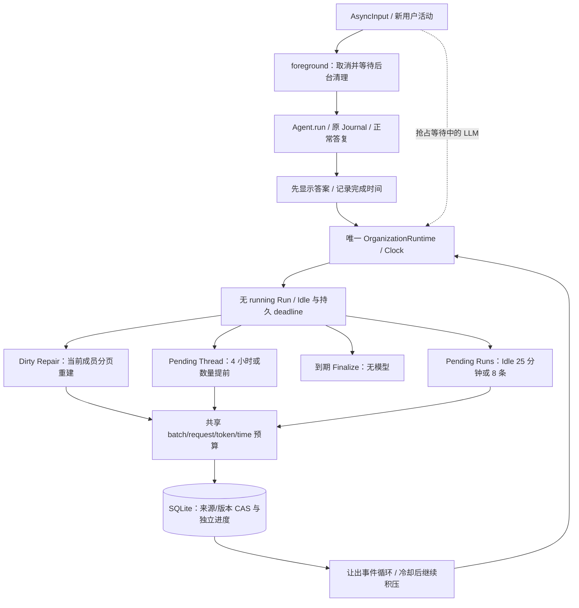

# P1 Review Fix：时间驱动、一致性与验证

## 基准与里程碑

开始时实际 HEAD 为 `4f7a6f8cf52e15d16df184c8c7eee845e58bb8a9`，main 工作区干净，与审查基准一致。确认原代码仍有 started_at Idle、单批后停止、无 Thread 周期、旧 owner dirty 无独立恢复路径及 Thread 命中遗漏未关联 Episode 等问题后实施，未重写 P1。最终 SHA 在本次交付消息及 Git HEAD 中记录，M5 为本文所在提交。

| 里程碑 | 提交 | 主要文件/方法 | 实际验证 |
| --- | --- | --- | --- |
| M1 Thread Consistency | b241b3a | models.RepairPage/ThreadRepair；storage/maintenance.CONSISTENCY_SCHEMA；ThreadRepairRepository.pending/window/publish；ThreadOrganizer.repair；ThreadRepository.publish/recover | 74 项相关离线测试，Ruff/格式、离线构建、CLI 帮助 |
| M2 Time-driven | ada7ea4 | Clock/SystemClock；ScheduleRepository.ensure/state/activity/thread_check；OrganizationRuntime.schedule/_idle_remaining/_cycle/foreground/diagnostics；Settings；main 输入路径 | 86 项相关离线测试，含 FakeClock，Ruff/格式、构建/帮助 |
| M3 Backlog & Cancellation | db8fb0f | MaintenanceBudget/CycleProvider；共享维护轮；预算 pending 分支；schema 10 持久退避/计量；Repair failure_count/retry_after | 98 项相关离线测试，40 Runs/Thread backlog/取消/重启/退避，Ruff/格式、构建/帮助 |
| M4 Timing & Retrieval | c0a7010 | EpisodeOrganizer.organize 的 started_at 边界/追加；ContextRetriever._candidates 的只读未关联候选与词法排序 | 55 项相关离线测试，长工具/午夜/短话题/跨天/两个指定检索问题，Ruff/格式、构建/帮助 |
| M5 Integration | 本提交 | OrganizerModel.ask 取消重验；ThreadRepository.publish 最终版本元数据；Finalize 独立到期；_thread_remaining/_cooldown_remaining；真实进程恢复与文档 | 最终完整结果见文末 |

## 实际运行与触发策略



| 工作 | 默认触发 | 无工作时 |
| --- | --- | --- |
| Episode | 完成/活动后 Idle 1500 秒；8 Pending Runs 可提前；不得存在 running Run | 不请求模型，不按定时器创建空 Episode |
| Finalize | 当前 provisional 的 ended_at + 10800 秒，Idle 执行；失败 Pending 不永久阻止到期 | 无已有 provisional 则跳过；不请求 LLM |
| Thread | Agent 级周期 14400 秒且有 Pending；3 Episode 可提前；在 Idle 执行 | 只推进检查时间，不请求模型，不创建空 Thread |
| Dirty Repair | 下个合适 Idle 优先，不等 4 小时、不需要新 Episode | 无 dirty/无可重试工作不请求模型；无成员则宿主明确归档 |

Idle 与分段时间分开：Idle 从正常答复完成、用户/命令活动及最新终结 Run 的 ended_at 计算；Episode 时间候选从相邻 Run.started_at 计算。10:00 输入、13:30 执行结束、14:00 新输入的分段信号为四小时，不是半小时。Duration/End Time 仍随证据提供，仅作辅助。短间隔可因语义切分，跨午夜不强制切分，远距离同主题由 Thread 关联。

首次启动从持久 UTC 时间恢复年龄/截止；进程内 Idle、Thread interval 和积压 cooldown 都转换为 monotonic 基准，防止 wall clock 前跳制造 Idle、回拨延误当前周期或下一轮积压。状态保存实际 UTC deadline，并提供 next_idle_at/next_thread_check_at 预计条件；重启仍需要宿主时钟可靠。

## Dirty Thread 的不变量与收敛

1. Episode 单一归属由一个 thread_id 表示，归属更新与批次/版本在同一 SQLite 事务内；触发器复核同 Agent，移入/移出/内容变更递增 source_revision 并失效受影响 owner。原 Journal 不变。
2. Dirty Repair 首页清空本轮工作摘要，从当前仍属于该 Thread 的 Episode 开始。旧 current_state、已移走 Episode 不进入重建输入；后续页只承接同一来源 epoch 内已提交的重建摘要。不能只用“这次移动的 A”重建仍含 B 的 X。
3. 来源按 ended_at/id 有界读取，先检查字节。中间页保存 cursor/摘要/归一化来源，保持 dirty；最终页复查 Thread revision/source_revision、job revision、当前来源页，再原子发布 clean state/新版本及全部来源引用。关联或语义来源改变会丢弃旧 scratch，重新从当前成员开始。
4. Thread X 失去全部成员时不调用模型，记录 empty_archived，写中性状态并 closed，旧正文不再注入 Context。该关闭依据是空归属，不是长时间未聊天。仅 status Finalize 不改变语义源时不额外作废有效 Thread state。
5. 来源稳定、Provider 成功且配置能容纳单页时，有限成员集会逐页推进；Idle 循环冷却后持续调用，最终 clean，不依赖未来新 Episode。真错误保留 dirty 及可重试工作；短暂失败有限指数退避，连续失败达默认三次后暂停自动付费尝试，显式 `/thread repair` 重新给出机会。不能把持续故障称为已收敛。

普通关联步骤不会把先前 dirty 或同批丢失成员的旧 state 标成 clean。版本 JSON 记录本事务关联触发器执行后的最终 source_revision/dirty，旧已提交版本不改。Repair 的 last_active_at 依据当前成员，移走最新成员时可回退，这是修正关联，不是按空闲时间完成任务。

## 闲置积压、预算与失败

一轮共享默认 4 个维护单元、4 次额外模型请求、131072 保守预留 tokens、120 秒。Dirty Repair 优先，到期/数量达标的 Thread 先获机会，再处理 Episode；每批 `await asyncio.sleep(0)`，请求前预留，整轮还有 timeout。每批仍受原 page_runs/source_bytes/input/output/JSON 限制，不全量读历史。

到限但有积压时保持来源 pending，记录轮计量和 cooldown_until，默认 60 秒后再运行，不等待用户发新消息。40 Runs、每批 8 的测试在共享请求预算为 2 时验证 16→16→8 的连续推进，无重复归档。Thread Pending 同样分轮推进；不足数量阈值的尾部仍会在周期到期获得机会。

正常 Episode/Thread 模型错误仍进入 failed，需显式 organize，不在每分钟检查反复调用。Repair 自动失败次数与指数 retry_after 跨重启保留；预算停止/用户取消不计作模型失败，不推进当前页，不消耗同源错误次数。单请求连整轮 token 上限都放不下时明确失败，不能无限冷却重发。用量未知标记 usage_complete=false，reasoning 是 output 子集，不重复计费；请求预留不是账单。

## 输入、取消和重启

CLI 输入线程只读取终端，所有 SQLite 留在事件循环。输入抵达后先置前台标志、cancel 并 await 当前后台 Task，再 Agent.run；schedule 对存活 Task 幂等。每个维护服务共享自身 asyncio.Lock，调度器单 Task 顺序调用，不并行跑两次 Organizer。

取消等待中的模型时，当前 Episode/Thread/Repair 尝试恢复 pending；已提交批次/重建页保留。finally 恢复原 Provider 并保存安全计量。即使 Provider 捕获 CancelledError 后返回，OrganizerModel.ask 仍重验 task cancellation/deadline，拒绝晚到建议。SQLite 短发布不能在中间被 asyncio 硬取消；在用户 Run 开始前 await 清理，保持顺序。

启动仍先占用数据库锁、标记遗留 Run interrupted；Episode/Thread/Repair 的 running 纯建议恢复 pending。依据 cursor、dirty、重建检查点、线程周期和 cooldown 继续，不执行/补齐/重试任何旧 ToolCall，也不盲目重复 Memory Apply。测试包含真正 os._exit 后继续 Repair 第二页，以及旧 P1 在 Episode 提交前后硬退出的回归。

## 未关联 Episode 检索

ContextRetriever 保留 lightweight 词法 fast path，没有新 LLM Planner。Thread 命中后合并该 Thread 最近 Episode 与近期未关联 Episode 的匹配候选；Title 权重 3、Summary 权重 1，结合来源时间排序，去重后仍受原 episode_limit。默认最多扫描 200 条元数据，只加载有界候选；命中不写 thread_id，不等待后台。

“继续之前 HeyBuddy 的 Memory 设计。”可命中旧 Thread，同时带入更新的未关联 Memory Episode；“我们之前讨论的那个自动整理记忆的机制，最后决定怎么做？”没有显式 Thread 名称时可由 Episode Summary 词法匹配。未知表达无证据时明确 recall_fallback，不宣称同义理解。newer_unlinked_evidence 标记旧 state 可能滞后，保留低信任、时间和来源；ContextBuilder 继续最终预算、Run/调用 ID 去重和完整 ToolCall/Result/Provider 数据重放。

## 迁移与诊断

| 新版本 | 追加内容 | 保留内容 |
| --- | --- | --- |
| 8 | topic_threads.source_revision；关联/内容失效触发器；thread_repairs、scratch/state 归一化来源 | 原 1–7 定义及全部 Journal/Summary/Reflection |
| 9 | organization_schedule：活动、周期、成功时间、冷却、最近批次/请求/安全错误 | 原独立 Episode/Thread/Reflection/Compaction cursor |
| 10 | Repair failure_count/retry_after，cycle_metrics | 原已提交版本和原始 Run/Message |

升级由 initialize() 原子顺序执行，user_version 同事务；三次新增迁移都测试失败回滚。状态命令示例：

```text
/episode status
/thread status
/episode organize
/thread organize
/thread repair
```

status 可见 pending/dirty 数量（有上限标记）、has_backlog、last success、next Idle/Thread/Finalize 条件、current_stage/maintenance_running、最近批次数/请求数、冷却、失败次数、retry_after 与错误。后台 task 等待定时器不等于正在调用模型；status 不输出私人摘要，也不发模型请求。

配置均在 .env.example：已有 Idle/数量/修订窗，加 THREAD_INTERVAL_SECONDS、CHECK_SECONDS、COOLDOWN_SECONDS、MAINTENANCE_BATCHES/REQUESTS/TOKENS/SECONDS、REPAIR_RETRY_SECONDS/MAX_FAILURES，均为 AGENT_ORGANIZATION_ 前缀并有 Pydantic 上限。原 MemoryAutomation 独立最多四次和审批/精确授权/失败显式 retry 不改，未混入本轮维护预算。

## 验证与限制

新增 tests/test_thread_repair.py、test_organization_schedule.py、test_organization_backlog.py、test_review_timing_retrieval.py、test_review_integration.py；复用 tests/conftest.py 的离线保护、FakeProvider、FakeClock 和临时隔离 SQLite，不等待真实 25 分钟/4 小时。覆盖移动/No Thread/空 owner/分页/冲突、时间跳跃、重复 schedule、40 Runs/Thread backlog、预算/失败/取消/重启、长工具/午夜/短话题/跨天、两个指定检索问题和完整上下文契约。

最终实际验证：

| 命令/检查 | 结果 |
| --- | --- |
| `uv run pytest --basetemp=.heybuddy/review-delivery-final` | 548 collected；547 passed、1 skipped；108.56 秒。跳过项为 OS 不允许创建 Symlink，Windows Junction 测试通过 |
| `uv run ruff check .` | All checks passed |
| `uv run ruff format --check .` | 135 files already formatted |
| `uv build --offline` | sdist 与 wheel 构建成功，发行号保留 0.7.2 |
| `uv run personal-agent --help` | 成功，未加载真实聊天/调用 Provider |
| `uv run python -m personal_agent.evaluation.p1 --help` | 成功，仅帮助，不含 `--live` |
| 与基线比较迁移 AST | sqlite.MIGRATIONS 的 1–7 项及各模块原 SCHEMA/INDEX_SCHEMA 完全相同 |
| Review/模块文档链接检查 | 29 个本地链接可解析 |

Windows 沙箱内 asyncio 测试会挂起，最终回归使用获准的沙箱外进程执行；pytest 保留 tests/conftest.py 禁网保护。默认系统临时目录存在权限限制，因此只将 basetemp 指向仓库忽略的 .heybuddy，无更改测试行为。未执行任何真实 LLM --live smoke，未产生 API 费用，Fake 成功不代表真实语义质量。没有读取真实 .env 正文，没有使用私人数据库作样本。

仍有边界：仅本地进程存活时维护；同步磁盘非硬取消；跨重启时钟恢复依赖可靠 UTC；巨大单页需调整可信预算；有限重建摘要有损；词法检索可能漏掉同义词/深历史；连续故障达上限需显式重试。runs.rowid cursor 仍依赖应用只追加 Journal，不提供外部重排/任意数据库维护后的修复工具。没有 P2 Learning、Curator、向量库、Persona 或通用 Scheduler。Worthiness 阴性推进 reflection_progress 的旧语义仍未改。

## P2 推荐接入边界（尚未实现）

复用 Clock、前台门控、MaintenanceBudget、冷却/诊断和“一个有界步骤”的执行方式；P2 应提供独立的 Sleep-style Learning Service/来源快照/学习 cursor，返回明确 report（completed、pending、failed、budget_exhausted），由宿主按 Idle 调用。不要把本轮私有 `_cycle()` 当作任意任务插件注册器，不把 Episode/Thread 的 dirty 或 Reflection 进度复用成学习进度。

学习来源必须展开验证原始 Run/精确引文；Episode/Thread Summary 只是索引和理解。继续复用 MemoryFS 的路径/隐私/hash/原子发布、Reflection 的计划/可信审批/Apply/reconcile，Memory 权限不能由模型或调度器自授。后续若增加学习服务，再显式设计阶段预算、公平性、失败退避和跨存储不确定窗口；本轮没有接入长期 Memory 写入。
