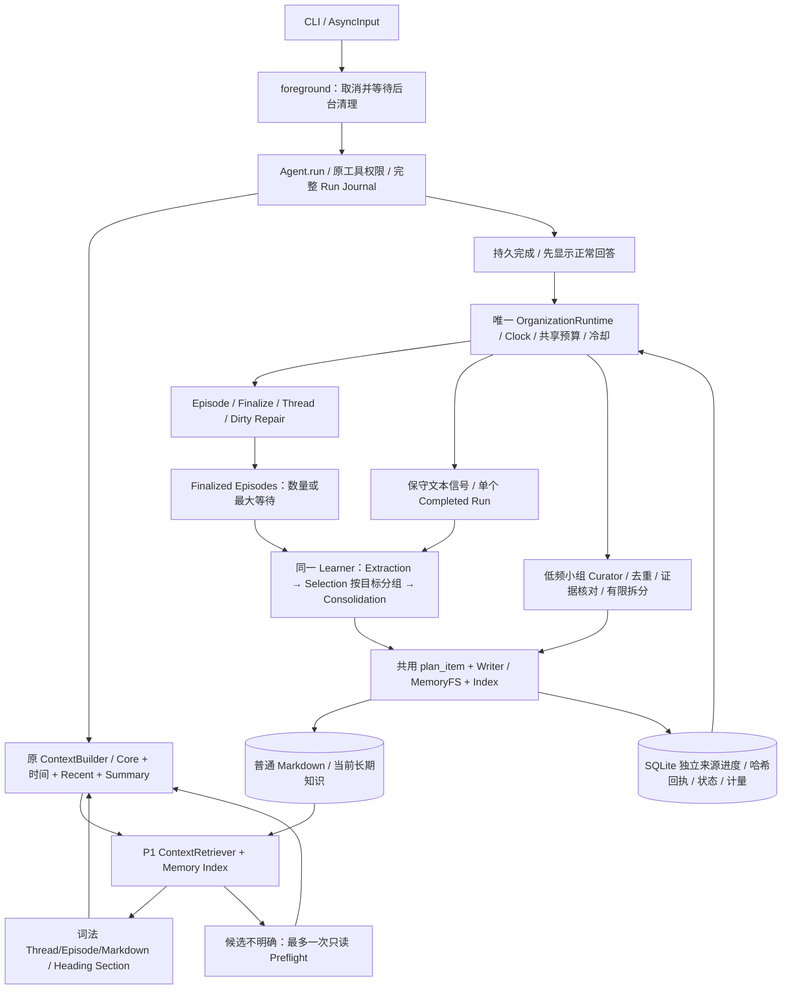

# P2 Long-term Memory：交付与验证

## 基准、提交与实际模块

开始时 HEAD 为 `9574de630c9c88cf05a2ddb13f340212e17e99b4`，工作区干净。先检查当前实现与 P1 Review Fix 报告，再按五个里程碑实现；没有重做 P1、重排旧 Journal 或迁移现有 Markdown。最终 SHA 为本文所在提交，完整值见交付消息及 `git rev-parse HEAD`。

| 里程碑 | 提交 | 新增/主要修改 | 实际检查 |
| --- | --- | --- | --- |
| M1 Learning Core | 1a3305f | learning/models、service 的 propose/learn/_verify/_execute；storage/learning 的 snapshot/create/save/recover；reflection/writer；schema 11 | 96 项相关离线测试、Ruff、格式 |
| M2 Automation | e508ca8 | activate/harvest_priority/pending_episodes；learn_priority/learn_batch；Runtime 共享维护轮；Settings、Host CLI 装配 | 112 项相关测试；最终门控 21 项，Ruff、格式 |
| M3 Curator | d6ac715 | learning/curator 的 due/run/_validate；共享 publication/reconcile/retry_job；Curator 配置/入口 | 95 项相关测试、Ruff、格式 |
| M4 Retrieval | 4e45aa8 | memory/retrieval 的 catalogue/rank/read；ContextRetriever.retrieve/preflight；ContextBuilder 异步可选检索和最终预算 | 101 项相关测试、Ruff、格式 |
| M5 Integration | 本提交 | 两个多天案例、真实退出恢复、迁移回滚、CLI 装配、边界和计量；持续 Dirty/学习公平性及文档 | 最终结果见文末 |

## 实际架构



Main Agent、Learner、Curator、Preflight 复用 Provider Protocol；没有独立 Agent Tool Loop 或通用 Job Scheduler。SQLite 不保存新事实表、实体关系、向量、知识版本或 Markdown 正文副本。schema 11 只有任务、来源处理记录和 Agent 级水位/维护时间三张表，原 1–10 定义保持不变。

## Reflection 与 MemoryFS 复用

Learner 复用 `ReflectionService._ask()` 的空工具、预算、输出 JSON、凭据过滤、超时及 Provider 错误路径；通过 `_evidence()` 和 `_verify()` 核实真实消息与精确引文。Selection 复用 catalogue/read_comparison，Consolidation 复用 plan_item 的路径、Frontmatter、唯一精确 old_text、expected_hash、容量及主题冲突验证。写入与只读核对抽到 reflection/writer.py，原手动 Reflection 也调用同一实现，原审批、计划与历史记录继续工作。

P2 Host 策略显式授权自动更新 human.md 和受限 topic；persona.md、索引直接编辑及整文件删除被拒绝。索引只由原 index.create/edit 维护。所有自动提案在准备文件回执前验证凭据模式，无法确认的候选进入 review/no-op，不强行写入。P2 不向 ToolRegistry 增加通用写权限，普通聊天、历史命令、Memory 和工具输出不能升级当前 Run 权限。Main Agent 仍需原 `/memory edit` 的逐 Run 授权。

## 来源、分组与幂等

`snapshot()` 绑定当前 Agent，按真实 Conversation JOIN 已完成 Run，先查数量/字节再加载完整内部消息。Batch 优先 finalized Episodes，Episode Summary/Highlights 只是定位提示，不能作为用户确认事实。请求保留真实 started_at/ended_at 及独立 as_of 处理时间，避免把“下周”等相对说法当作处理日的新安排。每条 Candidate 的引用必须存在于实际提供的 Run 范围，并匹配脱敏后精确文本；confirmed 至少有用户证据，Assistant 建议或 Tool 单独引文不足以确认用户事实。跨 Conversation 以 `(conversation_id, run_id, sequence)` 验证，而不是假设一个流。

先直接 Extraction，空候选合法，不强制 Worthiness。Selection 完整覆盖候选并按目标分组；同一目标最多一次 Consolidation/写入，候选按真实来源时间顺序提供。明确较新修正应替换旧当前状态，重复应 no-op；失效阶段仍可从原 Run/Episode 检索。Host 能证明来源、范围和写入边界，不能证明模型的每个语义判断正确。

独立 source 记录区分 Priority Run 与 Batch Episode/revision。Priority 完成不会跳过整个 Episode；Batch 仍提供同 Episode 的其他 Run，并读取当前 Markdown，由 Consolidation 再判重复。同一来源任务完成、空提取或全 no-op 都不会再次自动调用。显式调用的重叠来源范围会拒绝，不能悄悄漏处理新来源。

首次启用记录当前 Run/Episode rowid 水位，自动只学习其后的来源；新 Episode 若含旧 Run，也不静默再学习水位前 Run。记录迁移水位不改变旧数据。没有新增历史全量重学命令，手动 Reflection 仍可调试旧来源。外部重排/VACUUM 改变 rowid 后的维护工具仍未提供，应用 Journal 采用只追加约束。

## 自动调度、预算与故障隔离

| 阶段 | 默认行为 |
| --- | --- |
| Priority | 记住/偏好/正式决定/明确更正等保守信号；每次有界扫描 16 个新 Run 的首条用户文本；回复后后台尽快执行，不发 Classifier |
| Batch | Idle 时，3 个 Finalized Episodes 或最早来源等待 21600 秒；单 Episode 不会永久等待凑数 |
| Curator | Idle 且到期，累计 12 次更新或选中文件超过 12000 字节；默认 86400 秒检查；无变化不请求模型 |
| 共享轮 | 默认 4 维护单元、4 请求、131072 保守预留 tokens、120 秒；每批让出，60 秒冷却后继续 |

Learning 每轮至多一个流水线，开始付费提取前为完整流水线保守留出预算；默认两目标最多四请求，避免每轮只提取后预算耗尽又重来。预算配置不能容纳时显示 learning_budget_config，保留 pending 且零模型请求。每阶段原始字节、候选数、文件数、JSON 响应、模型输出和超时另有限制。

学习与其他维护交替获得优先机会；Dirty 首先处理，但持续分页后会让出完整预算轮给等待中的学习，避免占满请求导致饥饿。Curator 在没有学习竞争或交替轮有机会执行。P1 组织开关不会给 Memory 模型授予权限，也不要求另起后台循环。正常 Run 活跃时不维护，输入先 cancel+await 清理，再开始 Agent。

失败没有无限付费重试。过大/不可读来源保存 failed，不让一个 P2 来源阻止 P1 维护；人工调大可信预算后可显式 retry。模型失败保留安全错误，取消前若未准备文件回执恢复 pending。Provider 即使吞掉 CancelledError，返回后仍检查 cancellation/deadline，不能提交晚到建议。

P2 enabled 时旧 MemoryAutomation 不自动消费同一批新 Run，`/memory automation` 提示已接管；旧计划、精确 grants、审批和历史状态保留。P2 disabled 才恢复旧 Automation 设置；手动 `/reflect` 始终可用。关闭自动学习不删除已有记忆，Retrieval 开关独立。

## 文件与 SQLite 不一致时恢复

首个文件写入前持久保存路径、前/后 hash、状态和索引问题，不保存 new_text 或 Candidate 正文。每个短本地写入与记账都同步完成，不交给超时后继续跑的线程。多文件之间让出事件循环，前台可抢占；已发布文件不因后续失败撤销。

重启：无回执的 processing → pending；有回执 → requires_reconciliation。存在未核对任务时，自动 Learner/Curator 暂停，避免新写入改变核对依据。`reconcile` 只读比较 after_hash、索引可发现性及生成条目维护状态，全部核实才完成。无法核实时保留不确定，不能自动重发 CREATE/UPDATE。

过长 topic 单独选择并留出目标名额；Split 先保存新 topic 并确保索引完整，再整理旧文件。目标若因主题冲突降为 review，整个拆分在首写前停止，不能只执行来源移除。索引失败时两处都保留原知识，不报告整体成功；可用原 `/memory repair` 补链。`retry <job_id>` 仅在逐项证明“after 已保存且索引完成”或“before 尚未改变”后允许重新规划，保留核对回执；第三种内容 hash 拒绝。重规划先读当前文件，不重发旧 CREATE。外部编辑器不参与锁，最后检查与 replace 的竞争窗口及同步 I/O 限制仍存在。

## Curator 的保守边界

每次最多三个相关文件，默认最近修改 topic 作锚点，并提供有界真实来源用于状态核对。Curator 任务保存实际 Run ID/hash 并在发布前复查，但不占用 Priority/Batch 的来源处理记录。去重/结构整理校验被替换事实行在最终文件集合中仍保留；无法逐字保留的语义更正必须有明确用户引文。长期稳定偏好不按年龄删除，未解决冲突可 no-op。有限拆分必须复制真实唯一段落并链接目标，不支持自由跨库重写或整文件删除。已处理内容 hash 未变时直接跳过请求。

这种保守策略会拒绝部分合法的自由改写，且小组选择可能遗漏深层跨文件重复；这是第一版有意保留的能力边界，不宣称完成任意语义压缩。

## Retrieval 与三层 Context

Always-on：原 Base/精简 Core/时间/近期 Run/Working Summary。Retrieved：原 Thread/Episode/完整 Raw Run，加上索引发现的相关 Markdown；长文件选择完整 Heading Section。On-demand：Main Agent 继续 Recall 与 MemoryFS Read，缺少记录时明确不足。

短接话 fast，不扫描 Memory 或发额外模型请求。明确依赖历史/个人记忆才查索引；可信词法候选直接用，否则从最多 12 个 Memory/Thread/Episode 候选中做最多一次有界只读选择。Host 拒绝未知 ID/路径并重新校验 Agent 归属。失败退化 Core+Recent，Recall Tools 保留。ContextBuilder 最终决定可选预算、完整 ToolCall/Result、Run/call_id 与 Memory path/section hash 去重；新输入始终保留。相同 Thread state 已被 Markdown 完整覆盖时省略重复 state，部分语义重叠不能保证完全消除。

引用带路径/章节/hash/时间，文件 mtime 不当作事实确认时间。历史低信任 user JSON 不变成 System。没有固定规定 Memory/Thread/Episode 某层永远正确；最新明确用户证据与必要原文核查决定冲突。状态显示 fast/lexical/llm_preflight/recall_fallback、实际注入文件数、token 估算、预算省略、额外请求和阶段耗时。

## 配置与 CLI

`.env.example` 的 AGENT_MEMORY_LEARNING_ENABLED/BATCH_EPISODES/MAX_WAIT_SECONDS、PRIORITY_ENABLED、CURATOR_ENABLED/INTERVAL_SECONDS、RETRIEVAL_ENABLED/LLM_PREFLIGHT 均按 Settings 映射，另有输入/输出/超时/来源字节/文件数上限。默认启用 P2 与可选 Preflight，不是每条消息都会额外付费；本次开发验证未运行真实 API。

```text
/memory learning status
/memory learning run
/memory learning retry
/memory learning reconcile <job_id>
/memory learning retry <job_id>
/memory curator status
/memory curator run
/memory curator retry
/context status
```

status 提供 counts、最多八个需关注任务 ID、最近成功、pending Episode 数、最大等待条件、运行状态、更新次数、分阶段安全 usage 和维护轮计量；不打印私人候选/正文。debug run/retry 使用整轮 timeout 和共享额度，不是新的逐条审批界面。

## 测试、构建与尚未验证部分

新增 tests/test_learning.py、test_learning_runtime.py、test_curator.py、test_memory_retrieval.py、test_p2_integration.py、test_p2_recovery.py、test_p2_boundaries.py、test_p2_cli.py，使用 FakeProvider/FakeClock、隔离合成 SQLite/Memory。保留 tests/conftest.py 的禁网保护，不等待真实数小时，不使用私人数据库、Memory 或真实凭据。

多天实习案例验证“准备→面试→Offer”替换当前状态，原八条 Journal 消息仍在，Recall 可找回旧过程；HeyBuddy 案例验证 Episode/Thread/MemoryFS 决定归入同一项目文件，未来 Main Agent 请求实际携带相关 Markdown。真实子进程分别在模型阶段、文件发布后 os._exit，重启从持久状态继续或核对，不重复写入。另覆盖 schema 10→11 原子回滚/成功保留、跨 Conversation/Agent、工具注入、假设/未接受建议、凭据、人工编辑冲突、预算/失败/取消和 CLI 实际装配。

最终实际验证：

| 检查 | 实际结果 |
| --- | --- |
| `uv run pytest --basetemp=.heybuddy/p2-final-acceptance` | 612 collected；611 passed、1 skipped，136.62 秒。跳过项为 Windows OS 不允许创建 Symlink；Junction 测试通过 |
| `uv run ruff check .` | All checks passed |
| `uv run ruff format --check .` | 154 files already formatted |
| `uv build --offline` | sdist 与 wheel 构建成功 |
| `uv run personal-agent --help` | P2 CLI 启动帮助成功 |
| `uv run python -m personal_agent.evaluation.p1 --help` | 原评测帮助入口兼容，仅帮助，无 `--live` |
| 与基线比较迁移 AST/原 schema | 1–10 定义保持不变，maintenance.py 原迁移定义一致 |
| 本地文档链接检查 | 64 个链接可解析 |

Windows 沙箱内 asyncio 测试会挂起，使用获准的沙箱外测试进程；默认系统临时目录权限受限，沿用 `.heybuddy` basetemp，pytest 禁网不变。sdist/wheel 仍使用发行号 0.7.2，不改变旧配置文件或用户 Markdown 布局。

没有运行收费 Live Smoke，合成语义脚本仅证明执行链与 Host 契约，不证明真实模型提取、更新和召回质量。凭据模式过滤不是完备秘密识别器；Host 引文校验不等于语义蕴含证明。当前仅进程存活时维护；来源/大章节超限会明确失败或省略，需可信预算或按需工具读取；有限摘要有损、词法索引有漏召回，Preflight 只会选择有界候选。并发外部编辑及断电保证沿用 MemoryFS 原有限制。未新增 P3 Persona Evolution、向量数据库、知识图谱、消息平台或通用任务框架。
