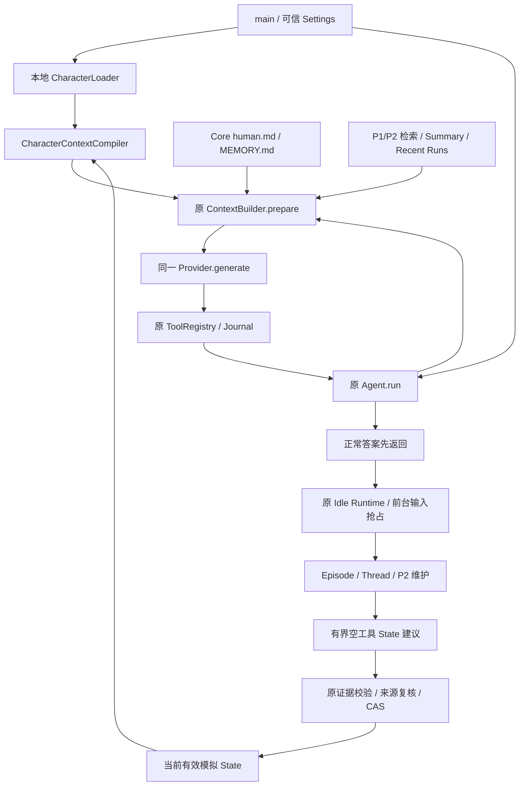

# P3 Character Persona & Behavior

## 范围与基准

初始 HEAD 为 `77674b61feb749b2050317df776d1ebf6af71bf8`，比任务中的参考 d6ac715 更新，包含完整 P2。P3 仅实现被动交互：本地 Character Package、同一 Main Agent 的情境化人格、短期状态和真实关系记忆利用；不主动发消息，不实现 AttentionEngine 或主动聊天调度。

## 包与参考

启用方式：`.env` 中显式设置 `AGENT_CHARACTER_ID=sherlock_bbc`；默认 none 保持 P2 普通模式。可选 AGENT_CHARACTER_ROOT 只指定可信本地目录。MAX_FILE_BYTES 默认 16384、MAX_CONTEXT_BYTES 默认 24576、CONTEXTUAL_BYTES 默认 6144，分别限制包文件、完整角色层与可选材料；最终仍服从整个 ContextBudget，不能靠角色预算扩大模型窗口。基础人格超限直接配置错误，关键内容不静默截断。

实际注入顺序：Host System → Character Identity/Behavior System → 去掉旧 persona 身份的 Core 数据 → Working Summary/当前时间 → 有界 Lore/短期状态参考 → P1/P2 可选检索 → 近期与当前 Run。角色始终是同一 Agent.run() 的条件，不新增角色 Loop 或逐轮额外模型。旧 persona.md 保留原位，只有角色启用时的注入视图不含它；human.md、MEMORY.md、MemoryFS 工具和 P2 权限不改。角色包不是 P2 Writer 目标。

包格式和实际读取路径见 [Character 模块](modules/character.md)。sherlock_bbc 的四份 Markdown 是原创适配，选择剧版中后期已开始珍视友谊、仍然自负与情感表达笨拙的方向。年龄约三十多岁是创作基线，不是推断演员年龄或声称剧集明确给定。用户不映射为 Watson；虚构 Lore 与真实共同经历分开。

背景核对采用剧集发行方的 [PBS 剧版简介](https://www.pbs.org/show/sherlock/)、[A Study in Pink](https://www.pbs.org/wgbh/masterpiece/shows/sherlock/episodes/s1-e1/)、[The Sign of Three](https://www.pbs.org/wgbh/masterpiece/shows/sherlock/episodes/s3-e2/)、[The Final Problem](https://www.pbs.org/wgbh/masterpiece/shows/sherlock/episodes/s4-e3/)。只取简要背景关系，不复制对白。人物的内在动机与 Companion 适配是此项目的设计解释，不是剧集事实清单。

情境化行为受 [Mischel & Shoda 的 CAPS 原论文](https://psychology.columbia.edu/sites/psychology.columbia.edu/files/2016-11/246.pdf) 启发：稳定人格可以通过不同情境下的不同反应体现。工程中用 Markdown Behavioral Signatures 表达，不编写心理规则引擎，也不宣称模拟完整心理学系统。评测参考 [InCharacter](https://aclanthology.org/2024.acl-long.102/) 的访谈方向和 [CharacterBench](https://arxiv.org/abs/2412.11912) 的多维一致性方向；后续离线样本只验证本地契约，不复制这些 Benchmark 或声称真实角色一致性已经得到证明。

人格和情绪状态是行为模拟，不意味着模型有真实情绪、意识或线下经历。BBC Sherlock 是开发参考人物，不意味着影视特有视觉、对白等内容可未经授权商业化分发。

## Character State 生命周期

实际状态与存储链路见 [State 模块](modules/character-state.md)。schema 12 追加 character_runs、character_states、character_state_sources：Host 标签记录实际角色归属，状态只保存一个当前有界模拟值，来源回执避免重付费。角色与包 hash 隔离；旧未标记 Run 不被默认为 Sherlock 经历。CharacterContextCompiler 读取状态视图，而不是把状态写回 Character Core、persona.md 或 P2 Memory。

即时反应由 Main Agent 在 Recent Runs 中自然延续；后台只针对新/修订 Episode 的本角色真实来源，在 Idle、速率与共享预算允许时作一次建议。默认 900 秒最小间隔，一小时 Mood 归于中性，三小时 Focus 失效；从所引事件时间计算，旧反例不能因晚处理被重新激活。no-op、失败、取消和处理完成分别保存，状态和 completed 回执原子提交，CAS 拒绝晚到结果。

状态模型没有好感度、亲密度分数、情绪向量或心理需求系统；输出 reason 只是有界可观察事件说明，不保存内部独白。包内容变化会使旧状态失效。/character status|run|retry 提供开发者入口，没有角色切换 UI；关闭 State 不影响角色核心，也不发送主动消息。

状态请求单独计量，默认最多一条维护请求/轮、24576 输入估算 tokens、2048 输出 tokens、4096 JSON 字节和20秒；连同 Episode/Thread/Learning/Curator 共用维护轮上限。P2 获得完整流水线预算轮时 P3 等待，角色状态不能使自动记忆长期饥饿。无新事件或来源已过期不付费判断。默认角色 none 下没有状态请求。

## Behavioral Signatures 与 Implicit Appraisal

P2 human.md 中的互动偏好与明确纠正继续进入当前请求，角色包和 persona.md 不由 Learner 修改。真实 Run 由 Host 标记角色归属，当前/近期/检索窗口最多 32 个 Run 标签作为低信任引用提供：同角色可按证据描述共同经历，其他角色或未标记历史必须中性转述。Canon、示例与模拟心境不能当作用户事实。P2 语义文件仍按 Agent 共享，没有逐事实角色参与证明，因此这不是完全安全的多角色关系迁移；具体链路与测试见 [Character 关系引用](modules/character.md)。

behavior.md 的十二组情境签名分别覆盖证据挑战、失败与关心、无聊日常、科研新奇、代码/工具证据、自身错误、成果认可、熟悉用户的交流偏好、严肃简洁、不确定模式、Canon 与真实关系边界、任务结束与沉默。每组包含情境、角色解释、反应倾向、可观察行为及调节条件，是 LLM 在当前证据中采用的倾向，不是 Python if/else 人格规则引擎。

examples.md 提供十四段原创示例，含反证、承认错误、工具真实失败、现实感官边界和经过真实检索才成立的共同经历。每轮最多选择两段；示例的 Context 是虚构演示条件，不能当作当前用户实际历史。Compiler 对示例做有界词面选择，对行为签名整体编译；人格因此在正常决策前影响关注点，不另做通用答案后的风格改写。

Agent.run/ContextBuilder.prepare/Provider.generate/ToolRegistry/Journal 路径不变。没有额外 Appraisal、内部独白、认知 JSON、答案重写或 Persona Critic 调用。tests/test_character_behavior.py 的情境样本证明每次主请求实际携带完整签名和少量示例，且无额外请求；恶意角色文本提出未知工具仍被 Registry 拒绝。这些是工程契约验证，不代表 FakeProvider 已证明自然语言中的角色品质。

## 总体架构与完整执行路径



1. main.main() 原入口锁定数据库并执行顺序迁移；_run_session() 按 Settings 选择 none 或加载本地包，将编译器挂到 SessionManager。只从可信配置读取角色 ID，不接受历史消息修改。
2. 同一个 Agent.run() 调用 ContextBuilder.begin()，原用户 Run 创建后由 record_run() 通知宿主保存角色归属。Provider、History Protocol、工具注册和单响应顺序执行不变。归属标签失败时诊断显示错误，该 Run 不作该角色状态来源。
3. prepare() 沿原路径有界读取并检索 P1/P2，for_request() 编译角色身份、完整行为签名、相关示例；读取最新 Core 时只过滤 persona.md 的注入视图。所有字符层、JSON、工具、Provider 数据共同计入最终上下文，不可压缩时明确停止。
4. Main Provider 在同一生成内结合人格、当前事件、真实历史和有效 State 形成回答/工具决定。没有每轮 Appraisal 调用。P2 原有可选检索 Preflight 仍按原条件单独计量，不能把它误算成 P3 认知调用。
5. 正常答案完成后原 Runtime 继续 P1/P2 维护；只有 Idle、新/修订且真实本角色来源的 Episode、间隔与共享预算允许时才作一次状态建议。新前台输入取消等待；后台状态服务从不返回聊天消息到 UI。
6. StateService 通过 Reflection 原来源校验，重新核对 Episode revision、Run hash、实际角色与事件时间，再以旧状态 revision CAS 原子提交当前状态和已处理回执。失败显式 retry，取消保存 pending；重启恢复 pending，绝不重放工具。
7. 下一次请求读取状态的有效视图。期限从所引事件而非处理时刻起算，过期回到基线；静态人格、P2 文件、原始 Journal 从未被状态更新改写。

## 本地包格式与配置

```text
<trusted-root>/sherlock_bbc/
  character.md  # Identity / Core Personality / Flaws & Contradictions / Character Adaptation
  behavior.md   # 至少两组 ## 情境签名
  examples.md   # 至少两条 ## 原创示例
  lore.md       # 至少一个 ## 背景章节
```

内置路径为 src/personal_agent/character/packages/sherlock_bbc，四个文件随 wheel/sdist 发布。包只读、无 Python 插件、无在线下载；ID 不接受路径。Loader 检查每层 Symlink/Junction/reparse、文件大小、UTF-8、空/重复章节并生成内容 hash。包在启动时读取，修改后重启生效；hash 变化使旧短期状态失效，真实同角色 Run 参与记录仍可作为关系引用。

| 配置 | 默认与作用 |
| --- | --- |
| AGENT_CHARACTER_ID | none；sherlock_bbc 显式启用 |
| AGENT_CHARACTER_ROOT | 未设置时使用内置包，设置时为可信本地根 |
| AGENT_CHARACTER_VARIANT | E2；E0 Profile，E1 加行为/示例，E2 加状态 |
| AGENT_CHARACTER_MAX_FILE_BYTES | 16384 / 单文件 |
| AGENT_CHARACTER_MAX_CONTEXT_BYTES | 24576 / 完整角色层 UTF-8 JSON 字节 |
| AGENT_CHARACTER_CONTEXTUAL_BYTES | 6144 / Lore、状态、来源标签可选材料 |
| AGENT_CHARACTER_EXAMPLE_COUNT / LORE_SECTIONS | 2 / 2，整段选择，不截断人格 |
| AGENT_CHARACTER_STATE_ENABLED | true，仅启用角色且 E2 时有效 |
| AGENT_CHARACTER_STATE_MOOD_SECONDS / FOCUS_SECONDS | 3600 / 10800 |
| AGENT_CHARACTER_STATE_MIN_INTERVAL_SECONDS | 900，处理请求限流 |
| AGENT_CHARACTER_STATE_INPUT_TOKENS / OUTPUT_TOKENS | 24576 / 2048 |
| AGENT_CHARACTER_STATE_TIMEOUT_SECONDS / SOURCE_BYTES | 20 / 32768 |

复用已有可信模型/Key/实际窗口配置，在已有 `.env` 设置 AGENT_CHARACTER_ID=sherlock_bbc 后运行 `uv run personal-agent`。可用 `/context status` 查看角色预算、`/character status|run|retry` 调试一个状态来源。设置 none 恢复普通模式；STATE_ENABLED=false 仅关闭状态更新。没有 Character Picker/Marketplace，也不自动编辑用户 `.env`。

上下文最大值以 UTF-8 字节校验，Provider 窗口按原估算 tokens 预算，两者不可混淆；估算不是精确 tokenizer。静态关键内容超 own cap 报配置错误，可选材料整段省略，总窗口不足返回 context_error。每个请求注入角色是非零成本，即使没有额外 LLM 调用。State 维护单列 character_state usage，整轮仍受默认 4 批/4 请求/131072 预留 tokens/120 秒限制；P2 优先轮预留完整学习流程，P3 不能长期抢占。

## 离线评测与审阅

执行 `uv run python -m personal_agent.evaluation.character` 可离线重现 E0/E1/E2；完整实现、七维 rubric 和可选显式付费命令见 [Character Evaluation](modules/character-evaluation.md)。13 场景覆盖闲聊、无聊、研究、无证据结论、反驳、自我纠错、挫折、共同项目、工具 Review、严肃语气、跨 Episode/Thread、Canon 边界和 20 轮漂移。原始合成请求和各组报告保存在忽略目录，不提交正文。

相同模型、工具、固定前文、检索结果、时间与状态来源夹具用 condition_hash 配对。E2 使用动态夹具验证注入/失效，真实状态更新质量和维护费用不在该夹具估计中。六个语义维度保留待人工 0–3 分，Cost & Latency 单列实测；不能从 Fake 输出得出 Sherlock 一致性收益，也不把 E2 默认解释为实验优胜。未来真实实验应盲评、重复与保留 Holdout，避免按分数改题。

## 验证、文件与里程碑

最终全量 `uv run pytest --basetemp=.heybuddy/p3-final-all -q`：667 passed、2 skipped，125.70 秒。跳过是 Windows 环境下 Symlink 权限限制，Junction 隔离测试保留并通过。`uv run ruff check .`、`uv run ruff format --check .`、`uv build --offline`、普通 CLI 与评测 CLI --help 均通过；已核对旧迁移 1–11 的 AST/引用源文件不变，以及 wheel 内四个 Markdown 资源与源码一致。

实际离线评测为 E0/E1/E2 各 13 场景、32 回答、33 次 Fake 请求（工具场景两次），总 99 次；没有真实 API 请求。各组输入估算分别为 436276、679731、687907 tokens，仅为当前估算器对合成窗口的读数，不是账单或 tokenizer 真值。无正文的 [离线结果](p3-offline-results.json) 保留用量估算、包/语料 hash、机械通过与待审阅语义维度；Fake 延迟不能代表真实模型延迟。

初始 SHA：77674b61feb749b2050317df776d1ebf6af71bf8。最终 SHA 见交付回复及本报告所在 M6 提交（`git log -1 --format=%H`），避免文档对自身提交 hash 的循环引用。

| 里程碑 | 提交 | 已实现 |
| --- | --- | --- |
| M1 Character Foundation | 013dba1 | 安全本地包、完整 Sherlock 适配、加载测试、wheel 资源 |
| M2 Main Integration | 3f62544 | Host/角色顺序、Core 兼容、CLI/配置、总预算 |
| M3 Behavioral Signatures | 0ea7d56 | 12 组签名、14 示例、隐式 Appraisal、真实工具边界 |
| M4 State Lifecycle | 7e518c5 | schema 12、来源校验、Idle 共享预算、衰减/CAS/恢复 |
| M5 Relationship Integration | de4db4c | P2 偏好/纠正、Run 角色参与、Canon 隔离 |
| M6 Evaluation & Documentation | 本报告所在提交 | 13 场景/20 轮、E0/E1/E2、七维审阅、完整回归 |

主要源码新增 character/{models,loader,context,state,storage}.py、四份包 Markdown、core/character.py、evaluation/{character,character_cases}.py；修改 config.py、core/context.py、sessions.py、main.py、organization/runtime.py、storage/sqlite.py、learning/service.py。无依赖变化，uv.lock 不变。

测试新增 tests/test_character_{loader,context,behavior,state,storage,relationship,evaluation}.py。文档新增本报告与 docs/modules/{character,character-state,character-evaluation}.md，更新 README、.env.example、AGENTS.md 和相关 Context/Config/Storage/Learning/Evaluation 模块说明。精确清单可用 `git diff --name-only 77674b6 HEAD` 查看。

验证使用合成临时 SQLite/Memory、FakeClock/FakeProvider，网络禁用保护保留；没有真实 Key/API 费用。覆盖包路径/Junction/字节、普通/角色模式、旧 persona 磁盘保留、多轮工具身份、预算失败、来源与跨角色、时间回拨/过期、no-op/去重、取消/重启、CAS/事务回滚、真实 P2 偏好纠正和无主动消息。最终命令与结果记录在交付回复。

## 已知限制与后续接口

角色表现依赖模型遵守提示，工程权限依然由 Registry/Host 执行；FakeProvider 不能证明实际自然度、人格一致性或心理有效性。签名/示例/Lore 采用有界词面选取，中文语义相关性可能不足；没有 Embedding、心理规则引擎、人格训练或后台自我改写。

当前状态依据 Episode 事后更新，短期即时连续性主要由 Recent Runs 承担，超大来源拒绝而不隐式分片。State 有来源和版本校验但语义可解释性仍需要真实审阅。单进程 monotonic 防回拨，重启后依赖可靠 UTC。SQLite/Markdown 仍无共同事务，本机恶意并发文件替换不在沙箱保证内。

P2 语义 Memory 仍是 Agent 级，不含逐事实角色参与证明；跨角色可靠迁移需未来显式设计来源归属和检索过滤。此轮仅状态严格隔离与原始 Run 归属标记，不宣称完整多角色产品。角色包变化不自动重解释旧状态或重学旧历史。

未来 Selective Explicit Appraisal 可以在现有上下文编译前研究极少数复杂情境，但需要单独请求授权、独立预算和收益证据；当前没有 E3 接线或空壳。未来 Proactive 若获明确请求，应作为外部事件/投递策略设计，不能把当前 Idle State Stage 直接当聊天触发器。本轮没有 AttentionEngine、主动问候、感知、消息 Adapter 或通用任务调度平台。
