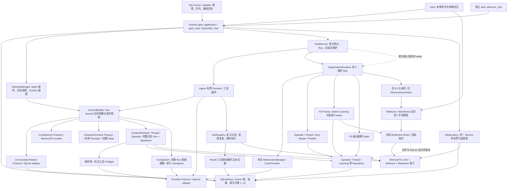
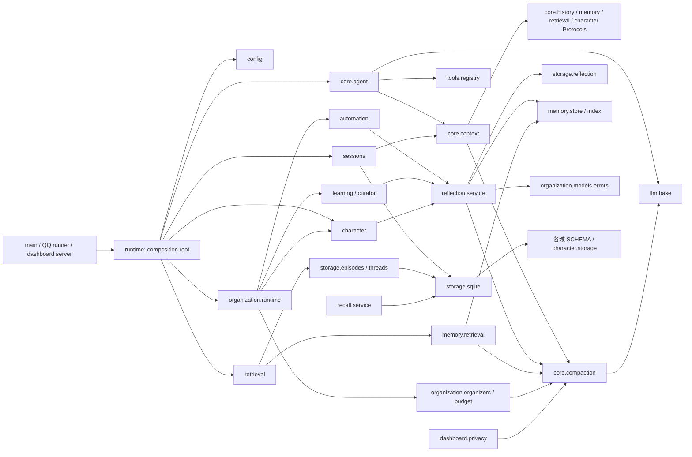

# HeyBuddy Architecture Audit

审查日期：2026-10-28。审查类型：只读产品架构审查，仅新增本文档。未修改产品代码、测试、配置或其他文档，未暂存、提交、推送，也未执行破坏性 Git 操作。本文中的重构方案均未实施。

本文第 1–9 节保留原始审查时点；后续修复与验证记录见第 10 节。

## 1. 基线、范围与结论

- 分支：`main`；HEAD：`8ab75073cb5d0852b3cac33efacf4af25b4a52d6`，`feat: 完成 Observatory 集成验收与只读启动保护`。
- 工作区起初非干净：已有 `docs/modules/dashboard.md`、`docs/observatory.md`、Dashboard Python/JS/CSS/模板修改，以及中文词典、i18n 脚本、截图和 `tests/test_dashboard_language.py` 等新增文件。审查以 **HEAD + 当时工作区** 为对象；这些内容不是本次审查的改动。
- 收尾时检测到外部并行变更：HEAD 已推进到 `d02b539828847abab16ca0f71943718fb5d75468`（`feat: Observatory 默认中文并支持中英文切换`），此前中文界面工作已进入该提交；另有 Observatory 独立页面/导航及 `tests/test_dashboard_navigation.py` 等暂存改动。已补读两个 HEAD 之间的差异、新的 Dashboard Python/布局、导航测试和相关文档差异。变更集中在展示与 GET 页面导航，不改变本文关注的 Core、Learning、维护调度、Store/MemoryFS 结论。本文基于这些明确时间点，不能保证覆盖收尾后继续发生的变更；所有现有暂存状态均未操作。
- 已读取仓库 `AGENTS.md`、README、整体架构和相关模块文档；对 `src/personal_agent/` 全部 108 个 Python 文件、15970 行进行 AST 导入、类/函数、调用及私有访问扫描，对全部测试文件扫描用例和依赖，再沿真实执行路径重点阅读实现与关键测试。扫描覆盖 evaluation、channels、dashboard，不只覆盖题目列出的模块；不等于对每个分支做形式验证。
- 关键细读测试包括 Agent/Provider/持久化、Compaction、Reflection、Learning/恢复、Curator/evidence、Organization schedule/backlog、Retrieval/preflight、Character、QQ 集成和 Dashboard lifecycle/boundaries；具体契约映射见第 7 节。
- 未读取真实 `.env`、私人数据库或运行中用户 Memory，未调用真实模型或外部服务。

**主要结论：核心方向正确，问题集中在增长后的边界，而非需要整体重构。** Agent 不认识 SQLite、CLI、Learning 或 Character 实现；Context 通过 Protocol 接入历史、记忆和角色；Markdown 与原始 Journal 的权威所有权清楚。实际需要处理的是状态查询隐藏写入、文档版本漂移、跨业务服务私有调用、维护 Runtime 聚集职责及 SQL 查询边界外泄。没有发现必须更换框架或存储体系的证据。

分类与严重程度：

- **已验证缺陷**：能由具体执行路径或最小实验确认的行为/文档契约不一致。
- **架构风险**：结构和依赖已确认，但故障需要特定实现、规模或未来并发条件；不冒充线上事故。
- **风格偏好**：命名、目录位置等没有独立业务收益的建议，不进入必做阶段。
- P1：优先解决的生命周期/一致性风险；P2：明确维护或契约收益；P3：按后续改动需要处理。未发现有证据支持的 P0。

## 2. 当前实际架构

### 2.1 执行与数据流

实线为调用/读取，虚线为抢占或发布边界。图中的后台维护只有一个现有 asyncio task，不是新 Agent Loop。

真实生产入口已经是 `main.run_cli → runtime.open_application → open_chat → assemble_chat → main.chat`。`main._run_session` 是仍供嵌入/测试使用的包装入口，已经不负责逐个服务装配。QQ 使用相同应用装配和 ChatService；Web 使用 observer-only 装配，跳过 Run/学习回执恢复与 Memory 初始化。Dashboard 文档明确说明 Web 启动仍可迁移 schema 和初始化/选择会话，因此不能把“整个启动过程绝不写 SQLite”当作现有契约，也不能据此指控已实现的 GET 只读接口失效。

### 2.2 模块依赖图

箭头表示源码使用/导入方向；这里区分“业务装配依赖”和“Core 接口依赖”，不是要求所有模块形成严格的层次树。

Core 没有向 `storage.sqlite`、`learning`、`reflection` 或 `character` 具体实现的反向导入。`core.agent → tools.registry` 和 `llm.base → core.models` 是当前可接受的执行边界，不值得为了“纯净分层”增加代理层。

### 2.3 循环依赖核对

AST 扫描把类型检查和函数内导入都算入边，因此必须进一步辨别：

| 表面循环 | 实际状态 | 判断 |
| --- | --- | --- |
| `storage.sqlite → episodes/threads/reflection/automation/qq → storage.sqlite`，另含 learning、character.storage | 多条回边只在 `TYPE_CHECKING` 内；Store 为迁移读取 SCHEMA | 类型/迁移耦合，未发现启动时互相读取未初始化符号的故障；不需立即搬迁全部 schema |
| `memory.store ↔ memory.migration` | `initialize()` 和迁移函数内局部导入，迁移复用 MemoryFS/DEFAULT_BLOCKS | 受控初始化依赖，正常读写不经过迁移；保留即可 |
| `channels.qq.runner ↔ dashboard.server` | QQ 局部导入 dashboard server；Web 局部导入 QQ 的 `stop_on_termination` | 真正的跨渠道职责回边，但当前延迟导入避免初始化失败；见 A07 |

没有证据说明当前存在导致正常启动失败的顶层循环导入。仅列出 SCC 就声称仓库“循环依赖严重”是不准确的。

## 3. 发现总表

成本为熟悉仓库后的相对估计，包含局部测试和文档，不是交付承诺。每项可独立评审，不要求一次性执行。

| ID | 分类 / 严重度 | 具体问题 | 最小候选成本 | 回归风险 | 优先级 |
| --- | --- | --- | --- | --- | --- |
| A01 | 已验证缺陷 / 中 | Curator status 隐藏修改 SQLite 调度时间；CLI 只读测试漏查数据库 | 0.5–1 天 | 低 | P2，最先做 |
| A02 | 已验证文档缺陷 / 中 | 总架构、README、部分模块文档落后于 schema/共享 Runtime/Preflight | 0.5–1 天 | 低 | P2，独立做 |
| A03 | 架构风险 / 中高 | Compaction 的取消/超时后发布防护与其他无工具请求实现不一致 | 0.5–1 天，先补契约测试 | 中 | P1，先验证 |
| A04 | 架构风险 / 中 | Reflection 私有请求/证据方法成为跨域基础设施；Character 依赖完整审批服务 | 1–2 天，分两次 | 中 | P2 |
| A05 | 架构风险 / 中 | Curator 依赖 Learner 私有锁/执行/校验，发布状态机接口缺失 | 1–2 天 | 中高 | P2，A04 后 |
| A06 | 架构风险 / 中 | OrganizationRuntime 同时承担终端输入、策略、预算装饰、SQL 诊断和 CLI | 1–2 天只搬职责；策略改造另议 | 中 | P2 |
| A07 | 架构风险 / 低中 | 渠道无关生命周期持有终端线程；Web 反向依赖 QQ 信号工具；CLI 重包 Service | 0.5–1 天 | 低中 | P3，接线变化时做 |
| A08 | 架构风险 / 中 | 查询 SQL 和 Repository 私有解码越过存储边界，诊断重复维护表契约 | 1–2 天，按调用点迁移 | 中 | P2 |
| A09 | 架构风险 / 低中 | 可选能力不在 Protocol；Context 请求编译带 I/O 且每轮重复 | 0.5–1 天 | 中 | P3 |
| A10 | 架构风险 / 低中 | 脱敏/证据投影归属 Compaction，共用机制与领域预算实现交织 | 0.5 天纯移动起步 | 低中 | P3，可随 A04 |
| A11 | 架构风险 / 中 | 当前 Run 每次 append 全量重解码/验证；工具批量缺少宿主数量上限 | 先测量 0.5 天；实现 1–2 天 | 中高 | P3，规模触发 |

## 4. 逐项证据、根因与建议

以下源码位置以 `src/personal_agent/` 为根，行号对应本次工作区；符号名是主要定位依据。

### A01 — 状态读取可能推进 Curator 调度

**位置与证据**：`learning/curator.py:412 MemoryCurator.status()` 的 `due` 字段调用 `due()`；`due():157` 到期、更新不足且无长文件时执行 `_schedule()`；`_schedule():93` 通过 SQL 更新 `memory_learning_state.curator_due_at`。`organization/runtime.py:500 diagnostics()` 默认调用 Curator status，也可能产生同样效果；此外 diagnostics 本身调用 `ScheduleRepository.ensure()`，首次会插入 schedule。

**已做最小离线实验**：在内存 SQLite 建立一个已过期且 updates=curator_updates=0 的学习状态，使用空文件集合、无历史 job、固定合法 Policy 调用实际 `MemoryCurator.status()`。输出为 `status_due=False, sqlite_changes=1, deadline_changed=True`。实验只保存合成元数据，无磁盘 Memory 或模型调用。

**影响**：检查状态可以顺延下次维护时机，状态查询行为取决于时间和文件大小；也会在“只读”查询中读取 Markdown 元数据/正文。`tests/test_p2_cli.py::test_actual_cli_debug_statuses_are_readonly_and_safe` 只检查 Memory 不变和无 Provider 请求，未检查 SQLite 变化，不能证明其名称所表达的完整契约。该测试创建的 Curator deadline 还未到期，未覆盖触发条件。

**根因**：`due()` 同时承担 eligibility 查询与“检查后消费一次时机”的命令语义，status 复用了它。注意 Dashboard 已走 `diagnostics(read_only=True) → _observe()`，不应把该问题扩大成所有 HTTP GET 都有写入。

**最小改动**：让 eligibility/status 纯读取，将无工作时顺延检查留给维护执行路径；CLI diagnostics 的 ensure 与观察也显式分离。无需增加独立监控服务。

**验收**：过期/未过期、有/无变化、有/无 schedule 各状态，重复 status 后 `total_changes` 和关键表快照均不变；真正维护 tick 仍会顺延空检查且不调用模型。保留原 HTTP 只读测试。

### A02 — 当前架构的文档基线不一致

**证据**：`storage/sqlite.py:40 SCHEMA_VERSION=13`、迁移表包含 Character 12 和 QQ 13；`README.md:200,214` 仍描述 schema 11；`docs/architecture.md:17,142` 也写 schema 11。总架构 `:55,146` 将装配归于 `_run_session`，实际 `main.py:260 run_cli()` 直接调用 `runtime.open_application()`，装配在 `runtime.py:80 assemble_chat()`。

`docs/modules/organization.md:17` 仍说维护“仅在 CLI 存活时”，与 QQ 复用维护冲突；`docs/modules/retrieval.md:35` 仍说“当前不做模型消歧”，同文前半段及 `retrieval.py:369 _preflight()` 已描述/实现条件性模型选择。README `:330` 的旧 suggest 说明应明确限定 P2 disabled，与前部正确的 P2 默认自动学习说明对齐。

AGENTS 顶部 P2/P3 授权明确覆盖部分旧阶段限制，因此“旧文写无后台提取”不证明当前实现越权；但 `AGENTS.md:128` 的未来边界仍包含“不实现 QQ”，而生产代码与新文档已交付 QQ，缺少一致的当前范围说明。不能从本次审查反推当时 QQ 实现是否被授权，只能确认当前约束文档存在漂移。

**根因/影响**：模块和功能交付持续向旧文档追加说明，原主体未同步改写，导致阅读者面对多个“当前实现”。会误判装配地点、默认写入策略、迁移版本和模型成本。

**建议/验收**：以后单独做一次文档修正：总架构描述当前入口/schema/默认模式；历史交付报告保留明确日期和适用阶段；AGENTS 将当前允许范围与历史限制分开；检查 README 模块索引。本文受本次权限限制没有修改这些文件。无需自动从源码生成全部文档或引入新的文档平台。

### A03 — 无工具模型请求的取消后提交契约不一致

**位置**：`core/compaction.py:87 compact_step()` 使用 `asyncio.timeout` 等待 Provider，返回后直接校验并调用 `source.save_summary()`；相比之下 `organization/provider.py:47 OrganizerModel.ask()` 在返回后复查 `deadline.expired()` 与 `current_task().cancelling()`，`reflection/service.py:142 _ask()` 也做同类检查。

**风险路径**：自定义 Provider 若吞掉 `CancelledError` 并返回合法文本，Compaction 当前没有同样的提交前屏障，可能发布调用方已请求取消/超时的摘要，随后 Agent 继续请求。原始 Journal 不会被删除，但取消语义和 checkpoint 发布时机可能偏离其他维护路径。该路径由静态控制流确认；本次未完成对应异步运行实验，故归为风险而非已复现的生产缺陷。

**根因**：无工具请求约束分别维护，后续防护只在 Organizer/Reflection 中补齐。不要立即把所有请求包装器合成一个大类；先修对等生命周期契约。

**验证**：为 Compaction 增加吞取消和吞超时的 FakeProvider：取消后 checkpoint 不前进、当前 Run 进入正确中断状态、不发生后续普通请求，已提交旧 checkpoint 保留。对照 `tests/test_review_integration.py::test_provider_that_swallows_cancel_cannot_publish_late_suggestion` 与 `tests/test_p2_boundaries.py::test_swallowed_cancellation_never_commits_empty_progress`，补齐 `tests/test_compaction.py`。测试先确定期望，再决定是否提取极小的返回后防护函数。

### A04 — ReflectionService 的私有方法已经是公共跨域机制

**证据**：`automation/service.py:51,130` 调用 Reflection `_request/_evidence`；`learning/service.py:212,222,234,271,302` 调用 `_verify/_ask/_evidence`；`character/state.py:166,205` 调用 verifier `_evidence/_verify`。Character 先构造 `Candidate(category='knowledge', confidence='uncertain')` 和 `Extraction`，只为使用精确引文检查。

Learner `learning/service.py:76` 再构造一个完整 ReflectionService 作为 `model`，借用请求预算、解析和 metrics，却不使用其手动审批进度。Reflection 为处理维护预算，又在 `reflection/service.py:18,157` 依赖 `organization.models.OrganizationError`。这是真实的跨域耦合，不是简单的下划线命名问题。

**影响/根因**：复用从完整审批服务上向外长出。修改 Reflection 的阶段名、Candidate 结构、锁或错误处理，需要同时理解 P2/P3；角色状态请求与长期记忆审批被不必要地绑在一起。`_ask` 对非 Extraction/Selection 的类型默认标为 consolidation，进一步说明它实际上已成为多域结构化请求器。

**最小方案**：先提取纯 evidence 投影/精确引用验证函数，输入真实来源和引用，返回校验结果或小型证据错误；“confirmed 必须用户证据”等策略由各调用方保留。再根据实际收益，将 Reflection 的工具禁用、预算/输出解析变为明确的小请求组件或公共接口。Character 不再需要完整 ReflectionService 构造依赖。可以先放在现有 reflection 包内公开模块，不强制新增顶层 services 包。

**不能合并的部分**：Episode 引文可单字，Reflection Evidence 至少四字；用户确认、时间窗、角色来源和审批均不同。不能用一个万能 Validator 抹平这些语义。

**验收**：保留伪造引用、脱敏投影、assistant/tool 不能确认用户事实、多会话 Learning、Character 来源归属/TTL 测试；Reflection 审批、进度与无批准不写文件均不改变。新增机制测试用合成数据，真实模型收益另行授权评测。

### A05 — Curator 直接进入 Learner 的锁与发布状态机

**证据**：`learning/curator.py:243` 使用 `learning._lock`；`:327` 调用 `_execute(..., proposer=...)`；`:375` 调用 `_verify()`。`learning/service.py:333 _execute()` 同时处理提案、fresh 校验、回执持久化、逐文件发布、取消、未明确结果与恢复。`reconcile():491` 用 `SimpleNamespace` 拼成 writer 所需的 PlanItem 形状，`_receipt():309` 和 `storage/learning.py` 则使用字典约定。

**风险**：Curator 必须知道 Learner“锁在谁手里、回执什么时候生成、哪种状态可重试”；稍有调整可能死锁、重复写或丢失不明确状态。现有共用 Writer、统一回执恢复是正确设计，风险是复用协议藏在私有实现里。

**最小方案**：先给目前已有“锁内执行提案并发布”行为一个明确的宿主内部入口，让锁归执行入口所有；Curator 提供 proposer/source snapshot，而不直接取锁。只为持久回执及 writer 必需状态引入小型类型，替代 SimpleNamespace/关键字典，不把全部 job 元数据改成新对象层。无需新 Job Engine，不合并手动 Reflection 审批与 P2 自动策略。

**验收**：重点运行 `test_curator*`、`test_learning_recovery.py`、`test_p2_recovery.py` 和 `test_p2_review_integration.py`；覆盖首文件成功次文件失败、源变更、索引缺失、取消、重启、已发布目标不再重写，以及 Curator 先建索引再移除旧 span。持久格式若无需变化就不迁移 schema。

### A06 — OrganizationRuntime 已是维护协调器，但同时拥有渠道与查询职责

**位置**：`organization/runtime.py` 共 699 行；`AsyncInput:29` 处理 daemon 终端线程；`_cycle:198` 编排维护优先级/公平性和预算；`_background:446` 管定时；`diagnostics:500/_observe:552` 查询业务表；`command:602/learning_command:644/character_command:680` 解析管理命令和展示 JSON。

`_cycle()` 临时替换多个 `model.provider`，按对象 id 去重并 finally 恢复；手动 Learning/Character 命令重复预算包装逻辑。Curator 与 Learning 共用 model 是特意设计，不能拆分时漏掉共享账本或恢复顺序。

**影响**：添加一种维护行为要同时修改调度、诊断、CLI 和预算接线，测试也必须构造 CLI 输入线程。这个问题来自实际共同变更面，不单来自文件长度。现有单循环、有限批次、前台抢占、持久 backoff 和“整条学习流水线预留”是有效约束，应保留。

**最小拆分顺序**：先移走 AsyncInput；再将纯 CLI 解析/输出放到宿主命令模块；查询交给明确的读取投影（A08）；最后看剩余 `_cycle` 是否仍难读。可以提取小的预算作用域辅助函数消除恢复逻辑重复，但保持显式固定顺序和当前策略。不要引入可动态注册的通用 Scheduler、任务 DSL 或策略继承树。

**验证**：原 schedule/backlog/抢占/吞取消/时间回拨/公平性测试必须原样通过；CLI 命令仍在 foreground 后执行；一轮限制、冷却、repair backoff、P2 替代旧 Automation 的规则不改变。尤其检查同一个 model 没有重复包裹、finally 总恢复 Provider。

### A07 — 共享生命周期仍包含终端专属资源与跨渠道工具

**证据**：`OrganizationRuntime.__init__:104` 无条件 `AsyncInput()`，因此 `runtime.assemble_chat()` 的 QQ 与 observer-only Web 也会启动一个等待队列的 daemon 线程；`dashboard/server.py:73 run_web()` 从 `channels.qq.runner` 导入通用 `stop_on_termination`；QQ 又局部导入 Dashboard。`main._chat():74` 用五个参数重新构造 ChatService，虽然 `run_cli()` 已持有原 Service；`chat()` 和 `open_chat()` 都负责关闭同一 OrganizationRuntime。

**影响**：目前 close 操作基本幂等，默认渠道也串行，没有已证实的数据损坏。但 Web/QQ 为终端资源付出不必要生命周期成本；未来给 ChatService 增加 observer 标记或 callback 时，CLI 的重新包装有遗漏风险。两个关闭 owner 使资源归属难以一眼判断。

**最小方案/验收**：AsyncInput 在 CLI chat 入口创建与关闭；信号上下文放到已有渠道公共模块或小的宿主生命周期模块；生产 chat 接收已有 ChatService，旧测试包装可暂留。明确 open_chat 是维护资源关闭 owner。验证 CLI EOF/Ctrl+C、QQ consumer/gateway、Web 启停、装配异常及相同 Service 实例身份；Web/QQ 不再启动 input thread。不需要 Channels 基类。

### A08 — SQL 与存储校验越过 Repository，观察路径重复表契约

**证据**：`retrieval.py:63,126,289` 自行查询 Thread/Episode/Run 并调用 `_thread/_episode/_source`；`learning/curator.py:94,109,121` 操作/查询学习状态和 receipts；`organization/runtime.py:552 _observe()` 直接拼五类表的观测 SQL并调用 Episode `_progress`；`channels/qq/adapter.py:125 _latest_run()` 直接查询 messages；Dashboard repository 也调用 `_thread/_episode`。不仅 repositories 使用 `_transaction`，业务服务也掌握它。

**所有权判断**：Store 持有单连接与短事务，Repository 绑定 Agent 和具体领域，MemoryFS 独占 Markdown 权威，这些边界有效。但“哪些数据可见、如何 bounded decode、哪张表代表进度”在检索/维护/观察处重复了。一个 schema 变更可能需要跨多个非存储模块修改。读取普遍使用 `BEGIN IMMEDIATE` 也混淆读写意图，但单 Owner 条件下不能据此声称已出现并发死锁。

**最小方案**：不把 SQL 全塞回 SQLiteStore。给 Episode/Thread 提供带 connection 的内部读取 API 或小的 evidence 查询模块；Curator 的 schedule/最近 jobs 查询移入 LearningRepository；将 `_observe` 投影放到 storage 的专门读取函数，复用当前 `reading()` 与 VM 预算。保持同一快照内读取/校验，避免把一段事务机械拆成多个公共调用。只有稳定且确实只读的路径迁移 reading；publish/CAS 不动。

**迁移与目录**：当前 `MIGRATIONS` 是明确、原子的单一版本入口，值得保留。SCHEMA 分散在各域模块意味着 Store 会认识 Character/QQ，但这是装配迁移依赖，不是 Core 认识渠道。没有足够收益支持现在整体搬到 migrations 包；若日后独立加载 migration 成为真实需求，再只移动常量、保留版本顺序和字节内容。

**验收**：所有新的读取入口重验 Agent/Conversation，按计数/字节预算先查元数据再 decode；事务不含 await；检索/观察失败不修改历史或启动模型；既有 schema 迁移失败注入及外键/触发器测试继续通过。

### A09 — Protocol 的可选能力与请求编译副作用不完整

**证据**：`core/retrieval.py:53 ContextRetrieval` 只声明同步 `retrieve`，但 `core/context.py:184` 用 `getattr(..., 'preflight')` 调异步能力；`core/character.py:10 CharacterContext` 未声明 `record_run`，Context `begin():279` 用 getattr 通知。`CoreMemory.compile() → str`，Character 模式却要求字符串必须是固定 kind/blocks JSON，见 `core/character.py:17 without_legacy_persona`。

Context `_select_history():199` 先 `for_request()` 算 base，`prepare():305` 再调用一次 for_request；后者会编译 Memory、角色 State/来源标签、读时间。`CharacterContextCompiler.compile()` 自身还更新 diagnostics。故一轮至少可能重复同样的磁盘/SQL读取，而不只是生成纯列表。

**影响**：新适配器从 Protocol 看不到完整能力，结构类型检查无法覆盖可选调用；预算试算与实际请求可能来自不同文件瞬间，重复同步 I/O 也提高事件循环延迟。总预算仍在最终请求上检查，因此不能说这已绕过预算。用户直接编辑文件的竞争窗口也不是本次审查新发现的漏洞。

**建议/验收**：先显式描述可选 async preflight 与 on-run 回调的类型；不需要为每个插件建立基类。若优化编译，只在一次 prepare 迭代内生成共同的注入视图并复用；工具写入后下一轮仍重新编译，不跨 Run 缓存。用计数 reader 验证一次准备的读取次数、最终预算和新 Memory 可见性，并保留 Core 非结构数据时的显式错误。

### A10 — 共用证据/脱敏原语归属 Compaction

**证据**：Reflection、Learning、Organization、Memory Retrieval、Dashboard Privacy 都导入 `core.compaction.SECRET/redact/projection`；`memory/safety.py` 又在 SECRET 基础上补充 PRIVATE 模式，Dashboard 再做展示字段/赋值过滤。这些不是相同目标：摘要投影、落盘凭据拒绝和 UI 隐私展示应有不同 policy。

**风险/最小方案**：为改变摘要而修改 `projection/redact`，会同时改变各域的引文可见性和模型输入。可把共享的纯投影/模式放到 `core/evidence.py` 或相邻小模块，Compaction 只保留摘要流程；各域组合不同过滤策略。不要合并成一个宣称完整 DLP 的安全框架，也不要为消除重复悄悄扩大/缩小旧引文投影。

**验收**：测试精确引用只能匹配实际披露的脱敏文本，ToolResult 投影上限不变；Provider reasoning 不外泄；UI 的字段过滤与存储侧拒绝仍各自测试。纯移动阶段不改 Prompt 或冻结评测快照。

### A11 — 当前 Run 的增长成本需要独立上限与测量

**证据**：`storage/sqlite.py:336 append_message()` 每次 `_run_messages()` 重新读取、反序列化此前所有当前 Run 消息并 validate_turn；finish 再读一次。`core/agent.py:232` 顺序处理整批 tool_calls；`core/models.py:43,72` 的 tool_calls 列表没有本地数量上限。max_rounds 限轮数，不直接限单响应工具数。Context 的历史页上限不约束 append 中当前 Run 的累计验证成本。

**风险**：工具批量很大时累计解码/校验近似二次增长，同步 SQLite 会占据事件循环，影响 Dashboard/抢占响应。真实 Provider 输出额度通常形成实际限制，因此本次没有性能基准或业务故障证据；不应直接优化掉写前配对校验。

**建议/验收**：先用合成大批工具测量解码次数/耗时，确定是否需要宿主单响应/单 Run 工具数量上限。若调整存储验证，必须保留原子消息顺序、完整 Provider JSON、跨重启验证、重复 call_id 和损坏历史拒绝；不得以缓存代替最终一致性检查。没有测量收益前不新增复杂增量索引。

## 5. 应保留不动的设计

1. **Agent Loop 与实现依赖分离**：`core/agent.py` 只围绕 Context、Provider、Registry、内部 Message/RunResult 工作；顺序工具执行、调用先记录、结果逐项记录、终轮显式拒绝工具。不要拆出新 Agent Framework。
2. **Context 保持存储无关**：`ConversationHistory`、`CoreMemory`、Retrieval/Character Protocol 的方向正确。Context 同时管理 Run 的 Journal 接口和工作视图是当前有用的集中点；不因它接近 400 行就拆成一串 Manager。
3. **权威与派生数据区分**：SQLite messages 是聊天历史；Markdown 是长期记忆；Summary/Episode/Thread/State/FTS 是受限工作数据或派生组织；学习表只存来源/回执而非第二份事实库。不要统一成“所有内容都是 Memory Record”。
4. **同一 SQLite Owner + 短事务 + 追加迁移**：锁后恢复、Run+用户消息原子创建、终态/派生索引同事务、来源 hash/revision CAS，配合失败注入和进程退出测试，具有明确一致性收益。Repository 不是 ORM，不应为形式改成 ORM。
5. **MemoryFS 安全和部分发布语义**：受限路径/链接检查、Git 隐私、UTF-8/JSON 容量、expected_hash、局部唯一 span、短锁和单文件 replace；索引生成条目标记保护人工内容。文件与 SQLite 无共同事务时用回执核对，禁止盲目重试，是正确边界。
6. **手动 Reflection 与 Host 自动 Learning 分开**：共用精确写入和证据机制、保持各自独立进度/审批策略。P2 不改 persona，P3 关闭时不注入角色，也不发主动消息。
7. **单维护循环与前台优先**：复用 asyncio、预算有界、完整学习请求预留、公平性、冷却/退避、取消后等待记账；不需要通用任务平台。
8. **适配器边界和离线测试**：OpenAI 专有 wire item 留在 adapter 的普通 JSON 中，正常重放保留顺序；模型工具不拥有 Host 配置或审批能力；FakeProvider、MockTransport 与网络禁用保护是正确的默认验证方式。

## 6. Retrieval、Recall 与目录设计的明确判断

| 组件 | 当前真实责任 | 应保持的差异 |
| --- | --- | --- |
| `recall/` + `storage/recall.py` | 模型按需调用，搜索/展开 canonical 聊天文本；completed/failed；参数和输出有界 | 不写 Memory，不执行历史工具，不负责请求前自动相关性 |
| 顶层 `retrieval.py` | 宿主请求前组合 Thread/Episode 导航、completed 完整 Run、Markdown；条件性无工具选择 | 返回低信任可选证据，不决定总窗口、不授予权限 |
| `memory/retrieval.py` | 沿 MEMORY.md 发现 Markdown、词法排序和完整章节选择 | 不保存 chunks/embedding，不查询聊天正文 |
| `core/retrieval.py` | Context 无存储依赖的结果/接口 | Context 负责最后预算、去重、完整工具配对 |

这是合理的职责分工，不是三套重复搜索引擎。真实问题在 A08 的 SQL/私有读取耦合、A09 的可选接口，以及两套词法 terms/keywords 在不同来源上各自维护；后者当前有不同候选上限、中文切片与触发语义，没有证据支持直接统一。

目录层面，`character/storage.py` 位于领域包而其他 Repository 多在 storage 下，顶层 `retrieval.py` 与 `runtime.py` 命名也不完全对称；仅移动位置属于风格偏好。优先提取被证实有多个调用者的 evidence/投影和宿主命令/输入职责。不要预建 `domain/application/infrastructure` 全套树、抽象 Repository 基类、DI 容器、服务注册器或可插拔调度系统。

可选最小落点只在对应阶段真正实施时创建：`core/evidence.py`（纯来源/投影）、CLI 命令/输入小模块、storage 中的 working-context/maintenance 查询函数。名称可按仓库现有习惯决定，不要求本次先建空目录。

## 7. 测试与业务边界的匹配

| 业务契约 | 已存在的关键测试 | 判断与补强 |
| --- | --- | --- |
| 执行、配对、权限、超时、终轮与持久化失败 | `test_agent.py`、`test_tools.py`、`test_provider.py`、`test_persistent_runtime.py` | 覆盖方向贴合副作用与 Journal 边界，保留；工具批量增长需测量 |
| 有界历史/完整 Run/摘要提交 | `test_compaction.py`、`test_working_context.py` | 覆盖页预算、Provider 重放、取消和 checkpoint；补 A03 的吞取消 Provider |
| Reflection 审批与精确证据 | `test_reflection.py` | 审批、伪引文、部分发布、schema 回滚和重启均有行为验证；提取机制时不得削弱 |
| P2 自动学习、激活水位与回执 | `test_learning*.py`、`test_p2_*.py` | 有跨日、真实进程退出和已发布不重写测试，适合 A05 验收 |
| Curator 有损/事实改写约束 | `test_curator.py`、`test_curator_evidence.py` | 覆盖字面守恒与来源隔离，不能据 Fake 输出宣称语义质量；补过期 status 的 DB 不变 |
| 维护优先级、预算、公平性与时间 | `test_organization_schedule.py`、`test_organization_backlog.py`、`test_review_integration.py` | 覆盖真实业务门控，不应重构为只测调度函数被调用 |
| Retrieval 基线保留、超预算、来源隔离 | `test_memory_retrieval.py`、`test_preflight_baseline.py`、`test_review_timing_retrieval.py` | 空/坏 preflight 不抹除有效证据很重要；保留真实 Provider 请求断言 |
| Character 参与标签、TTL、低信任与角色隔离 | `test_character_*.py` | 已覆盖有界/被动状态；提取证据机制时保留非用户确认语义 |
| 渠道和观测的真实生命周期 | `test_qq_integration.py`、`test_dashboard_lifecycle.py`、`test_dashboard_boundaries.py` | 使用相同 Service、实际 loopback HTTP 与重启边界，有实际价值；observer 测试应区分启动允许的元数据写与 GET 零写 |

测试组织风险：`tests/test_learning.py` 从 `test_reflection.py` 导入 fixture/helpers；`test_p2_cli.py` 再导入 learning 的 fixture；`test_curator_evidence.py` 同时依赖多个测试模块和 `FakeClock`。这些链在当前 pytest 中可工作，不是故障，但重命名一个测试模块可能影响多个域。只把确实重复使用的 seed/fixture/FakeClock 移到 conftest 或 tests helpers；不要为单个断言创建庞大测试框架。

本次测试执行事实：

- 全部源码 AST 扫描完成，已核对类型检查/函数内循环回边，未把它们误报为顶层导入失败。
- `uv run --offline pytest -q -p no:cacheprovider`、uv 版本的 Ruff 命令未成功进入相应检查，uv 无法持久化沙箱 interpreter cache；这是环境权限失败。
- 使用已有 `.venv` 的 Python 3.13.5 直接运行完整 pytest，结果为 **771 个 setup errors**，首个定位为 autouse fixture 所需的 pytest 临时目录创建失败；也尝试了沙箱外执行，仍在临时目录 fixture 阶段失败。不能记为 771 个产品逻辑失败，更不能引用 HEAD 的 768 passed 当作本次通过。
- 指定允许目录作独立 basetemp 的尝试未得到用例完成输出，已中止。异步 Compaction 最小实验也未取得完成输出，因此 A03 只记录静态风险。
- `.venv/Scripts/ruff.exe check --no-cache .`：**All checks passed**；`.venv/Scripts/ruff.exe format --check --no-cache .`：**216 files already formatted**。这里使用实际可运行的现有工具，没有安装/更新依赖。
- 外部导航改动出现后，收尾重新执行上述两条 Ruff 命令：check 通过，format 显示 **218 files already formatted**。新增导航测试已静态审阅，未声称运行通过。
- A01 的同步内存 SQLite 最小实验成功，明确观察到 status 导致一次 UPDATE；实验没有写入产品文件或私人数据。
- 没有改打包/入口代码，未执行 build、真实 CLI 启动或真实模型评测。后续实现阶段仍须在可运行临时目录的环境完成完整离线 pytest；当前验证不足以宣称所有回归通过。

## 8. 按依赖排序的独立阶段与验收

阶段可以分别发起、分别回退；先稳定契约，再移动职责。除真实发现需要的局部接口外，不顺手更换目录、schema 或 Prompt。

| 阶段 | 范围 / 前置条件 | 独立交付与验收 | 停止条件 |
| --- | --- | --- | --- |
| S0：恢复可执行验证基线 | 无产品依赖 | 排除 pytest 临时目录/事件循环环境问题；完整离线测试、Ruff 可运行；记录现有用户工作区差异 | 未有可靠基线前不做大范围移动 |
| S1a：状态查询纯读 | S0；A01 | 补过期状态与缺 schedule 测试；status 零 DB/Memory 写、零模型调用；维护 tick 的顺延仍发生 | 若必须改变维护时机，应单独说明行为变化，不混入搬文件 |
| S1b：文档当前基线 | 与 S1a 独立；A02 | schema 13、共享 Runtime、P2 默认与兼容模式、QQ/Web、Preflight 说明一致；历史报告标注阶段 | 不以修改文档替代修复业务契约 |
| S1c：取消发布契约 | S0；A03 | 先写对照契约测试，再按结果补 Compaction 提交前屏障；取消不发布晚到 checkpoint、不继续模型调用 | 若测试证明不同语义是有意设计，明确写出依据而非强行统一 |
| S2：证据纯函数与最小请求接口 | S1c 契约稳定；A04，可带 A10 纯移动 | Character 不依赖完整审批服务；跨域调用不再使用 Reflection 私有证据方法；实际输入投影、引文规则、阶段/usage 不变 | 暂不统一所有 budget/provider wrapper，不改变 Prompt |
| S3：Learning 发布入口 | S2；A05 | Curator 不直接获取私有锁或调用 `_execute`；回执形状明确；取消/部分发布/真实进程退出测试通过 | 保留 Reflection 人工审批、P2 自动 policy 和不明确结果写保护 |
| S4a：存储查询边界 | S1a；A08，可独立于 S3 | Curator 状态 SQL、维护投影、检索来源读取迁入明确查询 API；Agent 归属、快照、VM/字节限制保持 | 不扩大 SQLiteStore 为全业务类，不拆坏原子发布 |
| S4b：维护 Runtime 减负 | S1a，观察查询可随 S4a；A06/A07 | CLI/input 离开维护协调器；QQ/Web 无终端线程；单循环、共享预算/fairness/cancel/backoff 不变；单一关闭 owner | 剩余 `_cycle` 可读即停止，不继续构建通用 Scheduler |
| S5：接口与规模优化 | 按新需求选择；A09/A11 | Protocol 可选能力明确；每次准备注入视图复用但下一工具轮读新记忆；批量测量确有收益才加限制/优化验证 | 无性能或适配需求时不实施，避免预设计 |

每个涉及产品行为的阶段都应运行完整离线 pytest、Ruff check/format；涉及入口/打包资源才增加 build 与 CLI 启动检查。测试必须继续禁止外部网络，保持合成数据库和 Memory 隔离。真实模型质量与架构契约测试分开，仍需单独授权。

## 9. 最值得先做的改进

1. 修正过期 Curator `status()` 的隐藏 UPDATE，并把“只读”测试扩展到 SQLite；这是本次唯一已完成最小运行复现的代码行为问题。
2. 给 Compaction 补吞取消/吞超时的发布契约测试，对齐已有 Organizer/Reflection 防护；范围很小，直接保护生命周期。
3. 从 Reflection 提取纯证据校验，让 Character/Learning 不再调用审批服务的私有方法；先解真实复用，再考虑请求组件。
4. 从 OrganizationRuntime 移出终端输入、CLI 和 SQL 观察职责，保留原单循环、预算与调度政策。
5. 单独同步 README/总架构的 schema、装配入口、默认学习模式与渠道范围，降低后续维护误判。

这些改进均可以局部完成；没有证据支持整体重写、增加 Agent Framework、ORM、Redis、DI Framework 或微服务。

## 10. 2026-10-28 修复落实

本轮按用户后续授权实施，保留本报告前文作为审查历史。期间外部 Observatory 工作先后提交到 149335b、dd5dbc6；修复只提交独立的架构改动，不包含并行 UI 工作。没有改动旧 migration、事实所有权、手动审批、MemoryFS 校验、角色主动性或 Provider Prompt。

| 发现 | 已落实行为 / 验收证据 |
| --- | --- |
| A01 | due/status 纯读，维护 poll 才顺延；ScheduleRepository.state 在缺行或切换会话时仅推导视图，observe 不初始化。新增过期状态和跨选择零写测试 |
| A02 | README/AGENTS/整体架构和现行模块文档统一 schema 13、共享装配、P2 开启/兼容 Automation、QQ/Web 范围；历史交付报告不回写 |
| A03 | Compaction 返回后复查 timeout/cancelling；测试覆盖新旧 checkpoint、吞取消/超时、当前 Run 终态与不继续普通请求 |
| A04/A10 | core.evidence 提供纯投影/精确引文，reflection.evidence 保留用户确认策略；ReflectionModel 独立预算/请求，不携带审批。CharacterStateService 直接依赖 Provider |
| A05 | Curator 通过 Learner.publication 的受控回调进入既有发布状态机，不取私有锁/执行方法；作用域退出后回调失效。reconcile 使用真实 PlanItem，持久回执格式不变 |
| A06/A07 | CLI 拥有 console.AsyncInput 和 MaintenanceCommands；Runtime 保留既有协调循环；channels.lifecycle 共享终止处理；生产 chat 接收同一个 ChatService，open_chat 最终关闭维护；cycle_providers 统一串行预算作用域和 finally 恢复 |
| A08 | WorkingContextRepository 持有历史选择 SQL；Curator 元数据和维护观察移入现有 Repository；共享读取显式命名 read_episode/read_source/read_thread；QQInbox 负责最新 Run 查询 |
| A09 | 显式 PreflightRetrieval/RunCharacter 可选 Protocol；一次 prepare 迭代只编译一份注入前缀，预算与请求复用，下一工具轮重新读取 |
| A11 | 先测量再加宿主数量上限：默认每响应 64、每 Run 256，Settings 可有界配置。超限整批在记录/执行前拒绝，保留之前已提交结果；不优化掉原完整 Journal 验证 |

合成 SQLite 测量（非性能承诺）：单批 32/128 个工具调用分别触发 630/8646 条消息解码，耗时约 0.1715/0.6583 秒。保留现有验证，数量上限用于限制最坏增长，不新增派生校验索引或缓存。

验证过程：修复前离线基线 771 passed、2 skipped；阶段定向回归分别有 61、133、57 项通过。一次完整回归曾遇到并行新 Dashboard 测试的 Windows 换行断言，随后该外部测试改为按实际字节/双换行验证；另一次完整回归为 783 passed、2 skipped、1 个 Memory 索引发布失败，该用例隔离运行通过，未改 MemoryFS/index 以绕过失败。最后在源码仓库外的独立允许临时目录执行完整离线回归：**790 passed、2 skipped**；未为临时失败修改 MemoryFS/index 或网络保护。收尾 Ruff check 通过、format check 为 **227 files already formatted**。这些最终结果与中间诊断分开记录。

两个 CLI 帮助入口通过。uv build --offline 因缺 hatchling 构建缓存失败，之后标准 uv build 成功产出 sdist/wheel；未修改依赖声明或 uv.lock，未进行真实付费调用。

构建包检查确认新增 evidence/requester/query/CLI/lifecycle 模块均进入 wheel，未包含 `.db`、`.sqlite3` 或真实 `.env`。默认冻结 Prompt 与依赖锁文件保持原样；未引入新框架、ORM 或调度平台。
